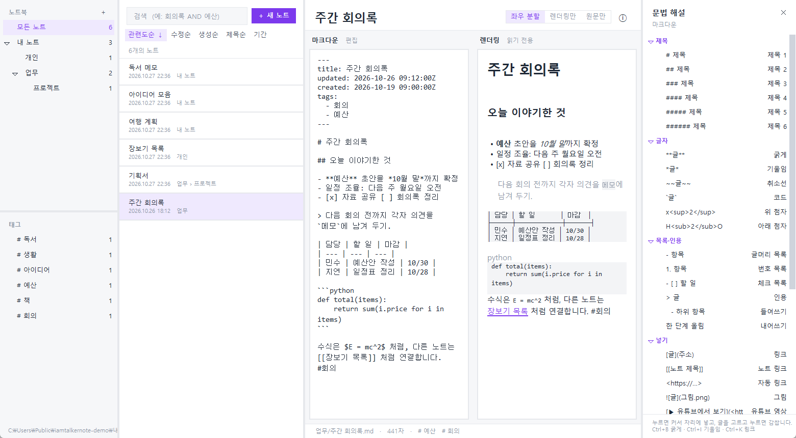
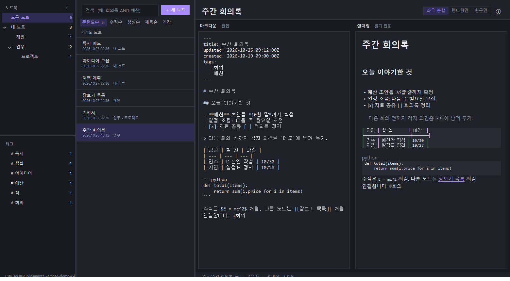

# iamtalkernote

**마크다운 파일로 저장하는 노트 앱** — 에버노트처럼 3단 목록, 조플린처럼 메뉴와 웹 클리퍼, 위키나루의 마크다운 편집·렌더링.
노트는 그냥 `.md` 파일이라 다른 프로그램과 함께 쓰거나 백업하기 쉽고, 앱이 없어도 읽을 수 있습니다. 내 컴퓨터 안에서만 동작합니다(웹 클리퍼 서버도 `127.0.0.1` 전용).

📘 **[사용 설명서](docs/manual.md)** — 설치부터 컴퓨터·폰 동기화, 문제 해결까지(앱 안에서는 **도움말 → 사용 설명서** 또는 `F1`).

> **안드로이드 앱은 별도 저장소입니다 — 개발할 때는 둘 다 읽으세요.** [iamtalkernote-android](https://github.com/iamtalker/iamtalkernote-android)의 README 에 폰 쪽 현황·로드맵이 있습니다. 노트 폴더의 파일 형식을 두 앱이 공유하므로, 형식(머리말·`태그:` 줄·`.history`·`.trash`·`.imported`)을 바꿀 때는 폰 쪽도 같이 고쳐야 합니다.





## 받아서 쓰기

[**Releases**](https://github.com/iamtalker/iamtalkernote/releases/latest) 에서 `iamtalkernote.exe` 를 받아 실행합니다(파이썬이 없어도 됩니다).
코드 서명이 없어 윈도 SmartScreen 경고가 뜰 수 있습니다("추가 정보 → 실행").
이미 쓰고 있다면 **도움말 → 업데이트 확인**으로 새 버전을 확인하고, 있으면 내려받아(릴리스 노트의 SHA-256 과 맞을 때만) 바꾼 뒤 자동으로 다시 시작합니다. 확인을 누를 때만 GitHub 에 접속하며, 노트·설정은 건드리지 않습니다. 현재 버전은 **도움말 → iamtalkernote 정보**에서 봅니다. (소스로 실행 중이면 릴리스 페이지만 안내합니다.)

- **폰 앱(안드로이드):** [iamtalkernote-android 의 Releases](https://github.com/iamtalker/iamtalkernote-android/releases/latest) 에서 APK 를 받아 설치합니다(옵션 → 동기화 맨 위에도 같은 주소가 있습니다). 컴퓨터와 맞추는 방법은 [사용 설명서](docs/manual.md#5-컴퓨터와-폰-동기화).
- **필요한 것:** Windows 10/11. 그림 변환(GDI+), 영상 재생 창(Edge), 숨김 폴더 속성은 윈도 기능을 씁니다.
- **소스로 실행:** Python 3.9+ (표준 라이브러리 `tkinter` 만 필요) → `iamtalkernote.bat` 또는 `py -3 app/iamtalkernote.pyw`.  WebP 같은 형식의 그림은 `pip install pillow`, 가져온 폴더의 PDF·mp3 는 `pip install pypdf tinytag` (exe 에는 모두 들어 있습니다).
- 처음 실행하면 `문서\iamtalkernote` 폴더를 노트 폴더로 씁니다. 바꾸려면 **설정 → 폴더 설정**.

## 특징

### 노트와 저장 방식
- 노트북 = 폴더, 노트 = `.md` 파일(제목 = 파일 이름), **하위 노트북**(하위 폴더) 지원.
- **볼트 방식**: 노트 폴더 하나만 지정하면 됩니다. 그림·첨부는 그 안의 숨김 폴더 `.resources` 에 저장되고 노트에는 상대 경로로 연결됩니다.
  예전 `_resources`(조플린 마크다운 내보내기 포함)나 따로 지정해 둔 리소스 폴더는 그대로 읽히고, 설정 → 폴더 설정의 **볼트 안으로 옮기기**로 파일과 노트의 링크를 함께 옮길 수 있습니다.
- 자동 저장(입력을 멈추고 0.6초 뒤). 삭제는 앱의 휴지통으로 가서 30일간 보관됩니다.

### 화면 (조플린·에버노트식)
- 노트북·태그 | 검색 + 노트 목록 | 에디터 | 문법 해설. **보기 메뉴**에서 각 칸을 켜고 끌 수 있습니다.
- 에디터는 **좌우 분할 / 렌더링만 / 원문만**. 노트 목록은 이어서 그려서(아래에 4화면쯤 남으면 미리 다음 묶음을 그립니다) **수만 개여도 끝까지 스크롤**됩니다. 목록에서 **Shift+클릭**으로 범위, **Ctrl+클릭**으로 하나씩 여러 노트를 고르고, 우클릭이나 Delete 로 한꺼번에 휴지통·노트북으로 보냅니다.
- 라이트 4색 · 세피아 · 다크 2종 **테마**와 강조색 직접 고르기, 목록·노트 **글자 크기·굵기** 설정(바로 적용).
- 오른쪽 위 ⓘ **노트 속성**: 위치, 파일, 갱신·생성 시각(수정 가능), URL, 작성자, 태그, 크기, 이전 버전.
- **창 상태 기억:** 종료할 때 창 크기·위치·최대화, 칸 너비, 노트북·태그 사이 경계, 정렬, 보던 노트북을 저장해 다음에 그대로 엽니다. 삭제한 뒤에도 목록이 보던 자리에 머뭅니다.
- **닫기(X) 버튼:** 기본은 앱을 끄지 않고 **작업표시줄 오른쪽 아래 트레이**로 보냅니다(웹 클리퍼·가져온 폴더 색인은 계속 돕니다). 아이콘을 누르면 다시 열리고 우클릭 → 종료로 끕니다. 옵션 → 일반에서 *바로 종료*로 바꿀 수 있고, 파일 → 종료는 언제나 바로 끕니다. 앱은 **한 번에 하나만** 실행됩니다: 이미 켜져 있을 때(창이 열려 있거나 트레이에 있을 때) 다시 실행하면 새로 켜지 않고 그 창을 앞으로 가져옵니다. 트레이 아이콘에 마우스를 올리면 실행 중인 버전이 보입니다.
- **미디어 폴더 모으기:** 설정 → 폴더의 *다른 폴더를 .resources 로 바꾸기…*로 노트가 쓰던 임의의 미디어 폴더(attachments, images …)를 골라 `.resources` 로 옮기고 모든 노트의 링크를 한꺼번에 고칩니다(몇 곳이 바뀌는지 보여 주고 확인을 받으며 복원 지점을 먼저 만듭니다).

### 마크다운 편집·렌더링 (위키나루 엔진)
- 제목, 굵게·기울임·취소선·코드, 위/아래 첨자, 목록·체크 목록·인용, 표, 코드 블록, 수식 표기, 각주, 접기, 목차, 노트 링크 `[[노트 제목]]`.
- 오른쪽 **문법 해설** 사이드바: 누르면 커서 자리에 넣고, 글을 고르고 누르면 감쌉니다(다시 누르면 풀림).
- 그림: ``, HTML ``(`width` 반영), 링크로 감싼 그림, 표 칸 안의 그림, 본문에 박힌 `data:` 그림, `%20` 경로.
  형식은 확장자가 아니라 내용으로 알아보고, WebP 등은 Pillow 로 변환해 보여 줍니다.
  그림은 **렌더링 칸의 너비에 맞춰** 칸보다 클 때만 줄여서 보이고(작은 그림은 원래 크기, 왼쪽 정렬), 창 크기를 바꾸면 다시 맞춥니다.
- 유튜브 주소가 한 줄에 있거나 `` 이면 **썸네일 카드**로 보이고, 누르면 작은 재생 창(Edge 앱 창) 또는 기본 브라우저로 열립니다.
  이 앱은 웹 화면 엔진이 없어 영상을 노트 안에서 직접 재생하지는 못합니다.
- 문장 속 맨 주소(`https://…`)도 링크가 됩니다.

### 검색·정렬·태그
- **문서에서 찾기:** 노트를 연 채 `Ctrl+F`(또는 편집 → 문서에서 찾기)를 누르면 찾기 막대가 열리고, 일치하는 곳을 모두 강조하며 지금 위치(`3 / 62`)를 보여 줍니다. `Enter`·`F3` 다음, `Shift+Enter`·`Shift+F3` 이전, `Esc` 닫기. 대소문자는 구분하지 않고, 좌우 분할일 때는 양쪽에 강조하되 편집 칸으로 이동합니다. 글을 고치거나 보기 모드를 바꾸면 다시 찾고, 다른 노트로 가면 닫힙니다. 모든 파일 검색은 `Ctrl+Shift+F`(노트가 안 열려 있거나 목록 검색칸에 있을 때는 `Ctrl+F` 도 같음).
- **검색:** `회의록 AND (예산 OR 일정) NOT 취소`, `"정확한 구절"`, `& | !` 기호. 일치한 부분을 강조하고 미리 보여 줍니다.
  **자동완성:** 검색창에 글자를 치면 아래에 후보가 뜹니다 — 그냥 치면 *파일 제목*(마지막 낱말만 바꿔 넣습니다), `#` 로 시작하면 *태그*(`#` 만 쳐서는 안 뜨고 `#신` 처럼 한 글자 이상 쳐야 그 글자로 시작하는 태그가 뜹니다). 한글은 마지막 글자를 조합하는 중에도 바로 반영됩니다(방향키로 확정하지 않아도 됩니다). ↑↓ 로 고르고 `Enter` 로 넣으며 `Esc` 로 닫고, 빈 칸을 누르거나 ↓ 를 누르면 *최근 검색*이 보입니다(30개까지 기억).
  [folder-search](https://github.com/iamtalker/folder-search) 의 검색을 가져왔고, 본문 검색은 SQLite 색인 안에서 처리해 1만 개 이상에서도 0.5초 안팎입니다.
- **정렬:** 관련도순 · 수정순 · 생성순 · 제목순(같은 버튼을 다시 누르면 방향 반대), 수정일/생성일 **기간 필터**.
- **태그:** 본문의 `#태그`, `태그: a, b` 줄, 머리말의 `tags:` 를 모읍니다. 보기 → 태그 보기를 켜면 노트북 아래에 나옵니다.
  글 맨 아래 줄의 **태그(`# 태그 추가`)를 누르면 그 자리에 입력칸이 열립니다**: 공백·쉼표로 나눠 적고 Enter 로 저장(Esc 취소). 저장하면 글 맨 아래의 `태그: #a #b` 줄에 적히고(없으면 만듭니다) 목록·사이드바에도 바로 반영됩니다. 본문에 직접 쓴 `#태그`나 머리말 `tags:` 의 태그는 여기서 지울 수 없고(글을 고쳐야 합니다) 그렇다고 알려 줍니다.
  **태그 목록(보기 → 태그 보기)에서 태그를 우클릭**하면 *태그 이름 변경*과 *태그 삭제*를 할 수 있고, 그 태그가 든 **모든 노트**에 적용됩니다. **Ctrl/Shift+클릭으로 태그 여러 개를 골라** 우클릭하면 한꺼번에 삭제하거나, 하나의 이름으로 바꿔 **합칠** 수 있습니다(Ctrl/Shift+클릭은 노트를 거르지 않고 선택만 합니다). 머리말 `tags:`·글 아래 `태그:` 줄·본문 `#태그` 세 군데를 모두 고치며(코드·주소 속 `#` 는 건드리지 않음), 적용 전에 몇 곳이 바뀌는지 보여 주고, 5개 이상이면 복원 지점을 먼저 만들고, 이전 내용은 노트 버전으로 남고 수정 시각은 바뀌지 않습니다. 이름의 공백은 `_` 로 바뀝니다(조플린에서 가져온 `3d girl` 같은 태그는 이름 변경에서 `3d_girl` 이 미리 채워집니다). 본문 `#태그` 를 지우면 그 글자가 글에서 지워집니다. 주소 속 `#`(페이지 위치·댓글 번호)와 머리말(`---` 사이)의 `title:` 같은 줄 속 `#` 는 태그로 읽지 않습니다(머리말은 `tags:` 목록만 태그입니다). `#태그http://…` 처럼 주소가 바로 붙어 있어도 `#태그` 만 태그로 보고 이름 변경·삭제도 그 부분만 고칩니다.
  **태그 붙이기**는 노트 목록에서 노트 하나(또는 Shift/Ctrl+클릭으로 여러 개)를 우클릭 → **태그 추가…** 입니다. 공백·쉼표로 여러 태그를 한꺼번에 쓸 수 있고, 글 아래 `태그:` 줄에 적힙니다.

### 휴지통·복원 지점·변경 이력
- **휴지통** (파일 → 휴지통): 지운 노트·노트북(노트 폴더 전체 포함)은 윈도 휴지통이 아니라 볼트 안 숨김 폴더 `.trash` 로 가서 **30일**(바꿀 수 있음) 보관되고, 시작할 때 기한이 지난 것이 완전히 지워집니다. 복원·완전 삭제·비우기.
- **복원 지점** (파일 → 복원 지점): 윈도의 복원 지점처럼 **그 시점의 모든 노트**로 되돌립니다. 지점을 만들 때는 노트를 복사하지 않고 "어느 노트가 어떤 내용이었는지" 목록만 적습니다(노트 1만 4천 개에 약 0.8MB). 노트 내용은 **앱이 그 노트를 바꾸거나 지우거나 옮기기 직전에, 바뀌기 전 내용만** 보관 폴더(`.snapshots/blobs`, 압축 없이 그대로)에 복사해 둡니다. 안 바뀐 노트는 파일 자체가 그 시점의 내용이라 공간을 쓰지 않으므로, **첫 지점은 거의 공간을 쓰지 않고 바뀐 노트의 이전 내용만 쌓입니다.**
  되돌리면 바뀐 노트는 보관본으로 되돌리고, 지워졌던 노트는 되살리고, 그 뒤에 생긴 노트는 휴지통으로 보내며, **되돌리기 직전 상태도 지점으로 남습니다.** 앱 밖에서(다른 편집기·동기화 도구 등) 직접 고친 노트는 바뀌기 전 내용을 보관할 기회가 없어서 되돌릴 수 없고, 그런 노트는 건드리지 않고 개수를 알려 줍니다.
  하루에 한 번 자동으로 만들고(끌 수 있음), 군더더기 정리·중복 정리·저장 폴더 삭제·리소스 폴더 이전처럼 한꺼번에 바꾸는 작업 **직전에도 자동으로** 만듭니다. 보관은 최근 30개이거나 30일 안의 것(설정 가능). 그림·첨부는 넣지 않습니다.
- **전체 변경 이력** (편집 → 전체 변경 이력): 모든 노트의 수정·생성·삭제·이름 바꿈·이동·복원을 시간순으로 모아 보고 더블클릭으로 노트를 엽니다(`.history/journal.jsonl`, 같은 노트의 연속 저장은 1분에 한 번만 기록). 노트별 이전 버전은 편집 → 노트 버전.

### 정리 도구 (도구 메뉴)
- **중복 노트 찾기** — **제목이 같은 노트**(끝의 "-1", " (2)" 같은 번호는 무시)를 먼저 모으고, 그 안에서 **본문이 같거나 아주 비슷한 것**만 묶어 보여 줍니다(사이트 메뉴 같은 공통 줄은 빼고 비교). 제목이 다르면 내용이 같아도 묶지 않습니다. **본문이 완전히 같은 것**과 **비슷한 것**을 나눠 보여 주고, 완전히 같은 것은 단추 하나로 최근 것만 남기고 휴지통으로 보냅니다. 노트를 누르면 그 노트가 열리고, 우클릭으로 열어 보기·휴지통을 합니다. 군더더기·안 쓰는 미디어 창도 같은 방식(누르면 열기, 우클릭 메뉴)이며, 세 창 모두 독립 창이라 최대화할 수 있습니다.
- **스크랩 군더더기 정리** — 노트마다 지울 줄을 이유와 함께 미리 보고 적용합니다. 적용 전 내용은 노트 버전으로 남고 수정 시각은 바뀌지 않습니다. 찾는 방법:
  - **사이트 공통 줄** — 같은 사이트(원본 주소의 호스트)에서 스크랩한 노트들에 똑같이 반복되는 메뉴·머리글·바닥글. 노트의 30% 이상에 나오는 줄, 또는 글 맨 위·아래 가장자리에서 6개 이상의 노트에 반복되는 줄. "조회수 : 1256" 같은 항목 줄은 값이 달라도 항목 이름으로 비교하고, 아이콘 그림 줄은 파일 이름의 해시와 링크 주소의 노트별 값을 빼고 비교합니다.
  - **메뉴 덩어리·링크 나열·빈 링크** — 글 맨 위·아래에 이어진 짧은 링크 줄, 링크만 길게 나열된 줄, 글자 없는 `[](…)` 와 `<a id=…></a>`.
  - **클리퍼 규칙** — 조플린 클리퍼 플러스에서 글에 적용할 수 있는 것만 가져왔습니다: 게시판 이전글/다음글/목록, "조회수+날짜" 줄, 통신사 "[OO 주요뉴스]" 꼬리, "ⓒ … 무단 전재" 줄, 위키 안내 줄. (클리퍼의 사이트별 CSS 선택자는 HTML 에만 걸 수 있어서 이미 마크다운이 된 노트에는 쓸 수 없습니다.)
  - **흔한 군더더기** — "맨위로", "공유하기", "댓글 쓰기" 같은 줄(줄 전체가 그 말일 때만).
  - 리소스 폴더(`.resources`·`_resources`)의 그림·첨부를 가리키는 줄과 `태그: #a #b` 줄(내가 붙인 태그)은 지우지 않습니다. 정리하고 다시 돌려도 또 나오지 않도록, 지운 사이트는 지운 뒤의 본문으로 공통 줄을 다시 구해 더 나올 게 없을 때까지 되풀이해서 한 번에 보여 줍니다(몇 단계 걸려 시간이 더 듭니다).
  - **한 칸짜리 표 풀기** — 옛 스크랩이 글 전체를 표 한 칸에 넣고 `<br>` 로 줄을 나눈 노트를 일반 마크다운 글로 풀어 줍니다.
- **안 쓰는 미디어 파일 정리** — 어떤 노트(휴지통 속 노트 포함)도 가리키지 않는 그림·첨부를 찾아 한꺼번에 휴지통으로 보냅니다(복원 가능).

### 노트 버전
저장할 때 이전 내용을 노트별로 보관합니다: 노트를 연 뒤 **처음 고칠 때**(그 직전 내용), 그 뒤로는 설정한 **간격**(기본 1분)이 지난 뒤 고칠 때.
편집 → 노트 버전…(또는 노트 우클릭)에서 보고 되돌립니다. 보관 개수(기본 10)와 간격은 설정 → 노트 버전. 버전은 `.history/` 에 노트별로 쌓이며 노트북으로 보이지 않습니다.

### 웹 클리퍼
[조플린 클리퍼 플러스](https://chromewebstore.google.com/detail/joplin-clipper-plus/fbieoidncnoalmenkkpbcbomppoenfoa)(크롬 확장)가 조플린 대신 이 앱에 저장하도록, 조플린 웹 클리퍼 API 의 일부(`/ping` `/folders` `/notes`)를 흉내 내는 로컬 서버를 둡니다.
저장하면 본문에 박힌 그림은 리소스 폴더의 파일로 빼고, 하위 노트북도 고를 수 있습니다.
원본 주소는 노트 맨 위 머리말(`---` `source: 주소` `---`)에 저장되어 렌더링 화면에는 안 보이고 문서 정보의 URL 로 나옵니다(0.3.2 까지 저장한 노트는 본문 맨 위 `원본: <주소>` 줄이며, 이것도 렌더링 화면에서는 숨겨집니다).

1. 확장 프로그램을 크롬 웹스토어(위 주소)에서 설치합니다. 릴리스에는 확장 파일을 따로 올리지 않습니다(0.3.6 까지는 `iamtalkernote-clipper-extension.zip` 이 있었고, 웹스토어를 못 쓰면 저장소의 `clipper/` 폴더를 `chrome://extensions` → 개발자 모드 → "압축해제된 확장 프로그램을 로드합니다"로 불러올 수 있습니다).
2. 이 앱의 **설정 → 웹 클리퍼 설정**에서 **토큰**을 확인해 확장 옵션에 붙여 넣습니다. 포트는 조플린과 같은 기본값 `41184` 라서 웹스토어 버전은 바꿀 필요가 없습니다.
   조플린을 같이 켜 두면 이 앱은 `41185` 같은 옆 포트로 밀려 열립니다(상태 표시줄과 설정에 포트가 나오니 확장 옵션의 포트를 그 값으로). 기본 포트가 비면 5초 안에 자동으로 `41184` 로 돌아옵니다.

### 다른 폴더 가져오기 (pdf · txt · mp3 …)
노트 폴더 밖의 폴더도 **원본은 건드리지 않고** 가져와 노트와 같은 검색 문법으로 찾습니다. 앱이 글만 뽑아 색인 DB(`%APPDATA%\iamtalkernote\docs-index.db`)에 적어 둡니다.
- **가져오기:** 파일 → 폴더 가져오기… (또는 설정 → 옵션 → 가져오기)에서 폴더를 추가하고 **읽을 파일 종류**(확장자)를 고릅니다. 고른 확장자만 읽고 나머지는 무시합니다. 기본은 `pdf txt md mp3`이고 `docx pptx xlsx csv html flac m4a …` 도 고를 수 있습니다.
- **어디에 나오나:** 노트북 칸에 **가져온 폴더** 항목이 따로 생기고(폴더별로 봅니다), 맨 위 **모든 파일**은 내 `.md` 노트와 가져온 파일을 함께 보여 주고 함께 검색하며 개수도 합산합니다.
- **원본 그대로 보기:** pdf·mp3·Office 문서는 윈도 탐색기 미리보기 창이 쓰는 방식으로 **윈도 기본 프로그램이 노트 화면 안에 직접** 보여 줍니다(pdf → Edge, mp3 → Windows Media Player 등 그 확장자에 등록된 프로그램). 이때 원문·분할 보기는 꺼지고, 머리줄의 **뽑은 글로 보기** 단추로 색인해 둔 글(Ctrl+F 로 문서 안 찾기 가능)과 오갈 수 있습니다. txt·md 같은 글 파일은 처음부터 글로 보이며, 더블클릭이나 우클릭 → *기본 프로그램으로 열기*로 원래 파일을 엽니다. 등록된 미리보기 프로그램이 없으면 글로 보입니다.
- **태그·메모:** 가져온 파일에도 태그(맨 아래 줄의 태그를 눌러 편집)와 **메모**(머리줄의 메모 단추)를 달 수 있습니다. 원본은 건드리지 않고 색인 DB 에만 저장되며 검색에도 잡히고, 태그 목록의 이름 변경·삭제·합치기에도 같이 적용됩니다. 파일을 다시 읽어도 지워지지 않습니다.
- **검색:** `AND OR NOT`, `"구절"`, 정렬·기간 필터. 문서 안의 글은 항상 색인해 두지만(PDF·txt·docx·pptx·xlsx 본문, mp3 는 파일 이름과 ID3 태그·가사), 찾을 때마다 본문까지 훑으면 결과가 길어지므로 **목록의 *문서 안 글 포함* 체크박스**(가져온 폴더가 있을 때만 보임)로 고릅니다. 끄면(기본) 파일 이름·경로·태그·메모로만 찾고, 켜면 본문까지 찾습니다. 옵션에서 *문서 안의 글도 색인*을 끄면 아예 본문을 읽지 않습니다.
- **빠르고 멈추지 않게:** 한 번 읽은 파일은 DB 에 남아서 바뀐 파일만 다시 읽고, 사라진 파일은 색인에서 빠집니다. 앱을 켜 두는 동안 **5분마다** 뒤에서 저절로 훑어 새 파일을 색인합니다. 무거운 pdf·Office 는 **여러 CPU 코어에서 나눠 읽고**(앱 화면과 다른 프로세스라 얼지 않습니다) 한 파일이 3분 넘게 멈춰 있으면 그 파일은 이름만 색인하고 넘어갑니다. 글자가 없는 스캔 PDF 는 이름만 색인됩니다(OCR 은 아직 없음).
- **폰으로 내보내기:** 가져온 문서의 이름·폴더·태그·메모와 **글 앞부분(2만 자까지)** 을 노트 폴더 안 숨김 폴더 `.imported/docs.jsonl` 로 내보냅니다(가져온 폴더를 훑고 나서, 태그·메모를 고친 몇 초 뒤). 노트 폴더를 동기화하면 [안드로이드 앱](https://github.com/iamtalker/iamtalkernote-android)이 이 파일을 읽어 가져온 파일을 목록·검색·보기(읽기 전용)로 보여 줍니다. 원본 파일은 담지 않습니다. 끄려면 `config.json` 의 `imports` 에 `"export": false`.
- 쓰는 오픈소스: PDF 는 [pypdf](https://github.com/py-pdf/pypdf)(BSD-3-Clause), 소리 태그는 [tinytag](https://github.com/tinytag/tinytag)(MIT). Office 문서는 표준 라이브러리로 읽습니다.

### 동기화 (Syncthing 내장)

- **옵션 → 동기화**에서 켭니다. 서버 없이 기기끼리 직접 맞추는 [Syncthing](https://syncthing.net)을 앱이 대신 내려받아(공식 GitHub 릴리스, 코드에 박아 둔 SHA-256 과 같을 때만 설치) 숨겨서 실행하고 제어합니다. 사용자는 Syncthing 을 따로 설치·설정하지 않습니다. 앱을 켤 때 함께 시작하고 끌 때 함께 멈춥니다.
- **노트 폴더 하나, 방향 하나**(다음 버전부터 새 정책의 기본, 아직 릴리스 전): 노트 폴더 전체가 Syncthing 폴더 하나이고 방향은 **양방향 / PC → 모바일 / 모바일 → PC / 동기화 안 함** 중 하나입니다(기본 **양방향**). 함께 보낼 것은 체크로 고릅니다 — *미디어(`.resources`)*·*가져온 문서 요약(`.imported`)*(기본 보냄), 고급으로 *변경 이력(`.history`)*·*휴지통(`.trash`)*(**기본 안 보냄**, 파일이 아주 많고 폰에서 쓸 일이 거의 없음). 복원 지점(`.snapshots`)은 PC 전용이라 옵션이 없고, 보내지 않는 것은 제외 목록(`.stignore`)으로 뺍니다. *외부 폴더*(옵션 → 가져오기에 등록한 폴더)만 폴더마다 방향을 따로 정하는 선택 기능으로 남습니다. 받는 순서는 작은 파일부터(`smallestFirst`)입니다. 예전 정책(모듈마다 폴더·방향)은 그대로 읽히고, 옵션 → 동기화의 **새 방식으로 바꾸기…** 로 전환합니다(전환하면 노트북 따로 설정은 없어지고, 이미 연결한 폰은 Fork 의 `inn-` 폴더를 지우고 다시 받아야 합니다).
- 정책은 노트 폴더 안 `.sync/policy.json` 에 저장돼 마크다운 모듈과 함께 폰에도 전달됩니다. 기기마다 다른 것(외부 폴더의 실제 경로 등)은 정책에 넣지 않습니다. 폴더 ID 는 정책의 `vault` 값에서 만들어 기기가 달라도 같은 대상으로 이어집니다.
- **Syncthing 업데이트**: Syncthing 자체 자동 업그레이드(공식 서명 확인)를 12시간마다 켭니다. 메이저 버전이 바뀌는 새 버전은 설정이 달라질 수 있어 올리지 않고 동기화 탭에 알립니다.
- **폰 연결**: 폰 앱(1.3.3 이상)의 설정 → 동기화 *연결 마법사*가 폰의 Syncthing-Fork 를 대신 설정합니다. 폰이 연결을 요청하면 이 탭에 *연결을 요청한 기기 … [허용]* 이 뜨고, 허용하면 폴더가 공유되어 폰 앱이 알아서 받아 정해진 위치에 둡니다(복사해 붙여넣을 것은 이 컴퓨터의 기기 ID 와 Fork 의 API 키 뿐). 마법사 없이 Fork 에서 직접 해도 됩니다. 처음 켤 때 윈도 방화벽이 네트워크 허용을 물으면 *개인 네트워크*만 허용하세요.
- 코드: `app/syncpolicy.py`(정책 계산, 엔진을 모름) · `app/syncengine.py`(Syncthing 설치·실행·REST) · `app/syncui.py`(옵션 탭과 시작 때 이어 주기). 이 앱이 만든 폴더는 ID 가 `inn-` 로 시작하고 그 외 Syncthing 폴더는 건드리지 않습니다.

### 저장된 검색 (스마트 폴더)
지금의 검색식·기간·태그·정렬을 이름 붙여 저장해 두고, 노트북 칸 아래 **저장된 검색**에서 한 번에 불러옵니다. 목록의 *검색 저장* 단추(또는 파일 → 지금의 검색 저장…)로 만들고, 우클릭으로 이름 바꾸기·지금의 검색으로 덮어쓰기·삭제를 합니다. 범위는 항상 모든 파일(내 노트 + 가져온 파일)이고, 불러온 뒤 검색어를 고치면 그 결과를 보는 것입니다.

### 조플린에서 옮겨 오기
조플린에서 **파일 → 내보내기 → "MD - Markdown + Front Matter"** 로 내보낸 폴더를 이 앱의 노트 폴더로 지정하면 됩니다(`_resources` 폴더 포함).
파일 날짜가 모두 내보낸 시각이어도, 노트 맨 위 머리말의 `updated` / `created` 를 읽어 **원래 날짜로 정렬·표시**하고, 저장하면 `updated` 가 갱신됩니다. 머리말의 `tags` 도 태그로 읽습니다.

### 성능: 색인 DB
노트 파일이 원본이고, 앱이 `%APPDATA%\iamtalkernote\index-*.db`(SQLite)에 노트별 요약(날짜·태그)과 검색용 본문 사본을 만들어 둡니다. 실행할 때는 크기·수정 시각이 바뀐 파일만 다시 읽고, 본문은 노트를 열 때만 읽습니다.
13,902개 노트(본문 약 1억 2600만 자) 기준: 목록이 뜨기까지 1.2초(색인이 있을 때), 검색 0.3~0.5초, 메모리 약 100MB. 색인을 지워도 다음 실행 때 다시 만들어집니다(처음 한 번은 오래 걸립니다).

### 동기화 시험 기록 (2026-10-30)
컴퓨터용 Syncthing(격리 시험 환경)과 **안드로이드 14 에뮬레이터의 Syncthing-Fork 2.1.7** 를 연결해, 사용자 데이터에서 **무작위로 뽑은 복사본**(노트 `.md` 100개 + 폰에서 만든 10개, 미디어 20개 + 5개, mp3·pdf 5개 + 2개)으로 방향마다 시험했습니다(원본은 읽기만 했고 표본은 시험 뒤 모두 지웠습니다). 모든 파일을 **SHA-256 해시로 비교**했고, 각 시나리오에서 ① 처음 맞춤 ② 양쪽에서 수정·삭제·새 파일 후 전달(그리고 방향 밖의 변경이 전달되지 않음)을 확인했습니다. 도구는 [`tools/sync_matrix.py`](tools/sync_matrix.py) 로 저장소에 있습니다(에뮬레이터·Syncthing-Fork API 키·노트 폴더 경로를 인자로 줍니다. 파일 머리말에 사용법).

| 방향 | 노트(md) | 미디어 | 외부 폴더(mp3·pdf) | 합계 |
| --- | --- | --- | --- | --- |
| 양방향 | 4/4 | 4/4 | 4/4 | **12/12** |
| PC → 모바일 | 5/5 | 5/5 | 5/5 | **15/15** |
| 모바일 → PC | 4/4 | 4/4 | 4/4 | **12/12** |

- 양방향: 합집합으로 같아지고, 수정·삭제·새 파일이 서로 전달되어 끝에 완전히 같음(폰이 고친 PC 파일도 PC 에 반영).
- PC → 모바일: PC 파일이 해시까지 같게 폰에 도착, PC 의 변경이 폰에 전달됨 / 폰이 따로 가진 파일·폰의 변경(폰이 고친 PC 파일 포함)은 PC 에 전달되지 않음.
- 모바일 → PC: 폰 파일이 PC 에 도착, 폰의 변경이 PC 에 전달됨 / PC 가 가진 파일·PC 의 변경은 폰에 내려가지 않음.
- **한계**: 실제 폰이 아니라 에뮬레이터, PC 와 폰의 주소를 직접 지정했음(같은 와이파이 자동 탐색은 실제 폰에서 따로 확인 필요), 파일 수백 개 규모(1.4만 개·7.6GB 규모의 속도는 미확인). 모바일 → PC 에서는 폰이 정책 파일을 받지 못해 폰 쪽 폴더 종류가 양방향으로 남지만 PC 가 받기 전용이라 실제로는 한 방향으로만 갔습니다.
- 시험 중 찾은 **컴퓨터 앱의 버그**: 설정 파일 `config.json` 을 화면과 동기화 시작 쓰레드가 동시에 쓰면 파일이 깨짐 → 0.5.2 에서 잠금 + 임시 파일 교체로 고침.

## 단축키

| 키 | 동작 | 키 | 동작 |
| --- | --- | --- | --- |
| Ctrl+N | 새 노트 | Ctrl+B / I / K | 굵게 / 기울임 / 링크 |
| Ctrl+Shift+N | 새 노트북 | Ctrl+Shift+T | 날짜·시간 넣기 |
| Ctrl+F | 문서에서 찾기(노트가 열려 있을 때) | Ctrl+E · Ctrl+L | 편집기 보기 순환 |
| Ctrl+Shift+F | 모든 파일에서 검색 | F3 · Shift+F3 | 찾기: 다음 · 이전 |
| Ctrl+/ | 문법 해설 보기 | Ctrl+Shift+L | 노트 목록 보기 |
| F10 | 노트북 보기 | Ctrl+, | 옵션 |
| Ctrl+- / Ctrl++ | 이전 / 다음 노트 | PageUp / PageDown | 마우스가 올라가 있는 칸 스크롤 |
| 목록에서 Shift+클릭 / Ctrl+클릭 | 범위 / 하나씩 여러 노트 선택 | Esc · Delete | 선택 해제 · 선택한 노트 휴지통 |
| F1 | 사용 설명서 열기(GitHub) | | |

## 폴더 구조

```
iamtalkernote/
├─ app/            앱 소스 (notes.py: 화면, store.py: 저장·색인·휴지통, search.py: 검색, clipserver.py: 클리퍼 서버,
│                  cleanup.py: 중복·군더더기·안 쓰는 미디어 찾기, snapshots.py: 복원 지점,
│                  docs.py: 가져온 폴더(pdf·txt·mp3 …) 읽기·색인·태그·메모, winpreview.py: 윈도 미리보기 처리기를 노트 화면 안에,
│                  tray.py: 트레이 아이콘(ctypes), single.py: 한 번에 하나만 실행, ime.py: 한글 입력기 조합 중인 글자 읽기(자동완성용),
│                  syncpolicy.py·syncengine.py·syncui.py: 동기화(정책 계산·Syncthing 설치/제어·옵션 화면),
│                  updater.py: 업데이트 확인·교체, version.py: 버전(릴리스할 때 올림),
│                  editor.py·preview.py·wikiconv/: 위키나루에서 가져온 마크다운 읽기·렌더링·서식 도구)
├─ clipper/        조플린 클리퍼 플러스 크롬 확장(이 앱에 맞춰 기본 포트·안내만 바꿈, MIT)
├─ tools/          build_exe.py(exe 만들기), make_icon.py(아이콘 그리기), sync_matrix.py(방향별 동기화 시험)
├─ docs/           사용 설명서(manual.md)·동기화 설계(sync-design.md)·스크린샷
└─ iamtalkernote.bat   소스로 실행
```

## 직접 빌드

```
py -3 -m pip install pyinstaller pillow pypdf tinytag
py -3 tools/build_exe.py        # → iamtalkernote.exe (앱이 켜져 있으면 iamtalkernote.new.exe)
```

## 알려진 한계

- 영상은 썸네일 카드와 재생 창으로만 보여 줍니다(노트 안 직접 재생 불가).
- 그림이 든 표는 칸을 세로로 맞추지 않고 가로로 늘어놓아 보여 줍니다. 그림이 없는 표는 상자 글자 표입니다(칸이 하나뿐인 표는 표가 아니라 글로 풀어서 보여 줍니다).
- 가져온 파일은 고치거나 옮기거나 지울 수 없습니다(태그·메모만 앱 DB 에 답니다. 목록에서 빼도 원본은 그대로입니다). 원본 미리보기는 윈도에 그 형식의 미리보기 프로그램이 등록돼 있어야 하고, 그 안에서의 찾기·쪽 이동은 그 프로그램의 기능입니다. 스캔한 PDF 의 글자 인식(OCR)과 소리 → 글 변환은 없습니다.
- 움직이는 GIF 는 첫 장면만 보입니다. SVG 는 보이지 않습니다.
- 노트 안에서 마우스로 끌어다 놓기·맞춤법 검사는 없습니다. 폰과의 동기화는 옵션 → 동기화(Syncthing)로 합니다.
- 복원 지점에 그림·첨부는 기본으로 들어가지 않고, 복원 지점 창의 *그림·첨부도 포함* 을 켠 뒤에 만든 지점부터 넣습니다(저장 폴더 안의 `.resources`·`_resources` 만. 저장 폴더 밖 첨부 폴더는 제외). 앱 밖에서 고친 노트의 *바뀌기 전* 내용은 되돌릴 수 없습니다(앱이 볼 기회가 없었습니다). 다만 다음에 실행할 때 알아채서 변경 이력에 *앱 밖 수정* 으로 적고, 고친 뒤의 내용은 노트 버전으로 남깁니다. 군더더기 정리는 글자 규칙과 사이트별 반복 줄로 찾기 때문에 틀릴 수 있어서, 적용 전에 미리 보기를 꼭 봅니다.
- 윈도 전용 기능(GDI+, Edge 재생 창, 숨김 폴더 속성)이 있어 다른 운영체제에서는 일부가 동작하지 않습니다.

## 로드맵

아직 구현되지 않은 계획입니다. 순서와 내용은 바뀔 수 있습니다.

- [ ] **유튜브 임베드 주소로 열기(시험 먼저)** — 지금은 영상을 `watch` 페이지로 열어서 광고가 뜹니다. 임베드 주소(`/embed/<아이디>`)로 열면 광고가 줄 수 있는지, 주소창 없는 Edge 앱 창에서 재생되는지, 임베드를 막은 영상은 어떻게 보이는지 먼저 시험하고, 되면 `open_url` 에 넣습니다. 더 나아가 노트 안에서 바로 재생(WebView2)하는 방법도 검토합니다.
- [ ] **비슷한 문서 추천 — 가져온 파일로 넓히기** — 노트끼리는 되었습니다(편집 → 비슷한 노트 찾기). 가져온 파일(pdf·txt 등)도 같은 방식으로 찾고, 노트 옆에 늘 보이는 칸으로 두는 것은 아직입니다.
- [ ] **스캔 PDF 글자 인식(OCR)** — 글자 없는 이미지 PDF 도 본문으로 찾을 수 있게. 오픈소스 OCR 엔진을 가져와야 해서 용량과 라이선스를 먼저 따져 봅니다.
- [ ] **폰 앱의 큰 폴더 성능** — 사용자 폰(SM-A235N)에서 노트 폴더에 노트가 5천 개를 넘으면 앱이 실행은 되지만 문서를 인식하는 데 너무 오래 걸렸습니다(당시 폴더는 SD카드, 복사 중이라 계속 다시 훑었을 수 있음). 첫 색인과 두 번째 실행의 시간을 재서 병목(폴더 목록 읽기·본문 읽기)을 찾고, 색인을 앱 안 DB 에 두어 바뀐 파일만 다시 읽게 합니다. 노트 폴더는 내장 저장소를 권장합니다.
- [ ] **안드로이드 앱** — 별도 저장소 `iamtalker/iamtalkernote-android`. 데스크톱 기능을 폰에 맞게 옮기는 7단계 로드맵을 모두 구현했고 1.3.4 까지 릴리스했습니다(업노트 구성 화면, 설정, 동기화 연결 마법사). 에뮬레이터와 사용자 폰에서 확인했습니다. 남은 일: 폰에서 가져온 파일의 태그·메모 고치기와 원본 열기(mp3 재생 등), 노트북 이름 바꾸기, 파일 주고받기.
- [ ] **동기화 다시 짜기 (Syncthing 내장, 우리 방식으로 조종)** — 2026-10-31 사용자 결정. 지금 구조는 폴더가 모듈마다 5개로 쪼개져 폰에서 폴더마다 수락해야 하고, 폰에 별도 앱(Syncthing-Fork)과 API 키 복사가 필요하며, 폰에서 끈 폴더 공유가 PC 의 재공유와 자동 수락 때문에 되살아나고, 처음 큰 덩어리(노트 1.4만 개·미디어 7.6GB)를 넣기가 너무 힘들었습니다. 원칙은 **PC 앱 ID 하나, 폰 앱 ID 하나, 서로 등록하면 끝, 동기화 폴더는 노트 폴더 하나.** 밖(LTE)에서도 되는 Syncthing 의 발견·공유기 뚫기·중계는 유지합니다(직접 만든 P2P 는 이 부분을 못 해서 접었습니다). 단계:
  1. **폴더 하나·방향 하나** — 모듈별 방향을 없애고 노트 폴더 전체를 하나로 동기화합니다(방향 한 가지: 양방향 / PC → 모바일 / 모바일 → PC, **기본은 항상 양방향**). 보낼 것(미디어·가져온 문서 요약)은 체크로 고르고, 이력(`.history`)·휴지통(`.trash`)은 **동기화하지 않는 것이 기본이고, 정말 원하는 사람만 고급 옵션으로 켭니다**(파일이 아주 많고 폰에서 쓸 일이 거의 없음; 켜도 문서가 다 맞춰진 뒤에). 복원 지점(`.snapshots`)은 PC 전용이라 옵션도 없습니다. 제외는 PC 가 `.sync/policy.json` 에 적고 폰이 같은 `.stignore` 를 만듭니다(`.stignore` 는 기기마다 따로라서). 외부 폴더(Music 등)는 선택 기능으로 따로 남깁니다. 폴더 ID·방향 계산은 `app/syncpolicy.py`.
  2. **폰 앱에 Syncthing 내장** — 폰 앱이 안드로이드용 Syncthing 을 네이티브 라이브러리로 함께 넣어 직접 실행·조종(PC 앱이 `syncthing.exe` 를 하는 방식 그대로). API 키는 앱이 만들어 쓰므로 사용자가 복사할 일이 없고 Fork 가 필요 없습니다. **먼저 작은 시험 앱으로** 이 폰(SM-A235N)에서 바이너리가 실제로 도는지, "모든 파일 접근" 권한으로 `Documents` 에 쓰는지, 백그라운드에서 안 죽는지(포그라운드 서비스·배터리 예외)를 확인합니다. MPL-2.0 이라 소스를 고치지 않으면 별도 실행 파일로 두고 라이선스만 적으면 됩니다.
  3. **기기 등록을 키·ID 복사 없이** — (가) *같은 자리에서*: PC 가 기기 ID 를 QR 로 보이고 폰 앱이 스캔하면 서로 등록·자동 수락(구글 계정·클라우드 설정이 필요 없는 가장 단순한 방법). 폴더 라벨을 `iamtalkernote` 로 하고 기본 경로를 `Documents` 로 두는 방식도 시험합니다(Syncthing 의 *자동 수락*은 기본 경로 아래에 라벨 이름으로 폴더를 만듭니다. 규칙은 폰에서 실제로 확인할 것). (나) *떨어져 있을 때(선택)*: 사용자 제안(2026-10-31) — **구글 로그인은 서로를 찾는 데만** 씁니다. PC·폰 앱이 같은 구글 계정으로 로그인해 각자의 Syncthing 기기 ID 를 드라이브의 앱 전용 숨김 영역(`appdata`)에 작은 파일로 적고 상대가 읽어 자동 등록(노트는 계속 Syncthing 으로 주고받으므로 구글에는 ID 몇 줄만 올라감). PC 쪽에서 새 기기는 한 번 [허용]을 받게 하고, 구글 클라우드 프로젝트·두 가지 로그인 설정이 필요합니다(`appdata` 권한이 심사 없이 쓸 수 있는 범위인지 만들 때 확인). 이유: **API 키 붙여넣기는 2단계(내장)로 없어지고**, 같은 와이파이에서는 지금도 *연결을 요청한 기기 [허용]* 으로 거의 자동이라, 구글 로그인이 필요한 경우는 PC 와 폰이 멀리 있을 때뿐입니다.
  4. **큰 폴더 다루기** — (가) *처음 큰 전송*: 노트 1.4만 개·미디어 수 GB 를 처음 맞출 때의 속도·이어받기·진행 표시를 다듬습니다. 이번 시험에서 폴더째 `adb push` 는 못 썼고 `tar` 로 묶어 `adb shell` 로 보내야 했으며 SD카드·탐색기(MTP) 복사는 멈추기 쉬웠습니다. 새 설치는 **내장 저장소**를 권장합니다. (나) *동기화 범위는 노트 글과 미디어만* — 사용자 결정(2026-10-31): 주문형·축소본은 하지 않습니다. 주문형은 서버가 없어 PC 가 켜져 있어야만 되고, 축소본도 결국 PC 가 켜져 있어야 새 것을 받으므로 득이 적습니다. **전체 사본을 동기화해 두면 이미 맞춰진 내용은 PC 가 꺼져 있어도 폰에서 오프라인으로 봅니다.** 동기화하는 것: 노트 글(`.md`)과 미디어(`.resources`), 그리고 폰이 읽는 가져온 문서 요약(`.imported`, 152KB). 하지 않는 것: 이력·휴지통·복원 지점(위). 부담은 아래 *경량화*로 줄입니다. 나중에 다시 검토할 것(지금은 안 함): 큰 그림만 폰용 축소본으로 보내기, 노트북별로 폰에 둘 미디어 고르기.
  5. (필요하면) Syncthing 소스를 포크해 설정으로 안 되는 동작을 바꿉니다. 지금 불만 대부분은 필요 없어 보입니다.
  - **폰 앱에 동기화 상태 화면과 멈춤 버튼** — 지금 폰 앱에는 폴더별 진행·멈춤이 없어 Syncthing-Fork 를 열어서 멈춰야 했고, 폰에서 끈 폴더 공유는 PC 의 재공유 + 자동 수락으로 되살아났습니다(공유를 끊는 곳은 PC 정책입니다). 내장하면 앱 화면에서 진행·멈춤·재개를 보이고, 끌 때는 PC 정책에 반영되게 합니다.
  - **내장하면 풀리는 것** — 마법사는 이미 등록된 Fork 폴더의 경로를 바꾸지 못해(새 요청만 받음) 노트 폴더를 옮길 때 Fork 폴더를 지우고 다시 받아야 했습니다. 폴더를 앱이 직접 관리하면 경로 변경도 앱에서 합니다. 이때 Syncthing 이 아는 폴더의 경로를 바꾸거나 파일이 일부 사라지면 지운 것으로 보고 상대에게 삭제를 전달할 수 있으므로, **경로를 옮길 때는 기존 폴더를 지우고 새로 등록**합니다.
  - **최근부터 단계별로 받기(글과 그림을 함께)** — 사용자 결정(2026-10-31): 최근 노트의 글과 그 노트가 쓰는 그림을 같이, 최근에서 과거로. Syncthing 의 `newestFirst` 는 파일 수정 시각 기준인데 **실제 노트 13,674개의 수정 시각이 전부 2026-10월**(미디어는 51개월에 걸치나 2023-03 에 2.9만 개가 몰림)이라 쓸 수 없고, 진짜 날짜는 머리말 `updated`/`created` 에 있습니다(시각을 일괄로 고치면 앱의 변경 감지·동기화에 영향이 커서 안 함). 그래서 **창 넓히기**: ① PC 앱이 머리말 날짜로 노트를 시기별(예: 최근 1개월 / 3개월 / 1년 / 그 이전)로 나누고 ② 각 노트가 본문에서 가리키는 `.resources/…` 그림을 같은 단계에 묶고(여러 노트가 같은 그림을 쓰면 처음 나오는 단계에서 한 번만) ③ `.stignore` 로 1단계만 열어 두고 다 받으면 다음 단계를 열어 갑니다. 폰 앱이 단계를 진행하고 *최근 3개월 완료 · 1년 진행 중* 처럼 보입니다. 안 쓰는 미디어는 마지막 단계(또는 먼저 정리). **불확실한 점**: 제외 목록이 수만 줄이 될 수 있어 Syncthing 이 처리하는 속도를 먼저 시험해야 합니다(`#include` 로 나누기).
  - **경량화 (2026-10-31 실제 노트 폴더 측정)** — 노트(`ScrapBook`) 13,674개 **171MB**, 미디어(`.resources`) 53,315개 **7.41GB**(중앙값 24KB; 100KB 이하 76%·용량 12%, 1MB 이하 98%·4.0GB, 5MB 초과 180개·1.54GB=21%; jpg 2.2GB·확장자 없음 1만 개 2.0GB·png 1.4GB·gif 1.3GB), 이력 13,121개 314MB, 복원 지점 12,693개 247MB, 휴지통 1,674개 86MB. 느린 이유는 크기가 아니라 **파일 개수**(작은 파일이 대부분)라서 폰에 꼭 필요한 것은 노트 글 171MB 뿐입니다. 방법(효과 큰 순):
    1. ~~미디어 주문형~~ — 서버가 없어 PC 가 켜져 있어야만 돼서 **하지 않기로 함**. 미디어도 동기화하되 아래 방법으로 가볍게 합니다.
    2. (보류) **폰용 축소본** — 큰 파일 180개(1.54GB)만 줄여도 효과가 클 수 있어 나중에 표본 100개로 실제 비율을 시험해 볼 만합니다(원본은 그대로).
    3. **안 쓰는 미디어 먼저 정리**(도구 → 안 쓰는 미디어, 미리 보기 있음) — 얼마나 되는지 아직 안 쟀음.
    4. **Syncthing 버전 보관(`.stversions`) 끄기** — 폰에 만들어져 있었음. 노트 버전은 앱이 따로 남깁니다.
    5. **Syncthing 설정** — 파일 변경 감시 사용, 폰에서 해시·복사 병렬도 낮추기, 받는 순서는 작은 파일부터(이미 적용).
    6. **첫 전송은 묶음** — 노트 글은 묶어서 한 번에(`tar` 방식이 실제로 통함).
    7. **확장자 없는 파일 1만 개(2GB)** 점검 — 클리퍼가 저장한 그림일 가능성, 형식 확인 후 정리·변환.
    - 가져온 문서 요약(`.imported`)은 5개 152KB 뿐이라 부담이 없습니다.
  - **나중에 검토: 구글 로그인 + 드라이브 '클라우드 모드'(선택)** — 사용자 제안(2026-10-31). 좋은 점: 서버가 생겨 PC 가 꺼져 있어도·밖에서도 받고, 로그인 한 번으로 기기 등록이 끝나며, 주문형·축소본도 가능해집니다. 어려운 점: ① 드라이브는 파일마다 요청 한 번이라 **큰 첫 전송은 오히려 더 느림**(조플린이 느린 것과 같은 이유; 해결하려면 묶음 업로드가 필요해 파일이 그대로 보이는 투명함이 클라우드 쪽에서는 사라짐) ② 노트가 구글 서버에 올라감(올리기 전 암호화하려면 직접 만들 것이 늘어남) ③ 무료 15GB 를 메일·사진과 같이 씀(미디어 7.4GB 는 부담) ④ 구글 클라우드 프로젝트·데스크톱/안드로이드 두 가지 로그인·삭제와 충돌 처리·할당량 대응까지 새 동기화 엔진 ⑤ 폰이 드라이브를 일반 폴더처럼 읽게 할 수 없음. 결론: Syncthing 내장 뒤에 *노트 글(171MB)만* 클라우드에 두는 선택 기능으로 검토합니다.
  - 안 하는 것(당분간): 우리가 직접 만드는 P2P·중계 서버, 데스크톱의 충돌 복사본 해결 화면(충돌이 한 번도 없었음). 이전 로드맵의 *큰 규모 속도*는 4단계로 옮겼습니다.
- [ ] **파일 주고받기(폰 ↔ PC)** — 사용자 요청(나중에). 노트 폴더 밖의 *주고받기 폴더*를 기본 모듈(양방향)로 두고, 폰에서 다른 앱의 공유(보내기)로 파일을 넣고 PC 에서 바로 열며, 반대로 PC 에서 넣은 파일을 폰 앱의 받은 파일 목록에서 기본 앱으로 엽니다. ‘폰 앱에서 원본 파일 열기’(가져온 mp3 재생)와 같이 설계합니다. 큰 파일의 진행률·저장 공간 확인, 받은 파일 자동 정리 기간은 미정입니다.

## 이어서 작업하기 (개발 메모)

새 세션이나 다른 사람이 이어받을 때 먼저 읽는 곳입니다.

**지금 상태**
- 전체 변경 이력(편집 → 전체 변경 이력)에서 줄을 골라 *이 변경 되돌리기*(수정·새 노트·삭제·이름 바꿈·이동)가 `store.undo_event` 로, 군더더기 정리 기준 창(사이트 공통 비율·최소 노트 수, 미리 보기에서 *이 줄은 지우지 않기*)이 `cleanup.configure`·`notes.cleanup_options` 로 들어갔고 복원 지점의 그림·첨부 포함 옵션(`snapshots.walk(media)`, 지점마다 `media` 표시)와 앱 밖 수정 감지(`store.note_external`, 시작할 때 색인과 비교)와 비슷한 노트 찾기(`similar.py`, 색인 DB 본문 사본을 한 번 훑는 BM25 비슷한 점수. 노트 1.4만 개에서 몇 초 예상)도 모두 0.4.1 에 들어갔습니다.
- 안드로이드 앱은 별도 저장소 `iamtalkernote-android` 입니다(Kotlin·Jetpack Compose, 한글 경로라 `android.overridePathCheck=true` 가 필요). 이 저장소에는 두지 않습니다.
- **저장소와 작성자**: 폰 앱 저장소 `iamtalkernote-android` 는 **공개**입니다(2026-10-30). 두 저장소 모두 커밋 작성자는 `iamtalker <iamtalker@users.noreply.github.com>`(저장소 로컬 `git config`)로 고정합니다 — 폰 앱 저장소는 처음에 전역 설정(개인 Gmail)로 커밋돼 있어서 공개 전에 **기록을 한 번 고쳐 쓰고 강제 푸시**했습니다(태그·릴리스·첨부는 그대로). 공개 저장소에 개인 컴퓨터 경로·이메일·키를 쓰지 마세요.
- **다음에 할 일(우선순위 순)**: 로드맵 *동기화 다시 짜기* 에서 **1단계(폴더 하나·방향 하나)는 코드로 끝났습니다**(PC: `syncpolicy.is_simple/set_simple/to_simple`·옵션 → 동기화 새 화면·`tools/test_syncpolicy.py`, 폰: 1.3.5 `ForkSync.ignoreLines/staleFolders`; 둘 다 푸시했고 **릴리스는 아직**, 사용자의 실제 정책은 옛 방식 그대로라 *새 방식으로 바꾸기…* 를 누르기 전에는 아무것도 달라지지 않음). 남은 순서: **전환·실사용 확인**(PC 앱 옵션에서 전환 → 폰 Fork 의 `inn-` 폴더 지우고 다시 받기, 실제 Syncthing 으로 `syncengine.apply` 시험은 아직 안 함) → 2단계 폰 앱에 Syncthing 내장(작은 시험 앱부터: 이 폰에서 바이너리 실행·모든 파일 접근·백그라운드) → 3단계 QR 등록 → *최근부터 단계별 받기*(제외 목록 수만 줄 속도 시험부터) → 경량화(안 쓰는 미디어 양 재기, 축소본 비율 시험). 그 뒤: 폰에서 가져온 파일 열기·파일 주고받기. **지금 PC 의 `.sync/policy.json` 은 노트·미디어 `pc2mobile`, 가져온 문서 요약 `both`, 이력·휴지통 `off`**(2026-10-31, 폰이 처음 받는 동안 안전하게 PC → 모바일로 둠. 폰 노트 복사 검증이 끝나면 양방향으로). (`tools/sync_matrix.py` 는 옛 방식 방향 3가지 시험이라 그대로 쓸 수 있고, 인자화한 뒤 에뮬레이터에서 다시 돌려 보지는 않았음.)
- **0.5.3(릴리스함)**: 옵션 → 동기화에 *창의 닫기(X) 버튼* 선택(트레이로 보내기 / 바로 종료) 추가 — 옵션 → 일반과 같은 설정(`closeAction`)이며, 동기화는 앱이 켜져 있어야 돌아가서 트레이에 잊히기 쉬운 점을 알립니다. 도움말 → **사용 설명서**(`F1`)로 GitHub 의 [사용 설명서](docs/manual.md)를 엽니다(폰 앱 설정 → 정보와 동기화 마법사에도 같은 링크).
- **0.5.2(릴리스함)**: 설정 파일(`config.json`) 쓰기가 쓰레드끼리 겹치면 깨지던 버그를 고침(`store.write_config` 잠금 + 임시 파일 교체, `read_config` 재시도) — 동기화 시작 쓰레드와 화면이 동시에 쓸 때 발생했습니다. 동기화 탭의 *연결을 요청한 기기*에 [허용] 버튼.
- **0.5.0(릴리스함)**: 옵션 → 동기화(Syncthing 내장, 위 *동기화* 절). 시험은 임시 APPDATA·임시 볼트로 정책 계산(`syncpolicy`)과 실제 Syncthing 제어(`syncengine`: 시작·폴더 만들기/고치기/지우기·제외 목록·기기 ID 검증·업그레이드 조회·종료)까지 돌렸습니다. **주의**: Syncthing 을 새 경로에서 처음 실행할 때마다 윈도 방화벽 창이 뜨므로 시험은 경로를 재사용하고, 시험 프로세스는 이름이 아니라 PID·경로로 끕니다.
- 마지막 릴리스는 **v0.5.3**(닫기 버튼 선택·사용 설명서·폰 앱 주소. 0.5.2 는 설정 파일 동시 쓰기 수정·[허용] 버튼, 0.5.1 은 이력·휴지통 분리, 0.5.0 은 동기화. 그 앞 v0.4.2 = 0.4.1 + 가져온 문서 요약을 `.imported/docs.jsonl` 로 내보내기. 0.4.1 은 아래 항목 포함. 0.4.0 은 가져오기·윈도 미리보기·태그/메모·저장된 검색·스마트 폴더). 0.4.1 에 들어간 것: 검색창 자동완성(제목 / `#태그`, 한글 조합 중 글자 반영), *문서 안 글 포함* 체크박스, 닫기 버튼 트레이와 옵션, 한 번에 하나만 실행(두 번째 실행은 기존 창을 연다), 한글 조합 중 글자 크기 맞춤, 노트북·태그 사이 경계 위치 복원 수정, 왼쪽 열 회색 배경 제거.
- 다음 릴리스를 만들 때: `app/version.py` 의 `VERSION` 을 올린 뒤 `py -3 tools/build_exe.py`, 릴리스 노트에 ``SHA-256 (`iamtalkernote.exe`): `<64자리>` `` 줄을 넣고 `iamtalkernote.exe` **만** 첨부합니다(업데이트 확인이 이 이름과 SHA 줄을 찾습니다).

**하려던 순서(부담이 작은 것부터)** — 자세한 항목은 아래 로드맵
1. 끝남: 0.4.1(되돌리기·군더더기 기준·복원 지점 첨부·앱 밖 수정 감지·비슷한 노트), 0.4.2(폰용 내보내기)
2. 유튜브 임베드 시험(광고가 줄어드는지 실제 화면에서 확인)
3. 비슷한 문서 추천을 가져온 파일로 넓히기, 스캔 PDF OCR(엔진 용량·라이선스 조사부터)
4. 안드로이드 앱 + 동기화: 앱은 별도 저장소에서 1.3.4 까지(업노트 구성 화면·설정·연결 마법사, 에뮬레이터와 사용자 폰에서 확인), PC 동기화는 0.5.3. 남은 것은 데스크톱의 충돌 해결 화면, 폰에서 가져온 파일 열기·파일 주고받기.

방향은 DEVONthink 처럼 "여러 형식의 문서를 한곳에서 찾고 정리하는 앱"입니다. 노트(.md) 파일이 원본이고 색인 DB 는 언제든 다시 만들 수 있는 캐시라는 원칙을 깨지 마세요. 가져온 파일은 원본을 건드리지 않고(읽기 전용) 태그·메모만 `docs-index.db` 의 `annot` 표에 둡니다.

**작업 요령**
- 시험은 **임시 폴더**에서: 임시 `APPDATA`(설정 `config.json` 의 `root` 를 임시 볼트로)를 써서 실제 노트 폴더(약 1.4만 개)를 건드리지 않습니다. 시험 창이 뜬 동안 사용자가 다른 창을 쓰면 윈도 포커스가 옮겨 가 일부 시험이 흔들릴 수 있습니다.
- 한글이 든 경로와 PowerShell/배치 스크립트 인코딩, bash heredoc 의 역슬래시가 자주 문제입니다. 패치 스크립트는 파일로 만들어 `py -3` 로 돌리세요.
- 앱을 실행 중에 exe 를 빌드하면 `iamtalkernote.new.exe` 로 저장됩니다. 프로세스는 이름이 아니라 **경로로** 걸러서 끕니다.

**겪은 함정**
- *윈도 미리보기*(`winpreview.py`): 한 번 미리보기를 품은 Tk 프레임은 `grid_forget` 했다가 다시 `grid` 하면 화면에 안 올라옵니다 → `pv_frame` 은 항상 `grid` 해 두고 `lift()/lower()` 로만 바꿉니다.
- *창 상태 복원*: 창이 화면에 그려지기 전에 칸 너비·경계를 맞추면 값이 엉뚱하게 잘립니다(`after` 로 그려진 뒤에). 저장된 좌표는 `+-1900` 처럼 부호가 겹칠 수 있습니다.
- *가져오기 읽기*: pypdf 같은 순수 파이썬 코드를 앱 안 쓰레드로 돌리면 화면이 통째로 멈춥니다 → 별도 프로세스(`ProcessPoolExecutor`). 그래서 `app/iamtalkernote.pyw` 의 `if __name__ == "__main__"` 가드와 `freeze_support()` 가 필수입니다.
- *ctypes*: 여러 모듈이 `ctypes.windll.user32` 같은 공용 핸들의 인자 형식을 건드리면 서로 깨집니다 → 모듈마다 `ctypes.WinDLL("user32")` 로 전용 핸들을 씁니다. 트레이는 같은 창 종류를 두 번 등록하면 죽으므로 정리할 때 `UnregisterClassW` 를 부릅니다. 트레이에 앱이 계속 떠 있으므로 새 버전을 설치·실행해도 구버전이 남을 수 있습니다 → 트레이 아이콘의 툴팁에 버전을 표시하고, `single.py`(이름 붙은 뮤텍스+이벤트)로 두 번째 실행을 막습니다. 업데이트 교체(`updater.apply`)는 `quit()` 로 완전히 끝낸 뒤에 합니다. `single.acquire()` 는 `notes.main()` 에서만 부르므로 시험 코드가 `App()` 을 직접 만들 때는 막히지 않습니다.
- *한글 입력기(IME)*: 마지막 글자는 확정 전까지 입력칸 값(`StringVar`)에도 커서 위치에도 반영되지 않습니다 → `ime.composing()` 으로 조합 중 글자를 따로 읽습니다. 별도 최상위 창으로 띄운 목록은 입력칸 포커스를 가져가므로 후보 목록은 앱 안에 겹쳐 놓는 위젯입니다. 조합 중인 글자는 입력기가 자기 글꼴로 그려서 칠 때 잠깐 커 보이므로 `ime.set_font` 로 칸 글꼴을 알려 줍니다(`match_ime_font`, 모든 Entry/Text 의 포커스 때).
- 사용자가 "고쳤는데 그대로다"라고 할 때는 **트레이나 다른 곳에 떠 있는 구버전**을 보고 있을 수 있습니다. 먼저 버전(트레이 툴팁, 도움말 → 정보)을 확인하세요.
- 사용자가 직접 쓰는 중이라 가장 잘 잡는 피드백은 "재현 조건이 선명한 것"입니다. 고치기 전에 같은 상황을 만들어 재현하고, 고친 뒤 같은 시험을 다시 돌리세요.

## 라이선스와 출처

- 이 저장소는 **[PolyForm Noncommercial License 1.0.0](LICENSE)** (비상업) 입니다. 개인적·비상업적 용도로 자유롭게 쓰고 고칠 수 있습니다.
- `app/editor.py` · `app/preview.py` · `app/bulk.py` · `app/wikiconv/` 는 같은 저작자의 [위키나루](https://github.com/iamtalker/wiki-naru) 코드를 가져온 것입니다.
- `clipper/` 는 [Joplin Clipper Plus](https://github.com/iamtalker/joplin-clipper-plus)(MIT, `clipper/LICENSE`)이며 [Readability](https://github.com/mozilla/readability)(Apache-2.0)와 [Turndown](https://github.com/mixmark-io/turndown)(MIT)을 포함합니다.
- 검색 문법과 정렬은 [folder-search](https://github.com/iamtalker/folder-search) 를 따랐습니다.
- exe 에는 [Pillow](https://python-pillow.org)(HPND), [pypdf](https://github.com/py-pdf/pypdf)(BSD-3-Clause), [tinytag](https://github.com/tinytag/tinytag)(MIT)와 [PyInstaller](https://pyinstaller.org) 런타임이 들어 있습니다.
- "조플린(Joplin)", "에버노트(Evernote)"는 각 소유자의 상표이며, 이 프로젝트는 그들과 관련이 없는 비공식 프로젝트입니다.
