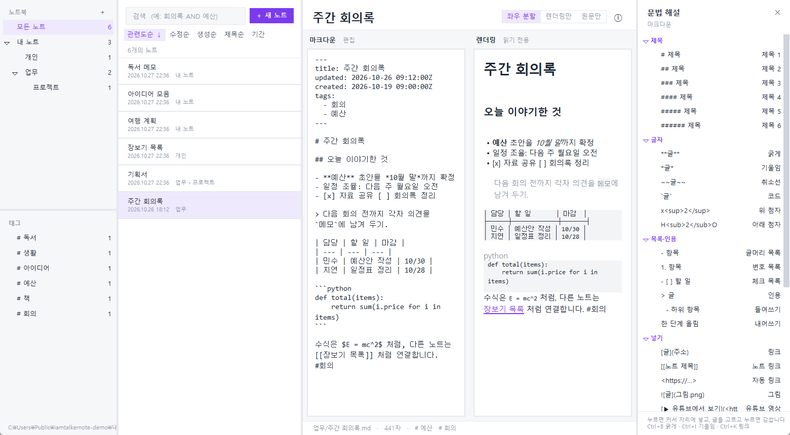
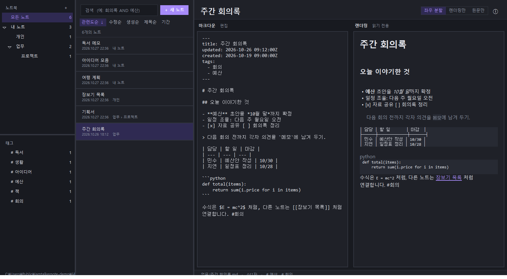

# iamtalkernote

**마크다운 파일로 저장하는 노트 앱** — 에버노트처럼 3단 목록, 조플린처럼 메뉴와 웹 클리퍼, 위키나루의 마크다운 편집·렌더링.
노트는 그냥 `.md` 파일이라 다른 프로그램과 함께 쓰거나 백업하기 쉽고, 앱이 없어도 읽을 수 있습니다. 내 컴퓨터 안에서만 동작합니다(웹 클리퍼 서버도 `127.0.0.1` 전용).

📘 **[사용 설명서](docs/manual.md)** — 설치부터 컴퓨터·폰 동기화, 문제 해결까지(앱 안에서는 **도움말 → 사용 설명서** 또는 `F1`).

> **안드로이드 앱은 별도 저장소입니다 — 개발할 때는 둘 다 읽으세요.** [iamtalkernote-android](https://github.com/iamtalker/iamtalkernote-android)의 README 에 폰 쪽 현황·로드맵이 있습니다. 노트 폴더의 파일 형식을 두 앱이 공유하므로, 형식(머리말·`태그:` 줄·`.history`·`.trash`·`.imported`)을 바꿀 때는 폰 쪽도 같이 고쳐야 합니다.





## 받아서 쓰기

[**Releases**](https://github.com/iamtalker/iamtalkernote/releases/latest) 에서 `iamtalkernote.exe` 를 받아 실행합니다(파이썬이 없어도 됩니다).
코드 서명이 없어 윈도 SmartScreen 경고가 뜰 수 있습니다("추가 정보 → 실행").
이미 쓰고 있다면 **도움말 → 업데이트 확인**으로 새 버전을 확인하고, 있으면 내려받아(릴리스 노트의 SHA-256 과 맞을 때만) 바꾼 뒤 자동으로 다시 시작합니다. 확인을 누를 때만 GitHub 에 접속하며, 노트·설정은 건드리지 않습니다. 현재 버전은 **도움말 → iamtalkernote 정보**에서 봅니다. (소스로 실행 중이면 릴리스 페이지만 안내합니다.)

- **폰 앱(안드로이드):** [iamtalkernote-android 의 Releases](https://github.com/iamtalker/iamtalkernote-android/releases/latest) 에서 APK 를 받아 설치합니다(옵션 → 동기화 맨 위에도 같은 주소가 있습니다). 컴퓨터와 맞추는 방법은 [사용 설명서](docs/manual.md#5-컴퓨터와-폰-동기화).
- **필요한 것:** Windows 10/11. 그림 변환(GDI+), 영상 재생 창(Edge), 숨김 폴더 속성은 윈도 기능을 씁니다.
- **소스로 실행:** Python 3.9+ (표준 라이브러리 `tkinter` 만 필요) → `iamtalkernote.bat` 또는 `py -3 app/iamtalkernote.pyw`.  WebP 같은 형식의 그림은 `pip install pillow`, 가져온 폴더의 PDF·mp3 는 `pip install pypdf tinytag` (exe 에는 모두 들어 있습니다).
- 처음 실행하면 `문서\iamtalkernote` 폴더를 노트 폴더로 씁니다. 바꾸려면 **설정 → 폴더 설정**.

## 특징

### 노트와 저장 방식
- 노트북 = 폴더, 노트 = `.md` 파일(제목 = 파일 이름), **하위 노트북**(하위 폴더) 지원.
- **볼트 방식**: 노트 폴더 하나만 지정하면 됩니다. 그림·첨부는 그 안의 숨김 폴더 `.resources` 에 저장되고 노트에는 상대 경로로 연결됩니다.
  예전 `_resources`(조플린 마크다운 내보내기 포함)나 따로 지정해 둔 리소스 폴더는 그대로 읽히고, 설정 → 폴더 설정의 **볼트 안으로 옮기기**로 파일과 노트의 링크를 함께 옮길 수 있습니다.
- 자동 저장(입력을 멈추고 0.6초 뒤). 삭제는 앱의 휴지통으로 가서 30일간 보관됩니다.

### 화면 (조플린·에버노트식)
- 노트북·태그 | 검색 + 노트 목록 | 에디터 | 문법 해설. **보기 메뉴**에서 각 칸을 켜고 끌 수 있습니다. 노트북 칸 머리글의 📂(모두 펼침)·📁(모두 접음) 단추로 하위 노트북을 한꺼번에 펼치거나 접고, 가져온 폴더와 그 하위 폴더는 처음에 접혀 있습니다(펼치고 접은 것은 목록을 다시 그려도 유지).
- 에디터는 **좌우 분할 / 렌더링만 / 원문만**. 노트 목록은 이어서 그려서(아래에 4화면쯤 남으면 미리 다음 묶음을 그립니다) **수만 개여도 끝까지 스크롤**됩니다. 목록에서 **Shift+클릭**으로 범위, **Ctrl+클릭**으로 하나씩 여러 노트를 고르고, 우클릭이나 Delete 로 한꺼번에 휴지통·노트북으로 보냅니다.
- **테마** 프리셋 5가지(라이트 보라·파랑·초록, 다크 검정·회색)와 **내 테마**(배경색·강조색 두 가지를 색 고르는 창으로 골라 만듦; 배경이 어두우면 글자는 밝게 저절로 맞춤), 목록·노트 **글자 크기·굵기** 설정(바로 적용).
- 오른쪽 위 ⓘ **노트 속성**: 위치, 파일, 갱신·생성 시각(수정 가능), URL, 작성자, 태그, 크기, 이전 버전.
- **창 상태 기억:** 종료할 때 창 크기·위치·최대화, 칸 너비, 노트북·태그 사이 경계, 정렬, 보던 노트북을 저장해 다음에 그대로 엽니다. 삭제한 뒤에도 목록이 보던 자리에 머뭅니다.
- **닫기(X) 버튼:** 기본은 앱을 끄지 않고 **작업표시줄 오른쪽 아래 트레이**로 보냅니다(웹 클리퍼·가져온 폴더 색인은 계속 돕니다). 아이콘을 누르면 다시 열리고 우클릭 → 종료로 끕니다. 옵션 → 일반에서 *바로 종료*로 바꿀 수 있고, 파일 → 종료는 언제나 바로 끕니다. 앱은 **한 번에 하나만** 실행됩니다: 이미 켜져 있을 때(창이 열려 있거나 트레이에 있을 때) 다시 실행하면 새로 켜지 않고 그 창을 앞으로 가져옵니다. 트레이 아이콘에 마우스를 올리면 실행 중인 버전이 보입니다.
- **미디어 폴더 모으기:** 설정 → 폴더의 *다른 폴더를 .resources 로 바꾸기…*로 노트가 쓰던 임의의 미디어 폴더(attachments, images …)를 골라 `.resources` 로 옮기고 모든 노트의 링크를 한꺼번에 고칩니다(몇 곳이 바뀌는지 보여 주고 확인을 받으며 복원 지점을 먼저 만듭니다).

### 마크다운 편집·렌더링 (위키나루 엔진)
- 제목, 굵게·기울임·취소선·코드, 위/아래 첨자, 목록·체크 목록·인용, 표, 코드 블록, 수식 표기, 각주, 접기, 목차, 노트 링크 `[[노트 제목]]`.
- **표**: 칸마다 격자선이 있고 머리행은 굵게, 열 정렬(`:--` `--:` `:-:`)을 따릅니다. 창이 좁으면 칸 안에서 줄바꿈하고, 아주 좁으면 `머리글: 값` 으로 풀어 보입니다. 표는 화면 글꼴(옵션 → 글꼴)로 그립니다.
- **다른 노트 포함(include)**: 줄에 `![[노트 제목]]` 또는 `![[노트 제목#절]]` 만 쓰면 그 노트(또는 그 절)의 내용이 그 자리에 인용 블록으로 보입니다(옵시디언과 같은 문법, 읽기 전용: 고치려면 맨 위 `[[링크]]` 를 눌러 원본으로). 서로 포함하는 순환은 막고, 한 번에 펼치는 양에 상한이 있어 너무 길면 앞부분만 보입니다.
- **글꼴**: 옵션 → 글꼴에서 화면 글꼴·고정폭 글꼴 종류와 크기·굵기를 고릅니다(기본 맑은 고딕).
- **표 복사·붙여넣기(웹과 주고받기)**: *렌더링 화면에서 복사*하면 글자와 함께 HTML 형식도 클립보드에 넣어(`copyhtml.py`·`winclip.py`) 오유 같은 웹 에디터·워드에 **표가 표로**(열 정렬·굵게·링크·제목 포함) 붙고, 글자 형식은 칸을 탭 하나로 이은 줄이라 엑셀에도 표로 붙습니다. 반대로 *웹에서 표를 복사해 편집 칸에 붙여넣으면* 마크다운 표로 바뀝니다(`pastehtml.py`; 표가 든 HTML 일 때만 바꾸고 그 밖의 붙여넣기는 그대로). `Ctrl+Shift+V`(편집 메뉴 → 글자만 붙여넣기)는 언제나 글자만 붙입니다. 윈도 전용.
- 오른쪽 **문법 해설** 사이드바: 누르면 커서 자리에 넣고, 글을 고르고 누르면 감쌉니다(다시 누르면 풀림).
- 그림: ``, HTML ``(`width` 반영), 링크로 감싼 그림, 표 칸 안의 그림, 본문에 박힌 `data:` 그림, `%20` 경로.
  형식은 확장자가 아니라 내용으로 알아보고, WebP 등은 Pillow 로 변환해 보여 줍니다.
  그림은 **렌더링 칸의 너비에 맞춰** 칸보다 클 때만 줄여서 보이고(작은 그림은 원래 크기, 왼쪽 정렬), 창 크기를 바꾸면 다시 맞춥니다.
- 유튜브 주소가 한 줄에 있거나 `` 이면 **썸네일 카드**로 보이고, 누르면 작은 재생 창(Brave 앱 창, 없으면 Edge 앱 창 — Edge 는 광고를 못 막아 Brave 를 먼저 씀) 또는 기본 브라우저로 열립니다.
  이 앱은 웹 화면 엔진이 없어 영상을 노트 안에서 직접 재생하지는 못합니다.
- 문장 속 맨 주소(`https://…`)도 링크가 됩니다.
- **파일 링크**: `[보고서](.resources/보고서.pdf)` 처럼 이 컴퓨터의 파일을 가리키는 링크를 누르면 윈도 기본 프로그램(pdf 는 pdf 리더)으로 열립니다(실행 파일 종류는 보안상 열지 않음). 렌더링 화면에서 그림이나 파일 링크를 우클릭하면 **파일 위치 열기**(탐색기에서 그 파일을 선택)가 있습니다(실행 파일 종류는 열지 않지만 위치는 볼 수 있습니다). **본문이 pdf 링크 하나뿐인 노트**(머리말·제목 줄·태그 줄은 글로 치지 않음)는 열면 윈도 pdf 뷰어로 바로 보이고, 머리줄의 *노트 글로 보기* 단추로 마크다운과 오갑니다.

### 검색·정렬·태그
- **문서에서 찾기:** 노트를 연 채 `Ctrl+F`(또는 편집 → 문서에서 찾기)를 누르면 찾기 막대가 열리고, 일치하는 곳을 모두 강조하며 지금 위치(`3 / 62`)를 보여 줍니다. `Enter`·`F3` 다음, `Shift+Enter`·`Shift+F3` 이전, `Esc` 닫기. 대소문자는 구분하지 않고, 좌우 분할일 때는 양쪽에 강조하되 편집 칸으로 이동합니다. 글을 고치거나 보기 모드를 바꾸면 다시 찾고, 다른 노트로 가면 닫힙니다. 모든 파일 검색은 `Ctrl+Shift+F`(노트가 안 열려 있거나 목록 검색칸에 있을 때는 `Ctrl+F` 도 같음).
- **검색:** `회의록 AND (예산 OR 일정) NOT 취소`, `"정확한 구절"`, `& | !` 기호. 일치한 부분을 강조하고 미리 보여 줍니다.
  **자동완성:** 검색창에 글자를 치면 아래에 후보가 뜹니다 — 그냥 치면 *파일 제목*(마지막 낱말만 바꿔 넣습니다), `#` 로 시작하면 *태그*(`#` 만 쳐서는 안 뜨고 `#신` 처럼 한 글자 이상 쳐야 그 글자로 시작하는 태그가 뜹니다). 한글은 마지막 글자를 조합하는 중에도 바로 반영됩니다(방향키로 확정하지 않아도 됩니다). ↑↓ 로 고르고 `Enter` 로 넣으며 `Esc` 로 닫고, 빈 칸을 누르거나 ↓ 를 누르면 *최근 검색*이 보입니다(30개까지 기억).
  [folder-search](https://github.com/iamtalker/folder-search) 의 검색을 가져왔고, 본문 검색은 SQLite 색인 안에서 처리해 1만 개 이상에서도 0.5초 안팎입니다.
- **정렬:** 관련도순 · 수정순 · 생성순 · 제목순(같은 버튼을 다시 누르면 방향 반대), 수정일/생성일 **기간 필터**.
- **태그:** 본문의 `#태그`, `태그: a, b` 줄, 머리말의 `tags:` 를 모읍니다. 보기 → 태그 보기를 켜면 노트북 아래에 나옵니다.
  글 맨 아래 줄의 **태그(`# 태그 추가`)를 누르면 그 자리에 입력칸이 열립니다**: 공백·쉼표로 나눠 적고 Enter 로 저장(Esc 취소). 저장하면 글 맨 아래의 `태그: #a #b` 줄에 적히고(없으면 만듭니다) 목록·사이드바에도 바로 반영됩니다. 본문에 직접 쓴 `#태그`나 머리말 `tags:` 의 태그는 여기서 지울 수 없고(글을 고쳐야 합니다) 그렇다고 알려 줍니다.
  **태그 목록(보기 → 태그 보기)에서 태그를 우클릭**하면 *태그 이름 변경*과 *태그 삭제*를 할 수 있고, 그 태그가 든 **모든 노트**에 적용됩니다. **Ctrl/Shift+클릭으로 태그 여러 개를 골라** 우클릭하면 한꺼번에 삭제하거나, 하나의 이름으로 바꿔 **합칠** 수 있습니다(Ctrl/Shift+클릭은 노트를 거르지 않고 선택만 합니다). 머리말 `tags:`·글 아래 `태그:` 줄·본문 `#태그` 세 군데를 모두 고치며(코드·주소 속 `#` 는 건드리지 않음), 적용 전에 몇 곳이 바뀌는지 보여 주고, 5개 이상이면 복원 지점을 먼저 만들고, 이전 내용은 노트 버전으로 남고 수정 시각은 바뀌지 않습니다. 이름의 공백은 `_` 로 바뀝니다(조플린에서 가져온 `3d girl` 같은 태그는 이름 변경에서 `3d_girl` 이 미리 채워집니다). 본문 `#태그` 를 지우면 그 글자가 글에서 지워집니다. 주소 속 `#`(페이지 위치·댓글 번호)와 머리말(`---` 사이)의 `title:` 같은 줄 속 `#` 는 태그로 읽지 않습니다(머리말은 `tags:` 목록만 태그입니다). `#태그http://…` 처럼 주소가 바로 붙어 있어도 `#태그` 만 태그로 보고 이름 변경·삭제도 그 부분만 고칩니다.
  **태그 붙이기**는 노트 목록에서 노트 하나(또는 Shift/Ctrl+클릭으로 여러 개)를 우클릭 → **태그 추가…** 입니다. 공백·쉼표로 여러 태그를 한꺼번에 쓸 수 있고, 글 아래 `태그:` 줄에 적힙니다.

### 휴지통·복원 지점·변경 이력
- **휴지통** (파일 → 휴지통): 지운 노트·노트북(노트 폴더 전체 포함)은 윈도 휴지통이 아니라 볼트 안 숨김 폴더 `.trash` 로 가서 **30일**(바꿀 수 있음) 보관되고, 시작할 때 기한이 지난 것이 완전히 지워집니다. 복원·완전 삭제·비우기.
- **복원 지점** (파일 → 복원 지점): 윈도의 복원 지점처럼 **그 시점의 모든 노트**로 되돌립니다. 지점을 만들 때는 노트를 복사하지 않고 "어느 노트가 어떤 내용이었는지" 목록만 적습니다(노트 1만 4천 개에 약 0.8MB). 노트 내용은 **앱이 그 노트를 바꾸거나 지우거나 옮기기 직전에, 바뀌기 전 내용만** 보관 폴더(`.snapshots/blobs`, 압축 없이 그대로)에 복사해 둡니다. 안 바뀐 노트는 파일 자체가 그 시점의 내용이라 공간을 쓰지 않으므로, **첫 지점은 거의 공간을 쓰지 않고 바뀐 노트의 이전 내용만 쌓입니다.**
  되돌리면 바뀐 노트는 보관본으로 되돌리고, 지워졌던 노트는 되살리고, 그 뒤에 생긴 노트는 휴지통으로 보내며, **되돌리기 직전 상태도 지점으로 남습니다.** 앱 밖에서(다른 편집기·동기화 도구 등) 직접 고친 노트는 바뀌기 전 내용을 보관할 기회가 없어서 되돌릴 수 없고, 그런 노트는 건드리지 않고 개수를 알려 줍니다.
  하루에 한 번 자동으로 만들고(끌 수 있음), 군더더기 정리·중복 정리·저장 폴더 삭제·리소스 폴더 이전처럼 한꺼번에 바꾸는 작업 **직전에도 자동으로** 만듭니다. 보관은 최근 30개이거나 30일 안의 것(설정 가능). 그림·첨부는 넣지 않습니다.
- **전체 변경 이력** (편집 → 전체 변경 이력): 모든 노트의 수정·생성·삭제·이름 바꿈·이동·복원을 시간순으로 모아 보고 더블클릭으로 노트를 엽니다(`.history/journal.jsonl`, 같은 노트의 연속 저장은 1분에 한 번만 기록). 노트별 이전 버전은 편집 → 노트 버전.

### 정리 도구 (도구 메뉴)
- **중복 노트 찾기** — **제목이 같은 노트**(끝의 "-1", " (2)" 같은 번호는 무시)를 먼저 모으고, 그 안에서 **본문이 같거나 아주 비슷한 것**만 묶어 보여 줍니다(사이트 메뉴 같은 공통 줄은 빼고 비교). 제목이 다르면 내용이 같아도 묶지 않습니다. **본문이 완전히 같은 것**과 **비슷한 것**을 나눠 보여 주고, 완전히 같은 것은 단추 하나로 최근 것만 남기고 휴지통으로 보냅니다. 노트를 누르면 그 노트가 열리고, 우클릭으로 열어 보기·휴지통을 합니다. 군더더기·안 쓰는 미디어 창도 같은 방식(누르면 열기, 우클릭 메뉴)이며, 세 창 모두 독립 창이라 최대화할 수 있습니다.
- **스크랩 군더더기 정리** — 노트마다 지울 줄을 이유와 함께 미리 보고 적용합니다. 적용 전 내용은 노트 버전으로 남고 수정 시각은 바뀌지 않습니다. 찾는 방법:
  - **사이트 공통 줄** — 같은 사이트(원본 주소의 호스트)에서 스크랩한 노트들에 똑같이 반복되는 메뉴·머리글·바닥글. 노트의 30% 이상에 나오는 줄, 또는 글 맨 위·아래 가장자리에서 6개 이상의 노트에 반복되는 줄. "조회수 : 1256" 같은 항목 줄은 값이 달라도 항목 이름으로 비교하고, 아이콘 그림 줄은 파일 이름의 해시와 링크 주소의 노트별 값을 빼고 비교합니다.
  - **메뉴 덩어리·링크 나열·빈 링크** — 글 맨 위·아래에 이어진 짧은 링크 줄, 링크만 길게 나열된 줄, 글자 없는 `[](…)` 와 `<a id=…></a>`.
  - **클리퍼 규칙** — 조플린 클리퍼 플러스에서 글에 적용할 수 있는 것만 가져왔습니다: 게시판 이전글/다음글/목록, "조회수+날짜" 줄, 통신사 "[OO 주요뉴스]" 꼬리, "ⓒ … 무단 전재" 줄, 위키 안내 줄. (클리퍼의 사이트별 CSS 선택자는 HTML 에만 걸 수 있어서 이미 마크다운이 된 노트에는 쓸 수 없습니다.)
  - **흔한 군더더기** — "맨위로", "공유하기", "댓글 쓰기" 같은 줄(줄 전체가 그 말일 때만).
  - 리소스 폴더(`.resources`·`_resources`)의 그림·첨부를 가리키는 줄과 `태그: #a #b` 줄(내가 붙인 태그)은 지우지 않습니다. 정리하고 다시 돌려도 또 나오지 않도록, 지운 사이트는 지운 뒤의 본문으로 공통 줄을 다시 구해 더 나올 게 없을 때까지 되풀이해서 한 번에 보여 줍니다(몇 단계 걸려 시간이 더 듭니다).
  - **한 칸짜리 표 풀기** — 옛 스크랩이 글 전체를 표 한 칸에 넣고 `<br>` 로 줄을 나눈 노트를 일반 마크다운 글로 풀어 줍니다.
- **안 쓰는 미디어 파일 정리** — 어떤 노트(휴지통 속 노트 포함)도 가리키지 않는 그림·첨부를 찾아 한꺼번에 휴지통으로 보냅니다(복원 가능).

### 노트 버전
저장할 때 이전 내용을 노트별로 보관합니다: 노트를 연 뒤 **처음 고칠 때**(그 직전 내용), 그 뒤로는 설정한 **간격**(기본 1분)이 지난 뒤 고칠 때.
편집 → 노트 버전…(또는 노트 우클릭)에서 보고 되돌립니다. 보관 개수(기본 10)와 간격은 설정 → 노트 버전. 버전은 `.history/` 에 노트별로 쌓이며 노트북으로 보이지 않습니다.

### 웹 클리퍼
[조플린 클리퍼 플러스](https://chromewebstore.google.com/detail/joplin-clipper-plus/fbieoidncnoalmenkkpbcbomppoenfoa)(크롬 확장)가 조플린 대신 이 앱에 저장하도록, 조플린 웹 클리퍼 API 의 일부(`/ping` `/folders` `/notes`)를 흉내 내는 로컬 서버를 둡니다.
저장하면 본문에 박힌 그림은 리소스 폴더의 파일로 빼고, 하위 노트북도 고를 수 있습니다.
원본 주소는 노트 맨 위 머리말(`---` `source: 주소` `---`)에 저장되어 렌더링 화면에는 안 보이고 문서 정보의 URL 로 나옵니다(0.3.2 까지 저장한 노트는 본문 맨 위 `원본: <주소>` 줄이며, 이것도 렌더링 화면에서는 숨겨집니다).

1. 확장 프로그램을 크롬 웹스토어(위 주소)에서 설치합니다. 릴리스에는 확장 파일을 따로 올리지 않습니다(0.3.6 까지는 `iamtalkernote-clipper-extension.zip` 이 있었고, 웹스토어를 못 쓰면 저장소의 `clipper/` 폴더를 `chrome://extensions` → 개발자 모드 → "압축해제된 확장 프로그램을 로드합니다"로 불러올 수 있습니다).
2. 이 앱의 **설정 → 웹 클리퍼 설정**에서 **토큰**을 확인해 확장 옵션에 붙여 넣습니다. 포트는 조플린과 같은 기본값 `41184` 라서 웹스토어 버전은 바꿀 필요가 없습니다.
   조플린을 같이 켜 두면 이 앱은 `41185` 같은 옆 포트로 밀려 열립니다(상태 표시줄과 설정에 포트가 나오니 확장 옵션의 포트를 그 값으로). 기본 포트가 비면 5초 안에 자동으로 `41184` 로 돌아옵니다.

### 다른 폴더 가져오기 (pdf · txt · mp3 …)
노트 폴더 밖의 폴더도 **원본은 건드리지 않고** 가져와 노트와 같은 검색 문법으로 찾습니다. 앱이 글만 뽑아 색인 DB(`%APPDATA%\iamtalkernote\docs-index.db`)에 적어 둡니다.
- **가져오기:** 파일 → 폴더 가져오기… (또는 설정 → 옵션 → 가져오기)에서 폴더를 추가하고 **읽을 파일 종류**(확장자)를 고릅니다. 고른 확장자만 읽고 나머지는 무시합니다. 기본은 `pdf txt md mp3`이고 `docx pptx xlsx csv html flac m4a …` 도 고를 수 있습니다.
- **어디에 나오나:** 노트북 칸에 **가져온 폴더** 항목이 따로 생기며, 가져온 폴더 안의 하위 폴더도 그 아래에 계층으로 표시됩니다. 폴더를 고르면 바로 아래 파일을 보고, 검색하면 그 하위 폴더까지 찾습니다. 맨 위 **모든 파일**은 내 `.md` 노트와 가져온 파일을 함께 보여 주고 함께 검색하며 개수도 합산합니다.
- **원본 그대로 보기:** pdf·mp3·Office 문서는 윈도 탐색기 미리보기 창이 쓰는 방식으로 **윈도 기본 프로그램이 노트 화면 안에 직접** 보여 줍니다(pdf → Edge, mp3 → Windows Media Player 등 그 확장자에 등록된 프로그램). 이때 원문·분할 보기는 꺼지고, 머리줄의 **뽑은 글로 보기** 단추로 색인해 둔 글(Ctrl+F 로 문서 안 찾기 가능)과 오갈 수 있습니다. txt·md 같은 글 파일은 처음부터 글로 보이며, 더블클릭이나 우클릭 → *기본 프로그램으로 열기*로 원래 파일을 엽니다. 등록된 미리보기 프로그램이 없으면 글로 보입니다. **연결 프로그램:** 가져온 파일을 우클릭 → *.확장자 파일을 열 프로그램 지정…* 으로 확장자마다 열 프로그램을 따로 정할 수 있고(예: zip → 만화 뷰어), 더블클릭·*연결 프로그램으로 열기* 가 그 프로그램에 파일 경로만 넘겨 엽니다(없어졌거나 *연결 해제* 하면 윈도 기본 프로그램).
- **태그·메모:** 가져온 파일에도 태그(맨 아래 줄의 태그를 눌러 편집)와 **메모**(머리줄의 메모 단추)를 달 수 있습니다. 원본은 건드리지 않고 색인 DB 에만 저장되며 검색에도 잡히고, 태그 목록의 이름 변경·삭제·합치기에도 같이 적용됩니다. 파일을 다시 읽어도 지워지지 않습니다.
- **검색:** `AND OR NOT`, `"구절"`, `#태그`, 정렬·기간 필터를 지원합니다. `#태그`는 본문에 적힌 문자열이 아니라 노트·가져온 문서의 태그 메타데이터와 정확히 일치합니다. 문서 안의 글은 항상 색인해 두지만(PDF·txt·docx·pptx·xlsx 본문, mp3 는 파일 이름과 ID3 태그·가사), 찾을 때마다 본문까지 훑으면 결과가 길어지므로 **목록의 *문서 안 글 포함* 체크박스**(가져온 폴더가 있을 때만 보임)로 고릅니다. 끄면(기본) 파일 이름·경로·태그·메모로만 찾고, 켜면 본문까지 찾습니다. 옵션에서 *문서 안의 글도 색인*을 끄면 아예 본문을 읽지 않습니다.
- **빠르고 멈추지 않게:** 한 번 읽은 파일은 DB 에 남아서 바뀐 파일만 다시 읽고, 사라진 파일은 색인에서 빠집니다. 앱을 켜 두는 동안 **5분마다** 뒤에서 저절로 훑어 새 파일을 색인합니다. 무거운 pdf·Office 는 **여러 CPU 코어에서 나눠 읽고**(앱 화면과 다른 프로세스라 얼지 않습니다) 한 파일이 3분 넘게 멈춰 있으면 그 파일은 이름만 색인하고 넘어갑니다. 글자가 없는 스캔 PDF 는 이름만 색인됩니다(OCR 은 아직 없음).
- **폰으로 내보내기:** 가져온 문서의 이름·폴더·태그·메모와 **글 앞부분(2만 자까지)** 을 노트 폴더 안 숨김 폴더 `.imported/docs.jsonl` 로 내보냅니다(가져온 폴더를 훑고 나서, 태그·메모를 고친 몇 초 뒤). 노트 폴더를 동기화하면 [안드로이드 앱](https://github.com/iamtalker/iamtalkernote-android)이 이 파일을 읽어 가져온 파일을 목록·검색·보기(읽기 전용)로 보여 줍니다. 원본 파일은 담지 않습니다. 끄려면 `config.json` 의 `imports` 에 `"export": false`.
- 쓰는 오픈소스: PDF 는 [pypdf](https://github.com/py-pdf/pypdf)(BSD-3-Clause), 소리 태그는 [tinytag](https://github.com/tinytag/tinytag)(MIT). Office 문서는 표준 라이브러리로 읽습니다.

### 동기화 (Syncthing 내장)

- **옵션 → 동기화**에서 켭니다. 서버 없이 기기끼리 직접 맞추는 [Syncthing](https://syncthing.net)을 앱이 대신 내려받아(공식 GitHub 릴리스, 코드에 박아 둔 SHA-256 과 같을 때만 설치) 숨겨서 실행하고 제어합니다. 사용자는 Syncthing 을 따로 설치·설정하지 않습니다. 앱을 켤 때 함께 시작하고 끌 때 함께 멈춥니다.
- **노트 폴더 하나, 방향 하나**(다음 버전부터 새 정책의 기본, 아직 릴리스 전): 노트 폴더 전체가 Syncthing 폴더 하나이고 방향은 **양방향 / PC → 모바일 / 모바일 → PC / 동기화 안 함** 중 하나입니다(기본 **양방향**). 함께 보낼 것은 체크로 고릅니다 — *미디어(`.resources`)*·*가져온 문서 요약(`.imported`)*(기본 보냄), 고급으로 *변경 이력(`.history`)*·*휴지통(`.trash`)*(**기본 안 보냄**, 파일이 아주 많고 폰에서 쓸 일이 거의 없음). 복원 지점(`.snapshots`)은 PC 전용이라 옵션이 없고, 보내지 않는 것은 제외 목록(`.stignore`)으로 뺍니다. *외부 폴더*(옵션 → 가져오기에 등록한 폴더)만 폴더마다 방향을 따로 정하는 선택 기능으로 남습니다. 받는 순서는 작은 파일부터(`smallestFirst`)입니다. 예전 정책(모듈마다 폴더·방향)은 그대로 읽히고, 옵션 → 동기화의 **새 방식으로 바꾸기…** 로 전환합니다(전환하면 노트북 따로 설정은 없어지고, 이미 연결한 폰은 Fork 의 `inn-` 폴더를 지우고 다시 받아야 합니다).
- 정책은 노트 폴더 안 `.sync/policy.json` 에 저장돼 마크다운 모듈과 함께 폰에도 전달됩니다. 기기마다 다른 것(외부 폴더의 실제 경로 등)은 정책에 넣지 않습니다. 폴더 ID 는 정책의 `vault` 값에서 만들어 기기가 달라도 같은 대상으로 이어집니다.
- **Syncthing 업데이트**: Syncthing 자체 자동 업그레이드(공식 서명 확인)를 12시간마다 켭니다. 메이저 버전이 바뀌는 새 버전은 설정이 달라질 수 있어 올리지 않고 동기화 탭에 알립니다.
- **폰 연결**: 폰 앱(1.3.3 이상)의 설정 → 동기화 *연결 마법사*가 폰의 Syncthing-Fork 를 대신 설정합니다. 폰이 연결을 요청하면 이 탭에 *연결을 요청한 기기 … [허용]* 이 뜨고, 허용하면 폴더가 공유되어 폰 앱이 알아서 받아 정해진 위치에 둡니다(복사해 붙여넣을 것은 이 컴퓨터의 기기 ID 와 Fork 의 API 키 뿐). 마법사 없이 Fork 에서 직접 해도 됩니다. 처음 켤 때 윈도 방화벽이 네트워크 허용을 물으면 *개인 네트워크*만 허용하세요.
- 코드: `app/syncpolicy.py`(정책 계산, 엔진을 모름) · `app/syncengine.py`(Syncthing 설치·실행·REST) · `app/syncui.py`(옵션 탭과 시작 때 이어 주기). 이 앱이 만든 폴더는 ID 가 `inn-` 로 시작하고 그 외 Syncthing 폴더는 건드리지 않습니다.

### 저장된 검색 (스마트 폴더)
지금의 검색식·기간·태그·정렬을 이름 붙여 저장해 두고, 노트북 칸 아래 **저장된 검색**에서 한 번에 불러옵니다. 목록의 *검색 저장* 단추(또는 파일 → 지금의 검색 저장…)로 만들고, 우클릭으로 이름 바꾸기·지금의 검색으로 덮어쓰기·삭제를 합니다. 범위는 항상 모든 파일(내 노트 + 가져온 파일)이고, 불러온 뒤 검색어를 고치면 그 결과를 보는 것입니다.

### 조플린에서 옮겨 오기
조플린에서 **파일 → 내보내기 → "MD - Markdown + Front Matter"** 로 내보낸 폴더를 이 앱의 노트 폴더로 지정하면 됩니다(`_resources` 폴더 포함).
파일 날짜가 모두 내보낸 시각이어도, 노트 맨 위 머리말의 `updated` / `created` 를 읽어 **원래 날짜로 정렬·표시**하고, 저장하면 `updated` 가 갱신됩니다. 머리말의 `tags` 도 태그로 읽습니다.

### 성능: 색인 DB
노트 파일이 원본이고, 앱이 `%APPDATA%\iamtalkernote\index-*.db`(SQLite)에 노트별 요약(날짜·태그)과 검색용 본문 사본을 만들어 둡니다. 실행할 때는 크기·수정 시각이 바뀐 파일만 다시 읽고, 본문은 노트를 열 때만 읽습니다.
13,902개 노트(본문 약 1억 2600만 자) 기준: 목록이 뜨기까지 1.2초(색인이 있을 때), 검색 0.3~0.5초, 메모리 약 100MB. 색인을 지워도 다음 실행 때 다시 만들어집니다(처음 한 번은 오래 걸립니다).

### 동기화 시험 기록 (2026-10-30)
컴퓨터용 Syncthing(격리 시험 환경)과 **안드로이드 14 에뮬레이터의 Syncthing-Fork 2.1.7** 를 연결해, 사용자 데이터에서 **무작위로 뽑은 복사본**(노트 `.md` 100개 + 폰에서 만든 10개, 미디어 20개 + 5개, mp3·pdf 5개 + 2개)으로 방향마다 시험했습니다(원본은 읽기만 했고 표본은 시험 뒤 모두 지웠습니다). 모든 파일을 **SHA-256 해시로 비교**했고, 각 시나리오에서 ① 처음 맞춤 ② 양쪽에서 수정·삭제·새 파일 후 전달(그리고 방향 밖의 변경이 전달되지 않음)을 확인했습니다. 도구는 [`tools/sync_matrix.py`](tools/sync_matrix.py) 로 저장소에 있습니다(에뮬레이터·Syncthing-Fork API 키·노트 폴더 경로를 인자로 줍니다. 파일 머리말에 사용법).

| 방향 | 노트(md) | 미디어 | 외부 폴더(mp3·pdf) | 합계 |
| --- | --- | --- | --- | --- |
| 양방향 | 4/4 | 4/4 | 4/4 | **12/12** |
| PC → 모바일 | 5/5 | 5/5 | 5/5 | **15/15** |
| 모바일 → PC | 4/4 | 4/4 | 4/4 | **12/12** |

- 양방향: 합집합으로 같아지고, 수정·삭제·새 파일이 서로 전달되어 끝에 완전히 같음(폰이 고친 PC 파일도 PC 에 반영).
- PC → 모바일: PC 파일이 해시까지 같게 폰에 도착, PC 의 변경이 폰에 전달됨 / 폰이 따로 가진 파일·폰의 변경(폰이 고친 PC 파일 포함)은 PC 에 전달되지 않음.
- 모바일 → PC: 폰 파일이 PC 에 도착, 폰의 변경이 PC 에 전달됨 / PC 가 가진 파일·PC 의 변경은 폰에 내려가지 않음.
- **한계**: 실제 폰이 아니라 에뮬레이터, PC 와 폰의 주소를 직접 지정했음(같은 와이파이 자동 탐색은 실제 폰에서 따로 확인 필요), 파일 수백 개 규모(1.4만 개·7.6GB 규모의 속도는 미확인). 모바일 → PC 에서는 폰이 정책 파일을 받지 못해 폰 쪽 폴더 종류가 양방향으로 남지만 PC 가 받기 전용이라 실제로는 한 방향으로만 갔습니다.
- 시험 중 찾은 **컴퓨터 앱의 버그**: 설정 파일 `config.json` 을 화면과 동기화 시작 쓰레드가 동시에 쓰면 파일이 깨짐 → 0.5.2 에서 잠금 + 임시 파일 교체로 고침.

## 단축키

| 키 | 동작 | 키 | 동작 |
| --- | --- | --- | --- |
| Ctrl+N | 새 노트 | Ctrl+B / I / K | 굵게 / 기울임 / 링크 |
| Ctrl+Shift+N | 새 노트북 | Ctrl+Shift+T | 날짜·시간 넣기 |
| Ctrl+F | 문서에서 찾기(노트가 열려 있을 때) | Ctrl+E · Ctrl+L | 편집기 보기 순환 |
| Ctrl+Shift+F | 모든 파일에서 검색 | F3 · Shift+F3 | 찾기: 다음 · 이전 |
| Ctrl+/ | 문법 해설 보기 | Ctrl+Shift+L | 노트 목록 보기 |
| F10 | 노트북 보기 | Ctrl+, | 옵션 |
| Ctrl+- / Ctrl++ | 이전 / 다음 노트 | PageUp / PageDown | 마우스가 올라가 있는 칸 스크롤 |
| 목록에서 Shift+클릭 / Ctrl+클릭 | 범위 / 하나씩 여러 노트 선택 | Esc · Delete | 선택 해제 · 선택한 노트 휴지통 |
| F1 | 사용 설명서 열기(GitHub) | | |

## 폴더 구조

```
iamtalkernote/
├─ app/            앱 소스 (notes.py: 화면, store.py: 저장·색인·휴지통, search.py: 검색, clipserver.py: 클리퍼 서버,
│                  cleanup.py: 중복·군더더기·안 쓰는 미디어 찾기, snapshots.py: 복원 지점,
│                  docs.py: 가져온 폴더(pdf·txt·mp3 …) 읽기·색인·태그·메모, winpreview.py: 윈도 미리보기 처리기를 노트 화면 안에,
│                  tray.py: 트레이 아이콘(ctypes), single.py: 한 번에 하나만 실행, ime.py: 한글 입력기 조합 중인 글자 읽기(자동완성용),
│                  syncpolicy.py·syncengine.py·syncui.py: 동기화(정책 계산·Syncthing 설치/제어·옵션 화면),
│                  updater.py: 업데이트 확인·교체, version.py: 버전(릴리스할 때 올림),
│                  editor.py·preview.py·wikiconv/: 위키나루에서 가져온 마크다운 읽기·렌더링·서식 도구)
├─ clipper/        조플린 클리퍼 플러스 크롬 확장(이 앱에 맞춰 기본 포트·안내만 바꿈, MIT)
├─ tools/          build_exe.py(exe 만들기), make_icon.py(아이콘 그리기), sync_matrix.py(방향별 동기화 시험)
├─ docs/           사용 설명서(manual.md)·동기화 설계(sync-design.md)·스크린샷
└─ iamtalkernote.bat   소스로 실행
```

## 직접 빌드

```
py -3 -m pip install pyinstaller pillow pypdf tinytag
py -3 tools/build_exe.py        # → iamtalkernote.exe (앱이 켜져 있으면 iamtalkernote.new.exe)
```

## 알려진 한계

- 영상은 썸네일 카드와 재생 창으로만 보여 줍니다(노트 안 직접 재생 불가).
- 그림이 든 표는 칸을 세로로 맞추지 않고 가로로 늘어놓아 보여 줍니다. 그림이 없는 표는 상자 글자 표입니다(칸이 하나뿐인 표는 표가 아니라 글로 풀어서 보여 줍니다).
- 가져온 파일은 고치거나 옮기거나 지울 수 없습니다(태그·메모만 앱 DB 에 답니다. 목록에서 빼도 원본은 그대로입니다). 원본 미리보기는 윈도에 그 형식의 미리보기 프로그램이 등록돼 있어야 하고, 그 안에서의 찾기·쪽 이동은 그 프로그램의 기능입니다. 스캔한 PDF 의 글자 인식(OCR)과 소리 → 글 변환은 없습니다.
- 움직이는 GIF 를 재생합니다. SVG 는 보이지 않습니다.
- 노트 안에서 마우스로 끌어다 놓기·맞춤법 검사는 없습니다. 폰과의 동기화는 옵션 → 동기화(Syncthing)로 합니다.
- 복원 지점에 그림·첨부는 기본으로 들어가지 않고, 복원 지점 창의 *그림·첨부도 포함* 을 켠 뒤에 만든 지점부터 넣습니다(저장 폴더 안의 `.resources`·`_resources` 만. 저장 폴더 밖 첨부 폴더는 제외). 앱 밖에서 고친 노트의 *바뀌기 전* 내용은 되돌릴 수 없습니다(앱이 볼 기회가 없었습니다). 다만 다음에 실행할 때 알아채서 변경 이력에 *앱 밖 수정* 으로 적고, 고친 뒤의 내용은 노트 버전으로 남깁니다. 군더더기 정리는 글자 규칙과 사이트별 반복 줄로 찾기 때문에 틀릴 수 있어서, 적용 전에 미리 보기를 꼭 봅니다.
- 윈도 전용 기능(GDI+, Edge 재생 창, 숨김 폴더 속성)이 있어 다른 운영체제에서는 일부가 동작하지 않습니다.

## 로드맵

아직 구현되지 않은 계획입니다. 순서와 내용은 바뀔 수 있습니다.

- [ ] **폰 웹 클리퍼: 안드로이드 브라우저에서 *공유 → iamtalkernote* 로 스크랩 (2026-11-01 사용자 요청)** — 폰 브라우저(크롬·삼성 인터넷 등)의 공유 메뉴에 iamtalkernote 가 나타나고, 누르면 그 페이지가 노트로 저장됩니다(PC 의 조플린 클리퍼 플러스와 같은 결과). 설계 초안:
  1. **받기**: 폰 앱 `AndroidManifest` 에 `ACTION_SEND`(`text/plain`) 인텐트 필터를 넣어 공유 대상으로 등록하고(앱이 꺼져 있어도 열림), 받은 글에서 주소(`https://…`)와 제목(`EXTRA_SUBJECT`)을 뽑습니다. 주소 없이 *글만* 공유하면(선택한 글 공유) 그 글을 그대로 새 노트로 저장하고 출처 주소는 비웁니다.
  2. **본문 가져오기**: 보이지 않는 `WebView` 로 주소를 불러 자바스크립트가 돌고 난 뒤의 본문을 얻고(앱 안에서 로그인한 페이지는 안 됨, 공개 페이지만), PC 클리퍼와 같은 `Readability.js`(본문 추출)·`Turndown`(HTML → 마크다운)을 `assets` 에 넣어 `evaluateJavascript` 로 돌립니다 → **PC 와 같은 규칙·같은 결과**(PC `clipper/` 의 사이트별 규칙을 나중에 공유 가능). 대안: 순수 코틀린 HTML 파서(jsoup)와 직접 만든 본문 추출 — 가볍지만 사이트마다 품질이 떨어짐.
  3. **저장**: 노트 폴더의 고른 노트북(기본 `ScrapBook`, 마지막에 고른 곳 기억)에 `.md` 로 저장하고, 머리말에 `source: 주소`(PC 와 같은 형식)와 `created`·`updated` 를 적습니다. 그림은 내려받아 `.resources` 에 저장하고 노트에는 상대 경로로 연결합니다(용량 상한과 와이파이 전용 옵션). 같은 주소를 이미 저장했으면 알리고 덮어쓸지 묻습니다. 동기화가 켜져 있으면 PC 로 자동으로 갑니다.
  4. **화면**: 공유를 누르면 작은 창(공유 시트처럼 앱 위에 뜸)에 *제목·노트북 고르기·[저장]* 만 보이고, 저장 중 진행 표시 뒤 *저장했습니다 [열기]* 토스트. 실패(네트워크·본문 없음)는 *주소만 담은 노트로 저장* 하는 선택지를 줍니다.
  5. **주의**: 실행 파일 성격의 파일·너무 큰 페이지(수 MB 이상)는 건너뜀, 쿠키 동의 창·유료 벽은 본문이 비어 나올 수 있음, 개인정보 — 주소를 외부 서버로 보내지 않고 폰에서 직접 가져옴. 구글 플레이 등록 때 `INTERNET` 권한은 이미 있음. 폰의 제3자 고지에 Readability(Apache-2.0)·Turndown(MIT)을 추가해야 함(PC 와 같은 문구 재사용).
  6. **시험**: 에뮬레이터 크롬에서 공유 → 저장 확인(뉴스·블로그·위키·유튜브 주소 몇 가지), 한글 제목·긴 글·그림이 많은 글, 같은 주소 두 번, 오프라인.
- [ ] **세계 공개 준비 (2026-11-01 사용자 결정: 전 세계 대상 서비스) — 순서: ① 저작권 표기 → ② 다국어 → ③ 스토어 등록**
  1. **저작권·라이선스 표기 정비 — 끝(2026-11-01, 커밋·릴리스 전)**: `app/assets/THIRD_PARTY_NOTICES.md`(Pillow·pypdf·tinytag·segno·Clipper Plus·Readability·Turndown·PyInstaller·Python·Tcl/Tk·Syncthing 의 저작권과 라이선스 전문; `tools/gen_notices.py` 로 다시 만듦)를 exe 에 넣고 **도움말 → 오픈소스 라이선스…** 로 보게 함, 폰도 `assets/THIRD_PARTY_NOTICES.md` + 설정 → 정보 → 오픈소스 라이선스(MPL-2.0·Apache-2.0 전문), README 출처 정리. 아래는 점검 당시의 기록: (이전 설명) — 점검 결과(2026-11-01, 법률 자문 아님): *있음* — 내 코드 `LICENSE`(PolyForm Noncommercial), `clipper/LICENSE`, `app/segno/LICENSE`, README 출처 목록(Joplin Clipper Plus MIT·Readability Apache-2.0·Turndown MIT·Pillow HPND·pypdf BSD-3·tinytag MIT). *부족* — ① `segno`(QR, BSD-3)가 README 출처에 빠짐 ② **exe 에 제3자 라이선스 전문이 안 들어감**(MIT·BSD·Apache 는 바이너리 배포 때 저작권 문구와 전문을 함께 주라고 요구) → 저장소 맨 위 `THIRD_PARTY_NOTICES.md`(이름·저작권자·라이선스 전문·원본 주소)를 만들고 exe 에 넣어 **도움말 → 정보**에서 열게 함. PyInstaller 가 묶는 파이썬·Tcl/Tk 고지도 포함 ③ **폰 앱은 제3자 표기가 거의 없음**(`LICENSE` 뿐, Syncthing MPL-2.0 한 줄) → 폰에도 같은 `THIRD_PARTY_NOTICES` 와 설정 → 정보 → *오픈소스 라이선스* 화면. 넣을 것: Syncthing 실행 파일(MPL-2.0: 전문·**소스 위치 링크**·수정 여부), AndroidX·Compose·코루틴(Apache-2.0 고지), 구글 코드 스캐너(구글 약관). ④ 상표: "Syncthing" 은 상표라 *~를 사용합니다* 로만 쓰고 공식 앱처럼 보이지 않게, 조플린·에버노트 비관련 문구는 이미 있음. 참고: PolyForm Noncommercial 은 무료 배포는 되지만 유료·광고를 넣으려면 라이선스를 바꿔야 함.
  2. **다국어(i18n)** — *1단계 끝(2026-11-01, PC 만)*: `app/i18n.py`(코드의 한국어 문장이 키, 영어일 때만 `EN` 사전에서 찾음, 없으면 한국어 그대로), 오른쪽 위 모서리의 언어 단추(`app/langbtn.py`: 깃발 + EN/KO ▾, 누르면 목록이 펼쳐짐; 윈도는 국기 이모지를 글자로 보여 줘서 깃발은 PhotoImage 로 직접 그림), 첫 실행은 윈도 표시 언어를 따름, 메뉴줄·모든 우클릭 메뉴·노트북 목록·검색·정렬·편집 머리말 영어화. *2단계 끝(2026-11-01, PC)*: 옵션 창 전 탭·모든 대화창·동기화 탭·상태 글·오류 안내·검색 문법 도움말·문법 해설·달력(요일 머리글 포함)·태그 편집·위키 링크 창을 영어화했습니다(`app/lang_en1.py`·`lang_en2.py`·`lang_en3.py` 는 한국어 문장 → 영어 사전, 코드의 한국어 문장이 곧 키이고 값이 들어가는 문장은 `tr("…{0}…").format(…)`). *규칙*: 새 화면 글자는 `tr()` 로 감싸고 사전에 영어를 넣는다. **노트 파일에 들어가는 글**(`태그:` 줄·`제목 없음` 기본 제목·서식 삽입 글)과 **글꼴 이름·정규식·설정 값**은 번역하면 안 된다(파일 형식이 폰·다른 프로그램과 달라짐). 같은 한국어가 문맥마다 다른 영어여야 하면(예: 메뉴 '제목'=Heading, 목록 열 '제목'=Title) 별도 함수(`i18n.group`·`i18n.unit`)로 처리. *남은 일*: ⓐ 영어화 안 된 곳: `store.py`·`cleanup.py`(군더더기 이유 글)·`updater.py`·`clipserver.py` 메시지, 공휴일 이름(`planner/model.py`), 아웃라이너·미리보기의 일부, 사용 설명서(`docs/manual.md`) 영어판 ⓑ **폰 앱**(`strings.xml` + `values-en`/`values-ko`, 기본은 영어·한국어는 별도 리소스, 앱 안에서 언어 고르기는 안드로이드 13+ 의 앱별 언어 설정 `LocaleManager`) ⓒ 사용 설명서 영어판(`docs/manual.en.md`)·README 영어 요약 ⓓ 날짜·숫자 표기(`2026.11.01` → 지역 형식)와 검색 문법 도움말 ⓔ 영어가 끝난 뒤 다른 언어(일본어·중국어·스페인어 …)는 사전 파일을 `lang/xx.json` 으로 빼서 번역 기여를 받기 쉽게. 번역 품질 확인은 원어민 검수 필요(기계 번역 초안 + 검수).
  3. **구글 플레이 등록 (폰)** — 조사 결과(지식 기준, 정책은 자주 바뀌니 등록 직전에 Play Console 문서로 다시 확인): *지금 APK 를 그대로는 못 올림*. 걸림돌 — ① **AAB + 정식 서명 키** 필요(지금은 디버그 서명 APK; 플레이 서명은 다르므로 기존 설치자는 재설치해야 하고 노트는 폴더에 있어 안전) ② **`MANAGE_EXTERNAL_STORAGE`(모든 파일 접근)**: 별도 심사, 문서·파일 관리 같은 핵심 기능이 아니면 대개 거절 → 플레이용 빌드는 노트 폴더를 **앱 전용 저장소**(`Android/data/…`)나 저장소 접근 프레임워크(SAF) 폴더로 두고 내장 Syncthing 이 그 경로를 쓰게(다른 앱·PC 탐색기에서 직접 못 보는 대신 심사 통과) ③ **앱 자체 업데이트(`Updater.kt`)·`REQUEST_INSTALL_PACKAGES`**: 플레이는 앱이 APK 를 받아 설치하는 것을 금지 → **빌드 변형(flavor) `play`** 에서는 제거하고 `github` 변형만 유지 ④ 배터리 최적화 제외(`REQUEST_IGNORE_BATTERY_OPTIMIZATIONS`)·포그라운드 서비스(`dataSync`) 선언과 설명 필요, 거절될 수 있음 ⑤ `targetSdk` 가 지금 34 → 플레이가 해마다 올리라고 요구(등록 때 최신 요구 확인), 내장 Syncthing 실행 파일이 **16KB 페이지 정렬** 요건을 맞추는지 확인 ⑥ 개인 개발자 계정: 등록비 약 $25(1회)·신분 확인·**비공개 테스트 12명 이상 14일 연속** 후 정식 공개, 개인정보 처리방침 URL·데이터 안전 설문·콘텐츠 등급·스토어 그림(아이콘 512·소개 그래픽 1024×500·스크린샷) ⑦ 영어 스토어 설명(위 다국어 선행). *쉬운 대안*: **원스토어**·삼성 갤럭시 스토어(심사 느슨), GitHub 릴리스 + Obtainium(지금 방식). **F-Droid 는 불가**(오픈소스 라이선스만 받는데 PolyForm Noncommercial 은 해당 안 됨). 권장: 저작권 표기(1) → `play` 변형 설계(저장소·업데이트·권한 정리) → 비공개 테스트 모집.
    - **3-1. `play` 빌드 변형 설계안(2026-11-01, 설계만 — 구현 안 함)**: 폰 저장소 `app/build.gradle.kts` 에 *flavor 차원* `dist` = `github`(지금 그대로) · `play`.
      ① **저장소**: `play` 는 `MANAGE_EXTERNAL_STORAGE` 를 선언하지 않는다. 노트 폴더는 앱 전용 외부 저장소(`getExternalFilesDir`, 경로 `/Android/data/kr.iamtalker.notes/files/notes`)로 두면 **네이티브 Syncthing 이 일반 파일 경로로 그대로 쓸 수 있다**(지금 `NoteRepo`·`History` 는 SAF `DocumentsContract` 를 쓰므로, 앱 전용 폴더를 `file://` 대신 SAF 로도 읽는 어댑터나 SAF 와 `java.io.File` 을 둘 다 받는 저장소 인터페이스가 필요 — 가장 큰 일). 단점: 다른 앱·PC 탐색기에서 직접 못 봄 → 설정에 *내보내기/가져오기*(폴더 zip, SAF 로 고른 폴더에 복사) 추가. 또는 SAF 로 고른 폴더를 계속 쓰고 Syncthing 은 앱 전용 폴더와 SAF 폴더를 앱이 양방향 복사로 잇는 방식(복사 부담·충돌 위험이 커서 비추).
      ② **업데이트**: `play` 는 `Updater.kt`·`UpdateUi`·`REQUEST_INSTALL_PACKAGES`·`FileProvider`(APK 설치용)를 빼고 설정의 *새 버전 자동 확인* 도 숨긴다(소스 세트 `src/play`·`src/github` 로 나눠 `Updater` 를 빈 구현으로 대체).
      ③ **권한**: `REQUEST_IGNORE_BATTERY_OPTIMIZATIONS` 는 플레이가 용도를 심사하므로 `play` 는 뺀다(대신 설정에 *배터리 제한 풀기* 안내 화면). 포그라운드 서비스 `dataSync` 는 Play Console 의 *포그라운드 서비스 권한 선언*(동기화 설명·시연 영상)을 낸다. `INTERNET`·`POST_NOTIFICATIONS`·`ACCESS_NETWORK_STATE` 는 그대로.
      ④ **빌드·서명**: AAB(`bundleRelease`) + Play App Signing(업로드 키는 따로 만들어 저장소 밖에 보관; 지금 디버그 서명과 달라 `github` 설치자는 재설치). `targetSdk` 는 등록 시점의 플레이 최소 요구(지금 34 → 35 이상일 수 있음)로 올리고 동작 변화(포그라운드 서비스 타입·백그라운드 제한)를 시험한다. 내장 엔진 `libsyncthingnative.so` 는 **16KB 페이지 정렬**(`readelf -l` 의 LOAD 정렬 0x4000 이상)을 확인하고 아니면 최신 Syncthing-Fork 릴리스의 정렬된 빌드로 교체.
      ⑤ **등록 서류**: 개인정보 처리방침 URL(저장소의 `PRIVACY_POLICY` 를 웹에 공개), 데이터 안전 설문(수집 없음·전송 없음; 웹 클리퍼는 사용자가 고른 주소만 폰에서 직접 가져옴), 콘텐츠 등급, 영어 스토어 설명·스크린샷(영어 화면은 이미 있음), 개인 계정 비공개 테스트 12명 14일.
      ⑥ **순서**: (a) 저장소 어댑터 + 시험 → (b) `play`/`github` 소스 세트 분리 → (c) 에뮬레이터에서 `play` 빌드로 동기화·클리퍼 시험 → (d) AAB·내부 테스트 트랙 업로드 → (e) 비공개 테스트 모집. **결정이 필요한 것(사용자)**: 앱 전용 폴더 방식을 받아들일지(다른 앱·탐색기에서 노트가 안 보임), 원스토어·삼성 스토어를 먼저 할지.
- [x] **글 쓸 때 노트 목록 스크롤바가 늘었다 줄었다** — 2026-11-01 고침(사용자 확인 대기): 재현은 노트가 많아 목록에 막대가 있어야 함(노트 3천 개 임시 폴더). 원인: 자동 저장 때 목록을 다시 그리면(`draw_list`) Tk Text 가 줄 높이를 아직 재지 않은 *추정값*으로 막대를 한 번 그렸다가 잠시 뒤 실제 값으로 바꿈(0.096 → 0.14). 고침: 다시 그린 뒤 `text sync` 로 높이 계산을 끝내고 나서 막대를 맞춤(저장 뒤 막대 값이 0.14 로 그대로). 같은 이유로 편집 칸의 막대도 입력 중에는 고정하고 멈춘 뒤 한 번만 맞추게 함(`ed_scroll`). 한글에서만 보였던 이유는 확인 못 함(저장 경로는 같음).
- [ ] **(2026-10-31 Claude 제안, 사용자 확인 전) 다음 순서 — 안정화 → 구조 정리 → 폰 맞추기**
  1. **실사용 피드백 모으기** — 0.6.15~0.6.17 의 아웃라이너·위키·즐겨찾기 폴더를 며칠 쓰며 불편한 점을 적습니다(눈으로 봐야 아는 화면 문제는 사용자가 가장 잘 잡음: 옵션 체크가 가로로 잘린 것을 세 번 놓쳤음). 아웃라이너 후속: 항목 안 `[[위키]]`·URL 링크 표시, 찾기(Ctrl+F), 접힘 상태 저장, 항목 메모, 한글 입력 조합 중 글자 처리.
  2. **`notes.py` 쪼개기(동작은 그대로)** — 약 5천 줄 한 파일(화면·사이드바·옵션·검색·동기화 연결)을 기능별 모듈로 나눕니다(옵션 창, 사이드바·노트북, 목록, 편집·렌더링, 아웃라이너 연결 등). 한 번에 하나씩 옮기고 `tools/test_*.py` 와 `test_wiki_app.py` 를 매번 돌립니다. 패치 사고(`\n` 이스케이프, 파일마다 CRLF/LF 가 달라 `store.py` 는 CRLF·`notes.py` 는 LF)를 줄이려고 줄바꿈 규칙도 `.gitattributes` 로 통일합니다.
  3. **화면 확인 도구** — 임시 설정으로 앱을 띄워 창 캡처(PrintWindow)를 남기는 스크립트를 만들어, 옵션 창처럼 눈으로만 아는 문제(잘림·겹침)를 릴리스 전에 잡습니다.
  4. **폰 맞추기** — 폰 1.4.12 릴리스(대기 중) → 위키 링크(같은 제목은 최신 노트로, 중복 제목 막기)·즐겨찾기 폴더·아웃라이너 폴더 규칙을 폰에도(파일 형식은 이미 같은 `.md`). 형식을 바꾸면 폰 저장소 README 도 같이 고칩니다.
  5. **규모 시험** — 노트 수만 개에서 목록·검색·색인(병렬 읽기 후)·아웃라이너(항목 1만 개)를 다시 재고 병목이 생기면 그때 손봅니다(지금은 8천 노트 기준 병목 없음).
- [ ] **유튜브 임베드 주소로 열기(시험 먼저)** — 지금은 영상을 `watch` 페이지로 열어서 광고가 뜹니다. 임베드 주소(`/embed/<아이디>`)로 열면 광고가 줄 수 있는지, 주소창 없는 Edge 앱 창에서 재생되는지, 임베드를 막은 영상은 어떻게 보이는지 먼저 시험하고, 되면 `open_url` 에 넣습니다. 더 나아가 노트 안에서 바로 재생(WebView2)하는 방법도 검토합니다.
- [ ] **비슷한 문서 추천 — 가져온 파일로 넓히기** — 노트끼리는 되었습니다(편집 → 비슷한 노트 찾기). 가져온 파일(pdf·txt 등)도 같은 방식으로 찾고, 노트 옆에 늘 보이는 칸으로 두는 것은 아직입니다.
- [ ] **스캔 PDF 글자 인식(OCR)** — 글자 없는 이미지 PDF 도 본문으로 찾을 수 있게. 오픈소스 OCR 엔진을 가져와야 해서 용량과 라이선스를 먼저 따져 봅니다.
- [ ] **폰 앱의 큰 폴더 성능** — 사용자 폰(SM-A235N)에서 노트 폴더에 노트가 5천 개를 넘으면 앱이 실행은 되지만 문서를 인식하는 데 너무 오래 걸렸습니다(당시 폴더는 SD카드, 복사 중이라 계속 다시 훑었을 수 있음). 첫 색인과 두 번째 실행의 시간을 재서 병목(폴더 목록 읽기·본문 읽기)을 찾고, 색인을 앱 안 DB 에 두어 바뀐 파일만 다시 읽게 합니다. 노트 폴더는 내장 저장소를 권장합니다.
- [ ] **안드로이드 앱** — 별도 저장소 `iamtalker/iamtalkernote-android`. 데스크톱 기능을 폰에 맞게 옮기는 7단계 로드맵을 모두 구현했고 1.3.4 까지 릴리스했습니다(업노트 구성 화면, 설정, 동기화 연결 마법사). 에뮬레이터와 사용자 폰에서 확인했습니다. 남은 일: 폰에서 가져온 파일의 태그·메모 고치기와 원본 열기(mp3 재생 등), 노트북 이름 바꾸기, 파일 주고받기.
- [ ] **★ 1순위(사용자 결정 2026-11-01) — 동기화 최적화**(아래 *동기화 다시 짜기*·*폰 앱의 큰 폴더 성능* 포함) **동기화 다시 짜기 (Syncthing 내장, 우리 방식으로 조종)** — 2026-10-31 사용자 결정. 지금 구조는 폴더가 모듈마다 5개로 쪼개져 폰에서 폴더마다 수락해야 하고, 폰에 별도 앱(Syncthing-Fork)과 API 키 복사가 필요하며, 폰에서 끈 폴더 공유가 PC 의 재공유와 자동 수락 때문에 되살아나고, 처음 큰 덩어리(노트 1.4만 개·미디어 7.6GB)를 넣기가 너무 힘들었습니다. 원칙은 **PC 앱 ID 하나, 폰 앱 ID 하나, 서로 등록하면 끝, 동기화 폴더는 노트 폴더 하나.** 밖(LTE)에서도 되는 Syncthing 의 발견·공유기 뚫기·중계는 유지합니다(직접 만든 P2P 는 이 부분을 못 해서 접었습니다). 단계:
  1. **폴더 하나·방향 하나** — 모듈별 방향을 없애고 노트 폴더 전체를 하나로 동기화합니다(방향 한 가지: 양방향 / PC → 모바일 / 모바일 → PC, **기본은 항상 양방향**). 보낼 것(미디어·가져온 문서 요약)은 체크로 고르고, 이력(`.history`)·휴지통(`.trash`)은 **동기화하지 않는 것이 기본이고, 정말 원하는 사람만 고급 옵션으로 켭니다**(파일이 아주 많고 폰에서 쓸 일이 거의 없음; 켜도 문서가 다 맞춰진 뒤에). 복원 지점(`.snapshots`)은 PC 전용이라 옵션도 없습니다. 제외는 PC 가 `.sync/policy.json` 에 적고 폰이 같은 `.stignore` 를 만듭니다(`.stignore` 는 기기마다 따로라서). 외부 폴더(Music 등)는 선택 기능으로 따로 남깁니다. 폴더 ID·방향 계산은 `app/syncpolicy.py`.
  2. **폰 앱에 Syncthing 내장** — 폰 앱이 안드로이드용 Syncthing 을 네이티브 라이브러리로 함께 넣어 직접 실행·조종(PC 앱이 `syncthing.exe` 를 하는 방식 그대로). API 키는 앱이 `--gui-apikey` 로 스스로 정하므로 사용자가 복사할 일이 없고 Fork 가 필요 없습니다. **에뮬레이터(안드로이드 14, x86_64)에서 시험 앱으로 확인함(2026-10-31, 소스는 폰 앱 저장소 `prototypes/syncthing-embed`)**: 앱 안에서 Syncthing 2.1.7 이 뜨고(기기 ID·발견·중계·공유기 통과 동작), 앱이 정한 키로 REST 가 통하며 틀린 키는 403, 모든 파일 접근을 허용하면 `Documents/…` 에 폴더를 만들고 파일을 인식합니다. 홈으로 나가면 계속 돌지만 시스템이 앱을 정리하면 같이 죽으므로 **포그라운드 서비스(알림)가 필요**합니다. 필요한 설정: `extractNativeLibs=true`(실행 파일을 풀어 둠), 127.0.0.1 평문 허용(network-security-config). 실행 파일은 Syncthing-Fork 릴리스 APK 의 `lib/<abi>/libsyncthingnative.so`(MPL-2.0, 약 37MB × ABI)를 꺼내 씁니다. **아직 안 한 것**: 실제 폰(arm64)·포그라운드 서비스·배터리 절약 예외·두 기기 사이 실제 동기화·앱 용량. 남은 일은 이 시험을 폰 앱에 옮기는 것(`SyncService`)과 연결 마법사를 내장 방식으로 바꾸는 것입니다. 참고: Syncthing-Fork 저장소가 `Catfriend1/syncthing-android` 에서 `researchxxl/syncthing-android` 로 옮겨 가 있어(같은 릴리스 v2.1.7.0, MPL-2.0) 출처를 쓸 때 확인합니다.
  3. **기기 등록을 키·ID 복사 없이** — (가) *같은 자리에서*: PC 가 기기 ID 를 QR 로 보이고 폰 앱이 스캔하면 서로 등록·자동 수락 — **코드는 들어감(2026-10-31, 실제 폰 시험 전)**: PC 옵션 → 동기화의 [폰 연결하기…] 창이 기기 ID 를 QR(`app/qrmini.py`, 순수 파이썬 `segno` 1.6.6 포함)로 보이고 창이 열린 동안 연결을 요청하는 기기를 바로 허용합니다. 폰 앱은 내장 엔진이 들어 있으면 새 마법사(`EmbeddedWizard`: 동기화 켜기 → 큐알 찍기 → 폴더 받기, 구글 플레이 서비스 코드 스캐너 사용, 안 되면 ID 직접 입력)와 포그라운드 서비스 `SyncService` 로 동작하고, 엔진이 없으면 예전 Fork 마법사를 그대로 씁니다. 내장 엔진 파일(`jniLibs/<abi>/libsyncthingnative.so`, 약 35MB)은 저장소에 넣지 않습니다. 남은 확인: 실제 폰에서 큐알 스캔·자동 허용·화면 꺼진 뒤 동작·배터리 예외(구글 계정·클라우드 설정이 필요 없는 가장 단순한 방법). 폴더 라벨을 `iamtalkernote` 로 하고 기본 경로를 `Documents` 로 두는 방식도 시험합니다(Syncthing 의 *자동 수락*은 기본 경로 아래에 라벨 이름으로 폴더를 만듭니다. 규칙은 폰에서 실제로 확인할 것). (나) *떨어져 있을 때(선택)*: 사용자 제안(2026-10-31) — **구글 로그인은 서로를 찾는 데만** 씁니다. PC·폰 앱이 같은 구글 계정으로 로그인해 각자의 Syncthing 기기 ID 를 드라이브의 앱 전용 숨김 영역(`appdata`)에 작은 파일로 적고 상대가 읽어 자동 등록(노트는 계속 Syncthing 으로 주고받으므로 구글에는 ID 몇 줄만 올라감). PC 쪽에서 새 기기는 한 번 [허용]을 받게 하고, 구글 클라우드 프로젝트·두 가지 로그인 설정이 필요합니다(`appdata` 권한이 심사 없이 쓸 수 있는 범위인지 만들 때 확인). 이유: **API 키 붙여넣기는 2단계(내장)로 없어지고**, 같은 와이파이에서는 지금도 *연결을 요청한 기기 [허용]* 으로 거의 자동이라, 구글 로그인이 필요한 경우는 PC 와 폰이 멀리 있을 때뿐입니다.
  4. **큰 폴더 다루기** — (가) *처음 큰 전송*: 노트 1.4만 개·미디어 수 GB 를 처음 맞출 때의 속도·이어받기·진행 표시를 다듬습니다. 이번 시험에서 폴더째 `adb push` 는 못 썼고 `tar` 로 묶어 `adb shell` 로 보내야 했으며 SD카드·탐색기(MTP) 복사는 멈추기 쉬웠습니다. 새 설치는 **내장 저장소**를 권장합니다. (나) *동기화 범위는 노트 글과 미디어만* — 사용자 결정(2026-10-31): 주문형·축소본은 하지 않습니다. 주문형은 서버가 없어 PC 가 켜져 있어야만 되고, 축소본도 결국 PC 가 켜져 있어야 새 것을 받으므로 득이 적습니다. **전체 사본을 동기화해 두면 이미 맞춰진 내용은 PC 가 꺼져 있어도 폰에서 오프라인으로 봅니다.** 동기화하는 것: 노트 글(`.md`)과 미디어(`.resources`), 그리고 폰이 읽는 가져온 문서 요약(`.imported`, 152KB). 하지 않는 것: 이력·휴지통·복원 지점(위). 부담은 아래 *경량화*로 줄입니다. 나중에 다시 검토할 것(지금은 안 함): 큰 그림만 폰용 축소본으로 보내기, 노트북별로 폰에 둘 미디어 고르기.
  5. (필요하면) Syncthing 소스를 포크해 설정으로 안 되는 동작을 바꿉니다. 지금 불만 대부분은 필요 없어 보입니다.
  - **폰 앱에 동기화 상태 화면과 멈춤 버튼** — 지금 폰 앱에는 폴더별 진행·멈춤이 없어 Syncthing-Fork 를 열어서 멈춰야 했고, 폰에서 끈 폴더 공유는 PC 의 재공유 + 자동 수락으로 되살아났습니다(공유를 끊는 곳은 PC 정책입니다). 내장하면 앱 화면에서 진행·멈춤·재개를 보이고, 끌 때는 PC 정책에 반영되게 합니다.
  - **내장하면 풀리는 것** — 마법사는 이미 등록된 Fork 폴더의 경로를 바꾸지 못해(새 요청만 받음) 노트 폴더를 옮길 때 Fork 폴더를 지우고 다시 받아야 했습니다. 폴더를 앱이 직접 관리하면 경로 변경도 앱에서 합니다. 이때 Syncthing 이 아는 폴더의 경로를 바꾸거나 파일이 일부 사라지면 지운 것으로 보고 상대에게 삭제를 전달할 수 있으므로, **경로를 옮길 때는 기존 폴더를 지우고 새로 등록**합니다.
  - **최근부터 단계별로 받기(글과 그림을 함께)** — 사용자 결정(2026-10-31): 최근 노트의 글과 그 노트가 쓰는 그림을 같이, 최근에서 과거로. Syncthing 의 `newestFirst` 는 파일 수정 시각 기준인데 **실제 노트 13,674개의 수정 시각이 전부 2026-10월**(미디어는 51개월에 걸치나 2023-03 에 2.9만 개가 몰림)이라 쓸 수 없고, 진짜 날짜는 머리말 `updated`/`created` 에 있습니다(시각을 일괄로 고치면 앱의 변경 감지·동기화에 영향이 커서 안 함). 그래서 **창 넓히기**: ① PC 앱이 머리말 날짜로 노트를 시기별(예: 최근 1개월 / 3개월 / 1년 / 그 이전)로 나누고 ② 각 노트가 본문에서 가리키는 `.resources/…` 그림을 같은 단계에 묶고(여러 노트가 같은 그림을 쓰면 처음 나오는 단계에서 한 번만) ③ `.stignore` 로 1단계만 열어 두고 다 받으면 다음 단계를 열어 갑니다. 폰 앱이 단계를 진행하고 *최근 3개월 완료 · 1년 진행 중* 처럼 보입니다. 안 쓰는 미디어는 마지막 단계(또는 먼저 정리). **불확실한 점**: 제외 목록이 수만 줄이 될 수 있어 Syncthing 이 처리하는 속도를 먼저 시험해야 합니다(`#include` 로 나누기).
  - **긴 무시 목록 시험 결과(2026-10-31, 임시 Syncthing·파일 1.4만 개)**: `.stignore`/무시 목록에 **14,000줄**을 넣어도 적용 0.2초, 1,000줄·5,000줄도 0.1초 이내, 다시 스캔은 즉시였고 무시된 파일은 바로 목록에서 빠졌습니다. 그래서 *창 넓히기*(단계별로 `.stignore` 를 줄여 가는 방식)는 줄 수 때문에 느려질 걱정은 없습니다. (참고: 파일 1.4만 개를 처음 훑는 데 128초 걸렸습니다 — 작은 파일 개수 문제를 다시 확인.)
  - **단계 계산 구현·실측(2026-10-31, `app/stages.py`·`tools/test_stages.py` 11/11)**: 사용자 정리 — 노트는 머리말 `updated`·`created` 중 **더 최근 날짜**로 나눕니다(오래전에 만들었어도 최근에 고쳤다면 자주 쓰는 문서), 날짜를 못 읽은 노트(13개)는 1단계, 그림은 쓰는 노트 중 가장 최근 단계에 한 번만, 아무도 안 쓰는 그림은 파일 시각으로. 실제 노트 폴더 결과(파일 수·용량·누적): 최근 1개월 1,928개(노트 433) 0.41GB → 최근 6개월 누적 3,401개 0.57GB → 최근 1년 7,202개 0.93GB → 최근 3년 18,917개 더해 누적 26,119개 2.77GB → 그 이전 40,863개(노트 11,755) 더해 전체 66,982개 8.11GB. 즉 **최근 1년치 글과 그림은 1GB 미만**이라 먼저 받으면 금방 쓸 수 있습니다. 계산에 11초, 목록 파일은 3.7MB. 남은 일: 적용할 때 PC 가 `.sync/stages.json` 을 쓰고, 폰이 이 목록으로 1단계부터 무시 목록을 풀어 가는 것(폰은 먼저 목록만 받고 나머지는 가림).
  - **경량화 (2026-10-31 실제 노트 폴더 측정)** — 노트(`ScrapBook`) 13,674개 **171MB**, 미디어(`.resources`) 53,315개 **7.41GB**(중앙값 24KB; 100KB 이하 76%·용량 12%, 1MB 이하 98%·4.0GB, 5MB 초과 180개·1.54GB=21%; jpg 2.2GB·확장자 없음 1만 개 2.0GB·png 1.4GB·gif 1.3GB), 이력 13,121개 314MB, 복원 지점 12,693개 247MB, 휴지통 1,674개 86MB. 느린 이유는 크기가 아니라 **파일 개수**(작은 파일이 대부분)라서 폰에 꼭 필요한 것은 노트 글 171MB 뿐입니다. 방법(효과 큰 순):
    1. ~~미디어 주문형~~ — 서버가 없어 PC 가 켜져 있어야만 돼서 **하지 않기로 함**. 미디어도 동기화하되 아래 방법으로 가볍게 합니다.
    2. (보류) **폰용 축소본** — 큰 파일 180개(1.54GB)만 줄여도 효과가 클 수 있어 나중에 표본 100개로 실제 비율을 시험해 볼 만합니다(원본은 그대로).
    3. ~~안 쓰는 미디어 먼저 정리~~ — **쟀더니 효과가 없음(2026-10-31, 읽기만 하는 측정)**: 노트 13,666개가 가리키지 않는 미디어는 **45개, 0.0GB** 뿐입니다(미디어 53,316개 7.96GB 거의 전부를 노트가 씀). 그래서 이 방법으로는 줄지 않습니다.
    4. **Syncthing 버전 보관(`.stversions`) 끄기** — 폰에 만들어져 있었음. 노트 버전은 앱이 따로 남깁니다.
    5. **Syncthing 설정** — 파일 변경 감시 사용, 폰에서 해시·복사 병렬도 낮추기, 받는 순서는 작은 파일부터(이미 적용).
    6. **첫 전송은 묶음** — 노트 글은 묶어서 한 번에(`tar` 방식이 실제로 통함).
    7. **확장자 없는 파일 1만 개(2GB)** 점검 — 클리퍼가 저장한 그림일 가능성, 형식 확인 후 정리·변환. 위 측정에서 확장자 없는 파일 중 안 쓰는 것은 2개뿐이라 **거의 다 노트에 쓰이는 그림**입니다(지우면 안 됨). 형식 확인·변환만 남음.
    - 가져온 문서 요약(`.imported`)은 5개 152KB 뿐이라 부담이 없습니다.
  - **나중에 검토: 구글 로그인 + 드라이브 '클라우드 모드'(선택)** — 사용자 제안(2026-10-31). 좋은 점: 서버가 생겨 PC 가 꺼져 있어도·밖에서도 받고, 로그인 한 번으로 기기 등록이 끝나며, 주문형·축소본도 가능해집니다. 어려운 점: ① 드라이브는 파일마다 요청 한 번이라 **큰 첫 전송은 오히려 더 느림**(조플린이 느린 것과 같은 이유; 해결하려면 묶음 업로드가 필요해 파일이 그대로 보이는 투명함이 클라우드 쪽에서는 사라짐) ② 노트가 구글 서버에 올라감(올리기 전 암호화하려면 직접 만들 것이 늘어남) ③ 무료 15GB 를 메일·사진과 같이 씀(미디어 7.4GB 는 부담) ④ 구글 클라우드 프로젝트·데스크톱/안드로이드 두 가지 로그인·삭제와 충돌 처리·할당량 대응까지 새 동기화 엔진 ⑤ 폰이 드라이브를 일반 폴더처럼 읽게 할 수 없음. 결론: Syncthing 내장 뒤에 *노트 글(171MB)만* 클라우드에 두는 선택 기능으로 검토합니다.
  - 안 하는 것(당분간): 우리가 직접 만드는 P2P·중계 서버, 데스크톱의 충돌 복사본 해결 화면(충돌이 한 번도 없었음). 이전 로드맵의 *큰 규모 속도*는 4단계로 옮겼습니다.
- [ ] **파일 주고받기(폰 ↔ PC)** — 사용자 요청(나중에). 노트 폴더 밖의 *주고받기 폴더*를 기본 모듈(양방향)로 두고, 폰에서 다른 앱의 공유(보내기)로 파일을 넣고 PC 에서 바로 열며, 반대로 PC 에서 넣은 파일을 폰 앱의 받은 파일 목록에서 기본 앱으로 엽니다. ‘폰 앱에서 원본 파일 열기’(가져온 mp3 재생)와 같이 설계합니다. 큰 파일의 진행률·저장 공간 확인, 받은 파일 자동 정리 기간은 미정입니다.

## 이어서 작업하기 (개발 메모)

새 세션이나 다른 사람이 이어받을 때 먼저 읽는 곳입니다.

### Copilot 작업 기록 (2026-11-02)
- **가져온 문서 검색·색인**: 문서 내부 검색을 끄면 파일 제목만 검색하고, 켜면 본문도 검색합니다. 검색 체크 이름을 *문서 내부 검색*으로 바꾸고 가져오기 설정에 색인 진행률을 표시합니다. 폴더를 가져오기 목록에서 빼면 이 앱의 색인은 지우되 원본과 문서별 태그·메모는 남깁니다. 12,000개 색인과 AND/OR/NOT 검색 회귀 시험을 추가했습니다.
- **즐겨찾기·아웃라이너 기능 설정**: 아웃라이너 기능을 끄면 전용 폴더가 일반 노트북으로 다시 나타나지 않도록 했습니다. 즐겨찾기와 아웃라이너 기능을 서로 독립적으로 표시하고, 끈 기능 때문에 현재 선택한 특수 항목이 사라지면 전체 파일 목록으로 돌아가도록 고쳤습니다. 옵션 창에서 즐겨찾기를 켜 둔 채 아웃라이너 체크박스를 직접 껐다 켜는 회귀 시험도 추가해, 사이드바에서 사라졌다가 바로 복귀하는 동작을 확인했습니다.
- **제목 자동 저장·한글 입력·연속 태그 입력**: 제목 입력을 멈춘 뒤 2초 후 자동 저장하고, 다른 노트로 이동할 때는 대기 중인 제목 변경을 먼저 저장합니다. 포커스 이동 시 즉시 제목을 확정하지 않고, 자동 저장 시점에 남아 있는 IME 조합은 명시적으로 확정해 방향키를 눌러야 마지막 글자가 갱신되던 문제를 줄였습니다. 저장 결과가 이미 입력칸 값과 같으면 값을 다시 대입하지 않아 커서·조합 상태를 불필요하게 초기화하지 않습니다. 연속으로 태그를 입력할 때 새 입력칸이 직전 태그 칩과 겹치지 않도록 배치 측정을 고쳤습니다.
- **GIF 재생**: 렌더링 화면에서 리소스 폴더·노트 폴더의 GIF와 본문에 포함된 GIF를 재생합니다. 화면을 다시 그리거나 다른 노트로 이동하면 예약된 프레임 갱신과 열린 이미지 파일을 정리합니다. 사용자가 최신 시험용 실행 파일에서 GIF가 실제로 움직이는 것을 확인했습니다.
- **좌우 분할에서 입력 중 렌더링 화면 흔들림**: 편집 중 블록 강조는 유지하되, 강조할 블록이 이미 렌더링 화면에 걸쳐 있으면 반대편 화면을 강제로 이동하지 않습니다. 렌더링을 다시 그릴 때도 비율 대신 원문 위치를 기준으로 스크롤을 복원합니다. `tools/test_split_scroll.py`에서 강조 유지와 입력 후 위치 유지 회귀 시험을 추가했습니다.
- **그림이 많은 노트의 첫 렌더링**: 로컬 그림의 크기 축소·PNG 변환을 백그라운드에서 하고, 준비된 그림을 한꺼번에 표시해 여러 고해상도 그림을 여는 동안 화면이 멈추지 않게 했습니다. 80개 2400×1600 PNG 회귀 시험에서 첫 렌더링은 1초 이내에 반환되고 그림은 모두 표시됩니다.
- **본문 단어로 태그 추천**: 태그 편집 상자에 *본문에서 태그 추천*을 추가했습니다. 자주 나온 단어 중 한국어 조사(은·는·이·가·을·를 등)를 떼고 최대 3개를 칩으로 더하며, 이미 붙은 태그는 보존합니다. `tools/test_tagac.py`에 조사 처리·기존 태그 유지 시험을 추가했습니다.
- **태그 목록 범위·태그 없음 필터**: 사이드바 태그 목록의 *현재 범위/전체 범위* 버튼으로 선택한 노트북·가져온 폴더의 태그와 전체 노트·가져온 문서 태그를 전환합니다. 목록 맨 위의 *태그 없음* 행은 해당 항목만 필터링하며, 저장된 검색에도 조건이 보존됩니다. `tools/test_tag_scope.py`와 `tools/test_docs_search.py`에서 확인합니다.
- **문서별 태그 위치**: 현재 노트의 태그 표시와 편집 상자를 제목 아래, 본문 위쪽으로 옮겨 긴 제목이나 상태 메시지와 공간을 다투지 않게 했습니다. `tools/test_editor_tools.py`에서 위치를 확인합니다.
- **검색 자동완성·최근 검색**: 빈 검색창을 눌렀을 때 최근 검색이 자동으로 열리지 않게 하고, 입력한 글자에 맞는 제목·태그 제안만 보여 줍니다. 최근 검색은 검색창의 시계 버튼으로 열며, 목록에는 검색어만 표시합니다. `tools/test_search_history.py`에서 이 동작을 확인합니다.
- **검색 태그·가져온 폴더 트리**: 검색어 `#태그`를 본문 문자열과 구분해 태그 메타데이터와 정확히 대조하고 AND·OR·NOT 조합에서도 적용합니다. 가져온 폴더의 하위 폴더는 노트북 트리에 계층 표시하며, 선택한 폴더의 파일만 목록에 표시하고 검색은 그 하위 경로 안에서 수행합니다. `tools/test_search_tags.py`, `tools/test_docs_folders.py`에서 확인합니다.
- **최근 검색 버튼 동작**: 기존 시계 아이콘을 유지하고, 목록이 열린 상태에서 다시 누르면 가장 최근 검색어를 검색창에 넣도록 했습니다. 아이콘을 추가로 만들지 않습니다. `tools/test_search_history.py`에서 확인합니다.
- **고급 검색**: 기간·태그(태그 없음 포함)·가져온 폴더·확장자를 고르고 AND·OR·NOT으로 결합해 검색합니다. 적용한 조건은 스마트 검색에 저장·복원됩니다. `tools/test_advanced_search.py`의 조건 평가와 `tools/test_wiki_app.py`의 검색 창 열기 시험으로 확인합니다.
- **태그 자동완성**: 입력 중인 글자로 시작하는 태그만 추천하고, 태그 입력 전이나 완성된 태그 뒤의 빈 입력칸에는 후보를 띄우지 않습니다. `tools/test_tagac.py`에서 접두어 일치와 빈 입력 상태를 확인합니다.
- **주 편집기 실행 취소·다시 실행**: 편집 칸 툴바에 `↶`·`↷` 단추를 추가해 Ctrl+Z/Ctrl+Y와 같은 되돌리기·복구 동작을 바로 실행합니다. `tools/test_editor_tools.py`에서 실제 입력 이력을 되돌렸다 복구합니다.
- **미리보기 엔진 검토**: 현재 마크다운 렌더러는 Tk 기반 편집·강조·표·아웃라이너 기능에 사용하고, PDF·MP3 등은 Windows에 미리보기 처리기가 있으면 앱 안에서 그 처리기로 표시하며, 그 밖의 파일은 우클릭 → *기본 프로그램으로 열기*로 연결합니다(실행 파일 형식은 보안상 직접 열지 않음). WebView2로 전체 렌더러를 바꿔도 ZIP 만화 등 임의 형식이 자동 지원되지는 않고, 기존 편집/표/링크 기능을 다시 연결해야 하므로 전환하지 않습니다. 현재의 혼합 방식과 파일별 기본 프로그램 연결을 유지하는 편이 지원 범위와 안정성에 유리합니다.
- **실행 파일 확인(앞선 수정)**: 앞서 만든 로컬 시험용 실행 파일에서 사용자가 아웃라이너 기능을 껐다 켜 항목이 사라졌다 복귀하는 것과 GIF 재생을 확인했습니다. 이 실행 파일에는 이번 태그 추천·최근 검색 수정이 포함되지 않았으며 저장소에도 포함하지 않았습니다.
- 검증: `tools/test_advanced_search.py`, `test_search_tags.py`, `test_docs_search.py`, `test_docs_keep.py`, `test_docs_folders.py`, `test_search_date.py`, `test_wiki_app.py`(고급 검색 창 열기 포함), `test_favorites.py`, `test_outliner_model.py`, `test_outliner_widget.py`, `test_newnote_title.py`, `test_tagac.py`, `test_tag_scope.py`, `test_search_history.py`, `test_gif_animation.py`, `test_split_scroll.py`, `test_many_images.py`, `test_editor_tools.py` 통과. 기존 작업은 `c4e17f8`에 커밋되어 있고, 이번 추가 통합은 아직 커밋되지 않았습니다. GitHub에 푸시하거나 릴리스하지 않았습니다.

### 데스크톱 요청 체크리스트 (2026-11-02)
- [x] **가져온 문서 검색·색인** — 문서 내부 검색 설정에 따라 제목만 또는 본문까지 검색하고, 색인 진행 상태를 표시합니다. 가져오기 목록에서 폴더를 빼도 원본 파일과 문서별 태그·메모는 보존합니다.
- [x] **즐겨찾기·아웃라이너 표시** — 두 기능의 표시를 서로 독립적으로 처리하고, 아웃라이너를 끄면 전용 폴더를 숨깁니다. 숨겨진 항목을 보고 있던 경우 전체 파일 목록으로 이동합니다.
- [x] **제목 자동 저장·한글 입력** — 입력을 멈춘 뒤 2초 후 저장하고, 노트를 바꿀 때 대기 중인 제목도 저장합니다. 저장 시 남은 IME 조합을 확정하며, 값이 같으면 입력칸을 다시 설정하지 않아 커서와 조합 상태를 보존합니다.
- [x] **분할 화면 스크롤 흔들림** — 블록 강조는 유지하되 이미 화면에 보이는 블록 때문에 반대편 화면이 강제로 움직이지 않게 했습니다. 다시 그린 뒤에도 비율이 아닌 원문 위치로 스크롤을 복원합니다.
- [x] **그림이 많은 노트의 렌더링 지연** — 로컬 그림의 축소·PNG 변환을 백그라운드에서 처리하고 준비된 그림을 표시합니다.
- [x] **GIF 재생** — 렌더링 화면에서 GIF 프레임을 재생하고, 화면 갱신이나 노트 이동 시 예약 작업과 이미지 자원을 정리합니다.
- [x] **본문 단어 태그 추천** — 본문에서 자주 나온 단어를 추천하고 한국어 조사를 제거합니다. 기존 태그는 유지하며 이미 붙은 태그는 다시 추천하지 않습니다.
- [x] **태그 자동완성** — 입력한 글자로 시작하는 태그만 보여 줍니다. 입력 전·태그 선택 후 빈칸에는 후보를 표시하지 않고, 태그 펼치기 버튼으로 전체 목록을 열 수 있습니다.
- [x] **최근 검색 표시** — 빈 검색창을 눌렀을 때 최근 검색이 자동으로 열리지 않게 하고, 입력어에 맞는 제안만 표시합니다. 최근 검색은 별도 시계 버튼으로 엽니다.
- [x] **최근 검색 다시 선택** — 최근 검색 목록이 열린 상태에서 기존 시계 버튼을 다시 누르면 가장 최근 검색어를 검색창에 넣습니다.
- [x] **태그 범위·태그 없음 필터** — 현재 범위와 전체 범위를 전환하고, 태그가 없는 노트·가져온 문서를 따로 필터링합니다. 이 조건은 저장된 검색에도 보존됩니다.
- [x] **`#태그` 정확 검색** — 검색어를 노트·가져온 문서의 태그 메타데이터와 정확히 비교합니다. 본문에 `#태그` 글자만 들어 있는 문서는 태그가 붙은 것으로 취급하지 않으며, AND·OR·NOT 조합도 지원합니다.
- [x] **가져온 폴더의 하위 폴더** — 하위 폴더를 노트북 트리에 계층으로 표시하고, 선택한 폴더의 파일만 표시합니다. 검색 시에는 선택 폴더 아래 경로까지 범위에 포함합니다.
- [x] **고급 검색** — 기간·태그·가져온 폴더·확장자를 AND·OR·NOT으로 조합합니다. 날짜 입력을 검증하고, 조건을 스마트 검색에 저장·복원합니다.
- [x] **편집기 태그 위치·실행 취소** — 태그 표시와 편집 상자를 제목 아래 본문 위로 옮겼고, 주 편집기 툴바에 실행 취소·다시 실행 버튼을 추가했습니다.
- [x] **미리보기 엔진 검토** — 전체 렌더러를 WebView2로 바꾸지 않고 Tk 기반 편집·렌더링을 유지하기로 했습니다. Windows 미리보기 처리기가 있는 파일은 앱 안에서 표시하고, 그 밖의 파일은 기본 프로그램으로 엽니다.

**지금 상태**
- 전체 변경 이력(편집 → 전체 변경 이력)에서 줄을 골라 *이 변경 되돌리기*(수정·새 노트·삭제·이름 바꿈·이동)가 `store.undo_event` 로, 군더더기 정리 기준 창(사이트 공통 비율·최소 노트 수, 미리 보기에서 *이 줄은 지우지 않기*)이 `cleanup.configure`·`notes.cleanup_options` 로 들어갔고 복원 지점의 그림·첨부 포함 옵션(`snapshots.walk(media)`, 지점마다 `media` 표시)와 앱 밖 수정 감지(`store.note_external`, 시작할 때 색인과 비교)와 비슷한 노트 찾기(`similar.py`, 색인 DB 본문 사본을 한 번 훑는 BM25 비슷한 점수. 노트 1.4만 개에서 몇 초 예상)도 모두 0.4.1 에 들어갔습니다.
- 안드로이드 앱은 별도 저장소 `iamtalkernote-android` 입니다(Kotlin·Jetpack Compose, 한글 경로라 `android.overridePathCheck=true` 가 필요). 이 저장소에는 두지 않습니다.
- **저장소와 작성자**: 폰 앱 저장소 `iamtalkernote-android` 는 **공개**입니다(2026-10-30). 두 저장소 모두 커밋 작성자는 `iamtalker <iamtalker@users.noreply.github.com>`(저장소 로컬 `git config`)로 고정합니다 — 폰 앱 저장소는 처음에 전역 설정(개인 Gmail)로 커밋돼 있어서 공개 전에 **기록을 한 번 고쳐 쓰고 강제 푸시**했습니다(태그·릴리스·첨부는 그대로). 공개 저장소에 개인 컴퓨터 경로·이메일·키를 쓰지 마세요.
- **다음에 할 일(우선순위 순)**: 로드맵 *동기화 다시 짜기* 에서 **1단계(폴더 하나·방향 하나)는 코드로 끝났습니다**(PC: `syncpolicy.is_simple/set_simple/to_simple`·옵션 → 동기화 새 화면·`tools/test_syncpolicy.py`, 폰: 1.3.5 `ForkSync.ignoreLines/staleFolders`; 둘 다 푸시했고 **릴리스는 아직**, 사용자의 실제 정책은 옛 방식 그대로라 *새 방식으로 바꾸기…* 를 누르기 전에는 아무것도 달라지지 않음). 남은 순서: **전환·실사용 확인**(PC 앱 옵션에서 전환 → 폰 Fork 의 `inn-` 폴더 지우고 다시 받기, 실제 Syncthing 으로 `syncengine.apply` 시험은 아직 안 함) → 2단계 폰 앱에 Syncthing 내장(작은 시험 앱부터: 이 폰에서 바이너리 실행·모든 파일 접근·백그라운드) → 3단계 QR 등록 → *최근부터 단계별 받기*(제외 목록 수만 줄 속도 시험부터) → 경량화(안 쓰는 미디어 양 재기, 축소본 비율 시험). 그 뒤: 폰에서 가져온 파일 열기·파일 주고받기. **지금 PC 의 `.sync/policy.json` 은 노트·미디어 `pc2mobile`, 가져온 문서 요약 `both`, 이력·휴지통 `off`**(2026-10-31, 폰이 처음 받는 동안 안전하게 PC → 모바일로 둠. 폰 노트 복사 검증이 끝나면 양방향으로). (`tools/sync_matrix.py` 는 옛 방식 방향 3가지 시험이라 그대로 쓸 수 있고, 인자화한 뒤 에뮬레이터에서 다시 돌려 보지는 않았음.)
- **다음 작업(사용자 요청, 2026-11-01 재확인)**: 폰에서 **노트 폴더 전체와 외부 폴더 각각의 동기화 방향을 제어**하게 해 달라는 요청. 큰 작업이라 **1단계 = 외부 폴더만 폰에서 제어**, 2단계 = 노트 폴더. 설계는 0.6.37 항목의 *폰에서 외부 폴더 방향 바꾸기* 메모 참고(`settings.json` 의 `ext` 맵 + `syncsettings` 의 최근 쪽이 이김). v0.6.38 은 푸시했으나 GitHub 릴리스는 권한 거절로 아직 안 만듦(exe 는 빌드해 둠).
- **폰에서 외부 폴더 방향 제어(2026-11-01, PC 0.6.38·폰 1.4.37 에 릴리스함)**: 노트 폴더 방향은 폰에 이미 있었고(설정 → 동기화), 외부 폴더만 빠져 있어 추가함. 설정 폴더의 `settings.json` 에 `ext` = {Syncthing 폴더 ID: {direction, updated}} 를 더해 **폴더마다 따로 더 최근에 바꾼 쪽이 이김**(노트 폴더 방향·함께 보낼 것은 예전 그대로 한 덩어리). PC: `syncsettings.ext_snapshot`·`adopt_ext`·`reconcile`, `syncpolicy.set_direction` 이 바꾼 시각을 모듈의 `updated` 로 찍음, `syncui` 가 폰 값을 받으면 `extDirections` 도 갱신(안 하면 낡은 값으로 되돌림). 시험 `test_syncsettings`(27개). 폰: `SyncSettings.ExtDir`·`extModules`·`changeExt`·`effective`/`overlay` 확장, 설정 → 동기화에 *외부 폴더* 목록(누르면 방향 4가지 고르기), 이미 있던 `tick` 이 덮어쓴 방향으로 폴더 종류를 맞춤. 단위 시험 `SyncSettingsExtTest`(5개) 통과. **안 한 것**: 폰에서 알림 내려가는지 실기기 확인, 폰이 만든 폴더(SD카드 음악 → 컴퓨터) 보내기. 알림 개선(폰, 같은 커밋): 동기화가 끝나면 상시 알림을 내림, 외부 폴더 저장 위치는 폰 설정 → 일반에서 동기화로 옮김. 알려진 한계: 폰에서 *동기화 안 함* 을 골라도 이미 등록된 Syncthing 폴더를 멈추지는 않음(노트 폴더 *안 함* 과 같은 기존 동작).
- **0.6.49 (릴리스함, 2026-11-04)**: 가져온 폴더 파일 수를 올바르게 세고, 항목 수가 0이면 숫자를 숨김. 검색창을 넓히고 최근 검색 버튼을 바깥으로 옮겼으며 검색 → 고급 검색 → 문서 내부 검색 순서로 버튼을 배치. 가져온 파일 미리보기는 이전 노트의 렌더링 화면과 겹치지 않도록 열 때 화면을 정리하고, 미리보기 창을 본문 크기에 맞춰 다시 배치·확장해 MP3 같은 네이티브 미리보기 크기 문제를 수정. `tools/test_nb_collapse.py` 에 가져온 폴더·전체 파일 수 및 0 숨김 회귀 검사를 추가.

SHA-256 (`iamtalkernote.exe`): `F82B07AD1791EAC59BBA758B71791A8555C7B1F3C4EC69DFE88AB75BA7BEF75C`
- **0.6.46(릴리스함, 2026-11-01)**: **가져온 폴더를 뒤에서 읽는 동안 아래 상태 줄에 진행을 보임**(`가져온 폴더 문서 읽는 중… 읽은 수 / 읽을 수  파일 이름`, `rescan_docs_bg`). 전엔 '다시 읽기' 를 눌렀을 때만 진행 창이 뜨고, 시작 20초 뒤·주기적·F5 로 앱이 몰래 읽을 때는 아무 표시가 없었다. 다 읽으면 원래 상태 줄로 돌아간다. 시험 `test_docs_folders`. 폰은 바뀐 것이 없다(1.4.46).
- **0.6.45(릴리스함, 2026-11-01)**: **가져온 문서 요약을 폰으로 보내던 기능을 없앰**(폰에서는 정보만 보이고 원본을 못 열어 쓸모가 없었고, 스위치가 하나 더 있어 '규칙이 같아야 동기화' 에서 실수할 자리만 늘렸다). 컴퓨터의 가져오기(색인·검색·보기)는 그대로. 옵션 → 동기화의 *가져온 문서 요약* 스위치와 `.imported/docs.jsonl` 내보내기(`DocIndex.export*`)를 지웠고, 정책의 `simple.include.imported`·`modules.imported` 는 읽을 때 치운다. `.imported` 는 늘 동기화에서 제외(`/.imported`). **앱을 켜면 노트 폴더의 예전 `.imported` 폴더를 스스로 지움**(`docs.remove_old_export`: 앱이 만든 파일 docs.jsonl·meta.json·임시·`.stfolder*` 만 있을 때만, 다른 파일이 있으면 그대로). 폰 1.4.46 과 함께 쓰세요.
- **0.6.44(릴리스함, 2026-11-01)**: ① **전체 새로 고침**(보기 → 새로 고침 · **F5** · 노트 목록 위 **⟳** 단추): 탐색기 등 앱 밖에서 노트북 폴더·노트를 지우거나 옮기거나 만들었을 때 껐다 켜지 않고 노트·노트북·태그·즐겨찾기·달력·가져온 문서를 다시 읽는다(`refresh_all`·`rescan_docs_bg`, 시험 `test_refresh_all`). ② 옵션 → 동기화의 *상태 갱신*(동기화 연결만 다시 맺음)을 테두리 없는 글자 대신 보라색 단추로(버튼인 줄 몰랐다). 폰 1.4.45 와 함께 쓰세요. **폰 1.4.45 에서 규칙을 바로잡음**: 폰이 '컴퓨터와 다르게 정한 것만' 기록하고 같게 두면 컴퓨터를 따라가게 만들었더니, 컴퓨터에서 바꾸면 폰이 그대로 따라가 '한쪽만 바꾸면 멈춤' 이 안 지켜졌다 → 폰은 처음 한 번만 컴퓨터 값으로 채우고(`SyncSettings.seed`) 그 뒤로는 독립이다.
- **0.6.43(릴리스함, 2026-11-01)**: ① **옵션 → 동기화에서 [적용] 버튼을 없앰**: 방향·함께 맞출 것·외부 폴더를 바꾸면 0.7초 뒤 **자동으로 저장·적용**(연달아 바꾸면 마지막만), 창을 바로 닫아도 마지막 변경이 저장됨(`changed`·`apply_auto`·`flush`; 동기화가 꺼져 있으면 정책만 저장). 시험 `test_sync_close`. ② **상태 갱신 버튼**(폴더 설정 다시 맞춤 + 폰과 연결 다시 맺기 `SyncEngine.reconnect` + 설정 폴더 즉시 검사) — 껐다 켜지 않아도 됨. 규칙 파일을 쓴 직후 설정 폴더를 바로 검사시켜(`SyncEngine.scan`) 폰에 빨리 가게 함. ③ 외부 폴더 진행 표시를 **폰 받기 / 컴퓨터 받기(=폰이 올리는 것)** 로 따로 보임(`own_progress`). ④ 방향 안내문을 새 규칙에 맞게 고침(옛 '가장 최근에 바꾼 쪽이 이긴다' 문장 삭제). ⑤ 맨 위 규칙 안내 문구가 첫 줄만 보이던 것 수정(`SelText._fit` 이 `count … end-1c` 로 한 줄 적게 셌음 → `end`). ⑥ **즐겨찾기가 제목을 바꾸거나 노트북을 옮기면 풀리던 것 수정**: 즐겨찾기는 노트 경로로 기억하므로 이름·위치가 바뀌면 `Favorites.move` 로 새 경로에 옮김(`fav_move`). 시험 `test_favorites`·`test_fav_rename_app`. ⑦ **가져오기: 폴더 안의 폴더를 폴더로 보임**(`doc_context`·`update_doc_rows`): 검색하지 않을 때는 지금 폴더 바로 아래 파일만, 하위 폴더는 위의 목록(많아도 스크롤, 파일 수 표시)에서 눌러 들어가고 `⬆ 위로` 로 나옴, 검색은 하위 폴더까지. **txt 가 '뽑은 글이 없습니다' 로 나오던 것**: *문서 안 글 포함* 이 꺼져 있으면 색인에 글이 없어서였다 → 글 파일은 색인이 비어 있어도 파일에서 바로 읽어 보임(cp949 도). 시험 `test_docs_folders`. ⑧ **원문 편집 칸 위에 최소 서식 툴바**(굵게·기울임·취소선·제목·목록·할 일·인용·코드·링크) + **그림·파일 첨부**(`attach_files`: 고른 파일을 리소스 폴더로 복사 `Store.add_media`, 같은 내용이면 재사용, 노트에는 상대 경로 링크). 원문만·좌우 분할 모두. 시험 `test_editor_tools`. **알림**: 폰에서 *가져온 문서 요약* 스위치가 켜져 있으면 컴퓨터가 가져온 문서 목록(`.imported/docs.jsonl`)이 폰에 와서 *가져온 파일 N개* 로 보인다(폰에서는 정보만 보이고 원본은 못 연다) — 필요 없으면 끄면 된다. 폰 1.4.43 과 함께 쓰세요.
- **0.6.42(릴리스함, 2026-11-01)**: 옵션 → 동기화 맨 위에 굵은 글씨로 *컴퓨터와 폰의 동기화 규칙(방향·함께 맞출 것)이 같아야 동기화됩니다. 다르면 그 폴더는 멈춥니다.* 를 넣음(전엔 맨 아래 긴 안내 속에만 있었다).
- **0.6.41(릴리스함, 2026-11-01)**: **동기화 규칙을 '양쪽이 같아야 동기화, 다르면 멈춤' 으로 바꿈**(사용자 결정). 전에는 방향을 한쪽에서 바꾸면 '더 최근에 바꾼 쪽이 이긴다' 로 상대에게 덮어써, 시각 경합으로 값이 되돌아가고 화면이 안 따라가 혼란스러웠다. 이제 컴퓨터는 `pc-config.json`, 폰은 `phone-config.json`(컴퓨터와 다르게 정한 것만)을 **각자 자기 파일만** 설정 폴더에 쓰고(서로 덮어쓰지 않음), 노트 폴더의 **방향·함께 맞출 것(미디어·가져온 문서 요약·변경 이력·휴지통)**, 외부 폴더의 **방향**이 다르면 **그 폴더만** 멈춘다(Syncthing 폴더 `paused`, 설정·받은 파일은 그대로, 같아지면 다시 돎). 옵션 → 동기화에 *⚠ 폰과 규칙이 달라 … 멈췄습니다 — 방향(컴퓨터 / 폰): … / …* 경고(`syncsettings.mismatches`, 4초 갱신), 폰이 규칙 파일을 안 쓰는 옛 버전이면 멈추지 않는다. 시험 `test_syncsettings`(22)·`test_sync_refresh`. ② **외부 폴더는 하나만**, **가져오기와 분리**: 옵션에서 `외부 폴더 지정…` 으로 폴더 선택 창에서 아무 폴더나 고르고(노트 폴더와 겹치면 거절) 경로를 정책 모듈의 `local` 에 직접 저장(`adopt_local_paths`: 예전 외부 폴더는 가져오기 등록 경로를 한 번 옮겨 적음). 시험 `test_sync_extfolder`. 가져오기(문서 색인)에는 자동으로 안 들어간다. ③ **화면 통일**: 방향 이름을 폰과 같게(`양방향 / 컴퓨터 → 폰 / 폰 → 컴퓨터 / 동기화 안 함`), 방향은 드롭다운, 함께 맞출 것은 폰과 같은 이름·설명의 스위치 줄. ④ 안내문을 쉬운 말로. **나중에 필요하면**: 외부 폴더를 노트 폴더의 일부로 묶어 노트와 하나로 취급(사용자 아이디어).
- **0.6.40(릴리스함, 2026-11-01)**: ① 옵션 → 동기화 화면이 **폰이 바꾼 방향을 따라간다**: 열어 둔 채로도 4초마다(`poll`) 정책 파일을 다시 읽어 노트 폴더·외부 폴더 방향 표시가 바뀌면 화면을 다시 그림(`syncpolicy.view` 로 비교, 바꾸고 [적용]을 안 누른 것이 있으면 건드리지 않음). 전에는 창을 열 때 읽은 값 그대로라 폰에서 바꿔도 표기가 안 바뀌었다(값은 바뀌어 있었음). 시험 `tools/test_sync_refresh.py`(실제 메인 루프 필요: 스레드의 `after()` 는 메인 루프가 아니면 조용히 거부됨). ② 동기화 방향 안내문을 쉬운 말로 다시 씀(방향마다 한 줄씩).
- **0.6.39(릴리스함, 2026-11-01)**: 옵션 → 동기화에서 바꾸고 **[적용]을 누르지 않은 채 옵션 창을 닫으면 확인**을 묻는다(창의 X·닫기 단추 모두, `syncui.tab` 이 `top.can_close` 를 달고 `dialogs` 의 `close()` 가 부름). 외부 폴더를 뺐는데 [적용]을 안 눌러 앱을 다시 켜면 되살아나 그대로 동기화되던 일(2026-11-01 이멋세)을 막으려는 것. 시험 `tools/test_sync_close.py`(실제 창, 시험 PC 에 Syncthing 이 없어 `syncengine.installed` 를 가장함).
- **0.6.38(릴리스함, 2026-11-01)**: **폰에서 외부 폴더 방향 제어를 받는 통로**(아래 항목) + **동기화 충돌 사본 처리**. Syncthing 이 만든 `이름.sync-conflict-날짜-시각-ID.md` 를 알아봐서(`store.conflict_of`·`note_title`) 목록에 `제목 (충돌 2026-11-01 14:30)` 으로 보이고, 위키 제목 목록(`titles`)에서는 뺀다. 우클릭 → **동기화 충돌 해결…**(`dialogs.conflict_dialog`)이 원본과 사본의 차이(빨강=원본만, 초록=사본만)를 보이고 **원본 두고 사본 지우기** / **사본으로 바꾸기**(원본 이전 버전으로 남김, 원본이 없으면 *원본 이름으로 되살리기*)를 한다. 시험 `tools/test_conflict.py`·`tools/test_conflict_app.py`(임시 폴더, 창·단추까지). 폰 앱의 충돌 사본은 `(충돌 …)` 이름이라 별개. **인계 정정**: 폰 저장소는 이미 1.4.36 까지 커밋돼 있고 색인은 이미 크기·수정시각으로 바뀐 파일만 다시 읽는다(위 "미커밋 변경" 메모는 낡음). 실기기(SM-A235N)로 노트 약 6만 개 동기화가 끝난 것을 사용자가 확인함(2026-11-01) → 동기화 최적화 1순위는 마무리, 속도 수치는 아직 안 적음.
- **0.6.37(릴리스함)**: **동기화를 껐다 켜도 외부 폴더 방향이 안 바뀌게**. 켜는 동작이 디스크의 정책이 아니라 *옵션 창을 열 때 읽어 둔 낡은 정책(메모리)* 을 저장·적용해, 창을 연 뒤 바뀐 방향(예: 이멋세 PC → 모바일)이 켤 때 옛 값(양방향·동기화 안 함)으로 되돌아가던 것으로 보인다(2026-11-01 사용자 제보, 폰은 안 건드림). ① 켜기가 디스크의 현재 정책을 쓴다 ② **[적용]** 으로 확정한 외부 폴더 방향을 `config.json` 의 `extDirections` 에 기억하고, 정책을 저장·계산할 때마다 그 방향으로 되돌린다(`syncpolicy.remembered_ext`·`apply_remembered_ext`, 시험 추가). 정확한 원인을 로그로 확인한 것은 아니다(낡은 정책 가설).
- **다음에 할 일(2026-11-01 사용자 요청, 아직 안 함) — 폰에서 외부 폴더 방향 바꾸기 + 폰의 SD카드 음악을 컴퓨터로 보내기**: 지금은 외부 폴더가 컴퓨터에서 시작해 폰이 받는 구조뿐이다(폰은 컴퓨터가 보낸 공유 요청을 받기만 함). 폰 SD카드의 음악을 컴퓨터로 보내려면 ① 폰이 폴더를 만들어(Syncthing 폴더 ID `inn-<볼트>-ext-<해시>`, 경로=SD카드 폴더, 종류 sendonly) 컴퓨터 기기와 공유하고 ② 컴퓨터가 그 공유 요청(pending folder)을 받아 **저장할 경로를 정해야** 한다(컴퓨터 옵션에서 *폰이 보낸 폴더 받기* 와 저장 위치 선택 필요). 폰 쪽 방향 바꾸기는 설정 폴더의 `settings.json` 에 `ext` 맵(폴더 ID → 방향·바꾼 시각)을 더해 더 최근에 바꾼 쪽이 이기는 기존 규칙(`syncsettings`)에 얹는 방식이 자연스럽다. 정해야 할 것: 컴퓨터의 저장 위치, 한 방향(폰 → 컴퓨터 받기 전용 권장)인지, 노트 등 다른 분류의 방향도 폰에서 바꿀지.
- **0.6.36(릴리스함)**: 옵션 → 동기화의 노트 진행률이 **100%를 넘던 것**(폰에만 있는 노트 5개가 *받음*에는 들어가고 컴퓨터 목록 *전체*에는 없어 102%) 을 고쳤다. 컴퓨터 목록에 있는 것 중 받은 수만 세고, 폰에만 있는 파일은 *폰에만 있는 파일 N개(컴퓨터에는 없음)* 줄로 따로 보인다(이 노트들은 받기 전용이라 컴퓨터에 안 올라가 있다 — 양방향으로 바꿔야 올라감).
- **0.6.35(릴리스함)**: 옵션 → 동기화의 진행 표시에 **외부 폴더(음악·PDF 등)의 폰 받기 진행**을 추가했다(전에는 노트 폴더만 보이고 폰에서만 외부 폴더가 받히는 것이 보였음). 폴더 이름 아래에 `파일 전체 N개 · 받음 · 남음 · P% · 용량 · 속도 · 남은 시간`.
- **0.6.34(릴리스함)**: **옵션 → 동기화의 진행 표시 정정과 폰과 같은 문구**. 전에는 용량(MB/초)이나 2분마다 갱신되는 파일 수로 속도·남은 시간을 내서 실제와 어긋났다(실측: 합친 개수는 초당 12.8개 늘었는데 화면은 *초당 2.1개 · 약 4시간*; 폰의 *14MB/초 · 약 1분* 도 큰 파일 몇 개가 지나가는 순간 값). 이제 **합친 개수(글+그림)가 최근 5분 동안 늘어난 속도**로 속도와 남은 시간을 계산하고(`syncprogress.CountRate`), **글 분당 N개 · 그림 분당 N개**를 따로 보이며, 용량은 *순간 속도(참고)* 로만 둔다. 문구는 폰과 같게: 전체 N / M개 (P%) → 글 · 그림 → 전체 M개 중 받음 · 남음 → 속도·남은 시간 → 지금 받는 범위 용량. 진행 표시는 맨 아래에서 **상태 줄 바로 아래로 올려** 창이 작아도 안 잘린다. 시험 `test_syncprogress` 추가(CountRate·문구).
- **0.6.13(릴리스함, 위키 링크 포함)**: ① **아웃라이너 보기**: 제목줄의 *아웃라이너* 체크를 켜면 렌더링 화면에서 목록(`-`, `*`, `1.`)이 WorkFlowy 처럼 점(●) 계층으로 보이고, **점을 누르면 그 항목으로 줌인**(맨 위에 `노트 › 항목 › 하위` 경로, 경로를 누르면 그 단계로 복귀)합니다. 목록이 아닌 글(문단·제목·인용·표·코드·그림)은 회색 **메모 카드**로 따로 보이고, 항목에 붙은 글은 그 항목의 메모로, `[ ]`/`[x]` 는 ☐/☑ 로 보입니다. 들여쓰기는 한 단계 16px, 6단계까지만(더 깊으면 줌인으로 봄). 원문은 그대로(`app/outline.py`, 시험 20개). ② **렌더링 화면에서 눌러 그 부분만 편집**: 글을 한 번 누르면(끌거나 더블클릭이 아니고 링크·점·그림이 아니면) 0.28초 뒤 그 항목 한 줄/블록 하나의 **마크다운 원문**이 작은 입력칸으로 열립니다 (항목 Enter 저장·블록 Ctrl+Enter 저장·Esc 취소·칸 밖을 누르면 저장, `app/inlineedit.py`). 원문의 그 구간만 바뀌고(항목은 마커·들여쓰기·체크박스 유지) Ctrl+Z 한 번에 되돌아갑니다. 아웃라이너가 아닐 때도 블록 단위로 됩니다. ③ 노트 글 칸 교체(`apply_text_change`)가 한 번에 되돌려지게 `autoseparators` 를 잠깐 끔.
- **0.6.12(릴리스함)**: ① **즐겨찾기**: 노트 우클릭 → 즐겨찾기(또는 Ctrl+D, 편집기 제목 옆 ☆)로 켜고 끄며, 목록에 ★가 붙고 목록 위 **★ 버튼**으로 즐겨찾기만 봅니다. 노트 파일은 건드리지 않고 설정 폴더(`favorites-pc.json`)에 적어 **폰과 맞춥니다**(폰은 `favorites-phone.json`, 둘을 합쳐 더 최근에 바꾼 쪽을 따름, `app/favorites.py`, 시험 12개). ② **렌더링 화면 우클릭 → 삭제**가 그림·표·목록·제목·인용·코드 블록·서식이 든 글까지 됩니다: 렌더링 화면은 원문 위치를 모르므로 블록(빈 줄로 나눈 덩어리)마다 따로 그려 본 길이로 원문과 맞추고, 그림 위에서는 **그림 삭제** 항목이 따로 있습니다(`app/viewdelete.py`). ③ **좌우 분할에서 왼쪽 커서가 있는 블록을 오른쪽에서, 오른쪽에서 누른 블록을 왼쪽에서 강조**합니다(같은 블록 맞춤 사용). ④ 태그 박스 자동완성이 느리던 문제 수정(태그 개수 세기를 백그라운드로 옮겨 입력이 막히지 않음).
- **0.6.11(릴리스함)**: 태그 박스에서 Enter 뒤 커서가 안 보이고 글자가 늦게 들어오던 문제 수정(후보 목록을 별도 창이 아니라 앱 창 안에 띄워 입력칸 포커스를 지킴), 한글 조합 중인 마지막 글자까지 칩에 넣음.
- **0.6.10(릴리스함)**: 맨 아래 줄의 태그를 누르면 하단에 조플린의 '태그 추가 및 제거' 같은 **작은 박스**가 열립니다. 태그를 치고 Enter(또는 공백·쉼표)를 누르면 **칩(태그 + ×)**이 되고 입력칸은 닫히지 않고 다음 태그를 받습니다. **[확인]**을 눌러야 한꺼번에 노트에 들어가고 **[취소]**(Esc)는 아무것도 바꾸지 않습니다. 이미 있는 태그도 칩으로 보이며 × 로 뺍니다. 치는 동안 기존 태그를 후보 목록으로 보이고(↓↑ Tab Enter 클릭), ▾ 로 모든 태그를 펼칩니다(`app/tagac.py`). 옵션 → 동기화의 글자를 마우스로 골라 복사할 수 있고, 컴퓨터가 글·그림 전체 개수 파일(`totals.json`)을 폰에 알립니다.
- **0.6.9(릴리스함)**: 옵션 → 동기화의 글자를 마우스로 드래그해 고르고 복사(읽기 전용 텍스트 칸), 글·그림 전체 개수를 설정 폴더에 적어 폰이 '전체 N개 중 M개'를 단계 목록 없이도 보이게 함.
- **0.6.8(릴리스함)**: 옵션 → 동기화의 폰 받기 진행을 **폰이 자기 저장소에서 직접 센 글·그림 개수**(설정 폴더의 `progress.json`, 폰 1.4.9)로 보여 줍니다(컴퓨터 Syncthing 이 세는 값은 가린 파일의 묵은 기록이 섞여 맞지 않았음).
- **0.6.7(릴리스함)**: ① **렌더링만 볼 때 우클릭 → 삭제**: 고른 글을 마크다운 원문에서 바로 지웁니다(불필요한 부분을 손으로 정리, Ctrl+Z 로 되돌림, `app/viewdelete.py`, 시험 통과). 서식 기호(`**`, `#`, 목록 기호)가 낀 글도 줄 단위로 맞춰 찾고, 정확히 못 찾으면 아무것도 안 지웁니다. ② 단계 열기: 파일이 1,500개보다 적은 작은 단계는 **다음 단계와 묶어서** 한 번에 엽니다(열 때마다 폴더를 처음부터 다시 훑는 데 몇 분 걸려서).
- **0.6.6(릴리스함)**: 옵션 → 동기화의 연결할 기기 목록에 **기기마다 연결 여부**(● 연결됨 / ○ 연결 안 됨, 같은 와이파이·인터넷·중계)를 4초마다 갱신해 보여 주고, 상태 줄을 "기기 N대 연결됨 (등록 M대)"로 바꿈.
- **0.6.5(릴리스함)**: 0.6.4 의 옵션 → 동기화 화면이 중간에 멈춰 기기 ID·기기 목록·방향이 비던 오류 수정(진행 표시 줄에 `justify` 를 중복으로 넘긴 것). 진행 표시를 **숨긴 단계까지 합친 전체 파일 수** 기준으로.
- **0.6.4(릴리스함)**: 옵션 → 동기화에 **폰 받기 진행 상황**(열린 단계·파일 전체/받음/남음·퍼센트·용량·속도·남은 시간, `app/syncprogress.py`, 시험 통과). 실제 폰 로그에서 확인한 *받기 실패 후 2시간 대기* 는 폰 앱 1.4.5 가 풉니다.
- **0.6.3(릴리스함)**: **설정 양방향 맞추기** — 방향·함께 보낼 것(미디어·가져온 문서·이력·휴지통)을 컴퓨터나 폰에서 고치면 *더 최근에 바꾼 쪽*이 이깁니다(`app/syncsettings.py`, 시험 14/14). 노트 폴더 방향이 '컴퓨터 → 폰'이면 폰이 쓴 파일이 올라갈 수 없어서, 설정만 담는 작은 양방향 폴더(종류 cfg, `%APPDATA%\iamtalkernote\sync-control`)를 따로 둡니다. 컴퓨터는 5초마다 이 폴더의 `settings.json`(바꾼 시각 ms)을 보고 폰 쪽이 더 최근이면 정책에 받아들여 적용합니다. 폰 화면은 폰 앱 1.4.4. **남은 일**: 외부 폴더를 폰에서 추가·켜고 끄기(3단계), 실제 폰 시험.
- **0.6.2(릴리스함)**: 단계를 **피보나치 주(1·2·3·5·8·13…주 이내)**로 나눔(최근은 촘촘히, 비는 단계는 뺌, 실제 폴더에서 14단계). 파일 이름에 깨진 글자(U+FFFD)가 있으면 Syncthing 이 무시 목록을 못 읽어 **폴더 전체가 error 로 멈추던 문제**를 고침(그 글자도 `?` 로 바꿔 가림). 시험 13/13.
- **0.6.1(릴리스함)**: 단계별 받기의 **가림을 폰이 아니라 컴퓨터가 맡도록 바꿈**(`app/stagesync.py`). 실제 폰 시험(2026-10-31)에서 폰이 단계 목록대로 파일 6만 5천 줄짜리 무시 목록(3.58MB)을 걸자 4분 넘게 아무것도 받지 못하고 멈췄습니다(폰 CPU 에서 파일 6.7만 개 × 패턴 6.5만 줄을 맞추느라 막힌 것으로 추정, 폰 로그는 못 봄). 그래서 컴퓨터가 아직 열지 않은 단계를 **자기 무시 목록으로 가리고**, 폰이 지금 단계를 다 받으면(연결 중·남은 파일 0·20초 유지·열고 60초 쉼) 다음 단계를 엽니다. 열린 단계 수는 컴퓨터 설정(`config.json`)의 `stagesReleased` 에만 있고, 앱이 켜져 있는 동안 5초마다 확인합니다. 무시 패턴의 `* ? [ ] { }` 는 `?` 로 바꿔 씁니다(윈도 Syncthing 은 역슬래시 이스케이프 불가).
- **0.6.0(릴리스함)**: 동기화를 *노트 폴더 하나·방향 하나*로 단순화(기본 양방향, 보낼 것 체크, 이력·휴지통은 고급 옵션, 복원 지점은 PC 전용, 옛 방식에서 *새 방식으로 바꾸기…*), 동기화 탭에 **[폰 연결하기…]**(기기 ID 큐알 + 창이 열린 동안 연결 요청을 바로 허용, `qrmini.py`·`segno`), **최근부터 단계별 받기** 계산(`stages.py`: 머리말 updated·created 중 더 최근 날짜, 그림은 쓰는 노트와 같은 단계, 적용할 때 `.sync/stages.json`). 폰 앱 1.4.0 은 내장 Syncthing(포그라운드 서비스·큐알 마법사·단계별 받기)을 넣었습니다. **실제 폰(arm64)과 두 기기 사이 전송은 아직 시험 전**이라 릴리스 노트에 시험판이라고 적었습니다. 실제 사용자의 정책은 *새 방식으로 바꾸기…* 를 누르기 전에는 옛 방식 그대로입니다.
- **0.5.3(릴리스함)**: 옵션 → 동기화에 *창의 닫기(X) 버튼* 선택(트레이로 보내기 / 바로 종료) 추가 — 옵션 → 일반과 같은 설정(`closeAction`)이며, 동기화는 앱이 켜져 있어야 돌아가서 트레이에 잊히기 쉬운 점을 알립니다. 도움말 → **사용 설명서**(`F1`)로 GitHub 의 [사용 설명서](docs/manual.md)를 엽니다(폰 앱 설정 → 정보와 동기화 마법사에도 같은 링크).
- **0.5.2(릴리스함)**: 설정 파일(`config.json`) 쓰기가 쓰레드끼리 겹치면 깨지던 버그를 고침(`store.write_config` 잠금 + 임시 파일 교체, `read_config` 재시도) — 동기화 시작 쓰레드와 화면이 동시에 쓸 때 발생했습니다. 동기화 탭의 *연결을 요청한 기기*에 [허용] 버튼.
- **0.5.0(릴리스함)**: 옵션 → 동기화(Syncthing 내장, 위 *동기화* 절). 시험은 임시 APPDATA·임시 볼트로 정책 계산(`syncpolicy`)과 실제 Syncthing 제어(`syncengine`: 시작·폴더 만들기/고치기/지우기·제외 목록·기기 ID 검증·업그레이드 조회·종료)까지 돌렸습니다. **주의**: Syncthing 을 새 경로에서 처음 실행할 때마다 윈도 방화벽 창이 뜨므로 시험은 경로를 재사용하고, 시험 프로세스는 이름이 아니라 PID·경로로 끕니다.
- 마지막 릴리스는 **v0.6.33**(위). 그 앞 **v0.5.3**(닫기 버튼 선택·사용 설명서·폰 앱 주소. 0.5.2 는 설정 파일 동시 쓰기 수정·[허용] 버튼, 0.5.1 은 이력·휴지통 분리, 0.5.0 은 동기화. 그 앞 v0.4.2 = 0.4.1 + 가져온 문서 요약을 `.imported/docs.jsonl` 로 내보내기. 0.4.1 은 아래 항목 포함. 0.4.0 은 가져오기·윈도 미리보기·태그/메모·저장된 검색·스마트 폴더). 0.4.1 에 들어간 것: 검색창 자동완성(제목 / `#태그`, 한글 조합 중 글자 반영), *문서 안 글 포함* 체크박스, 닫기 버튼 트레이와 옵션, 한 번에 하나만 실행(두 번째 실행은 기존 창을 연다), 한글 조합 중 글자 크기 맞춤, 노트북·태그 사이 경계 위치 복원 수정, 왼쪽 열 회색 배경 제거.
### 다음 세션 인계 (2026-10-31 저녁, 사용자 한도 소진으로 중단)
- **★★★★★ 맨 먼저 읽을 최신 인계(2026-11-04, 이 아래 ★★★★ 이하는 앞선 기록)**
  - **릴리스**: PC **v0.6.48**(가져온 폴더 접기·펼치기 개선, 푸시·릴리스함) · 폰 v1.4.46(바뀐 것 없음, 함께 쓸 수 있음). PC 의 `main` 은 `origin/main` 과 같습니다.
  - **v0.6.48**: 가져온 폴더와 하위 폴더는 처음에 접고, 사용자가 펼치거나 접은 상태는 목록을 다시 그려도 기억합니다. 머리글 단추로 하위 노트북을 모두 펼치거나 접을 수 있고, 접힌 폴더 안 항목을 선택하면 그 경로만 펼쳐집니다. `tools/test_nb_collapse.py` 13개 확인 통과.
  - **한도로 중단된 동안 GitHub Copilot 이 PC 작업을 이어서 했고, 그 결과를 `main` 에 합쳤다**(백업 태그 `backup-before-copilot` = 합치기 전 `ec0cd81`, 되돌리려면 `main` 을 그 태그로). 들어온 것: 가져온 문서 *문서 내부 검색*(끄면 제목만)·색인 진행 표시·뺀 폴더의 색인 삭제(태그·메모는 유지), 고급 검색 창(기간·태그·폴더·확장자를 AND/OR/NOT, 태그 없음), `#태그` 정확히 일치 검색, 태그 목록 *태그 없음*·전체/현재 범위 토글, 검색창 최근 검색 단추, 본문 단어 태그 추천, 제목 자동 저장·한글 조합 보정, 좌우 분할 스크롤 흔들림·그림 많은 노트 지연 개선, GIF 재생, 편집기 실행 취소·다시 실행 단추, 가져온 폴더의 하위 폴더 계층 표시. 시험 파일 12개가 같이 들어옴. **화면에서 직접 확인한 것은 아님(시험만 통과)**.
  - **같은 날 내가 더한 것**: ① 즐겨찾기·달력·아웃라이너 폴더를 끄고 닫았다 켜면 목록이 비던 것(시작할 때 `nb` 를 먼저 '모든 파일'로, `test_feature_off_restart`) ② 옵션 *달력·할일* 탭의 중복 '사용' 체크 제거(일반 탭 하나로) ③ 동기화 탭 긴 안내문을 창 너비까지 가로로(`SelText.pack` 이 `fill=x`) ④ **본문이 pdf 링크 하나뿐인 노트는 pdf 뷰어로**(`pdflink.py`·`try_pdf_note`, 머리줄 *노트 글로 보기* 단추, `test_pdf_note`) ⑤ 렌더링 화면 우클릭 *파일 위치 열기* 가 실행 파일 종류에도 나옴 ⑥ 가져온 파일 **확장자별 연결 프로그램**(우클릭 → *.zip 파일을 열 프로그램 지정…*, `config.json` 의 `openWith`, `test_open_with`) ⑦ 화면 엔진 검토 `docs/html-engine.md`(전면 교체 대신 렌더링 칸만 WebView2 로 시험하자는 제안, Copilot 은 Tk 유지로 결정 — 아직 미결).
  - **남은 것(사용자 요청 목록 중)**: 폰 쪽(지운 노트북 폴더 잔여·삭제가 안 지워짐·전체 갱신 메뉴 밖으로·제목칸 비우면 첫 줄을 제목으로·복사 메시지 제거)은 폰 저장소 일. PC: 사진이 동기화 안 되는 노트(에펨코리아 제목)·즐겨찾기에 '2' 로 보이는 것은 재현 못 함, 아웃라이너 체크 오작동은 재현 못 함(옵션에서 번갈아 눌러도 정상) → 화면에서 정확한 증상 필요. 가져온 문서 1만 2천 개 규모의 색인·AND/OR/NOT 검색 회귀 시험(`test_docs_search`)과 본문 태그 추천의 조사 제외 시험(`test_tagac`)은 통과했지만, 사용자의 실제 폴더에서 속도와 화면은 확인하지 못함.
  - **알려진 불안정 시험**: `test_refresh_all`·`test_sync_refresh` 는 창 타이밍으로 가끔 실패한다(커밋된 `ec0cd81`~`687b626` 에서도 6번 중 1~2번). `test_sync_engine` 은 syncthing.exe 경로 인자가 필요해 그냥은 안 돈다.
  - **Copilot 작업 폴더**: 저장소의 git 워크트리 5개(`copilot-worktrees` 아래)라서 복사본이 아니다. 내용은 모두 `main` 에 들어 있고 더 새 것은 없다(옛 `iamtalker-resume-pc-work`·`iamtalker-imported-document-search` 브랜치는 같은 작업의 앞선 시도). 지울 때는 `git worktree remove` 로.
- **★★★★ 앞선 인계(2026-11-01 밤)**
  - **릴리스**: PC **v0.6.46** · 폰 **v1.4.46**(둘 다 푸시·릴리스함, 작업 트리 깨끗). 아래 '0.6.4x' 항목과 폰 README 의 1.4.4x 가 자세한 내용.
  - **동기화 규칙(사용자 결정, 시각 비교·덮어쓰기 없음)**: 컴퓨터와 폰의 규칙(노트 폴더 방향·함께 맞출 것[미디어·변경 이력·휴지통]·외부 폴더 방향)이 **같아야 동기화, 다르면 그 폴더만 멈춤**(Syncthing `paused`). 설정 폴더(항상 양방향, 종류 cfg)에 각자 자기 파일만 씀: 컴퓨터 `pc-config.json`, 폰 `phone-config.json`(폰은 컴퓨터가 설정 폴더를 보내 준 뒤 **처음 한 번만 컴퓨터 값으로 채우고 그 뒤로는 독립** — 따라가게 하면 '한쪽만 바꾸면 멈춤' 이 깨진다, `SyncSettings.seed`). 옛 폰 앱은 파일이 없어도 멈추지 않는다. 옵션 → 동기화는 **[적용] 없이 0.7초 뒤 자동 적용**, 맨 위에 규칙 안내, 다른 폴더에 경고. `syncsettings.py`(컴퓨터)·`SyncSettings.kt`(폰)이 같은 규칙.
  - **외부 폴더는 하나만**, **가져오기와 분리**(옵션에서 폴더 선택 창으로 아무 폴더나, 경로는 정책 모듈 `local`). 폰의 *가져온 문서 요약*(`.imported`) 기능은 **통째로 삭제**(컴퓨터 가져오기 색인·검색·보기는 그대로). 앱이 켜질 때 예전 `.imported` 를 스스로 지움(앱이 만든 파일만 있을 때만).
  - **이번 세션에 고친 것**: 즐겨찾기가 제목·노트북 변경에 풀리던 것(`Favorites.move`), 가져오기 하위 폴더 표시·txt 직접 읽기·뒤에서 읽는 진행 표시, 편집기 서식 툴바+그림 첨부, 전체 새로 고침(F5·⟳·폰 ⋯ 메뉴), 폰 첫 줄 제목 중복·`제목 없음` 쌍, 폰 상태 갱신·연결 끊김 자동 복구·올리는 진행, 알림 자동 내림(완료+15초).
  - **실기기에서 아직 확인 못 한 것(에뮬레이터는 꺼져 있었음)**: 폰의 '다르면 멈춤'·첫 값 채우기, 폰 `.imported` 정리, 새 업데이트 진행바, 연결 자동 복구가 '준비 중에 멈춤' 을 실제로 막는지, 새 노트 `제목 없음` 쌍이 사라졌는지(원인은 코드만으로 확정 못 함). 안 되면 폰의 *엔진 로그* 확인.
  - **함정(이번에 추가)**: ① bash heredoc·`sed -i` 로 파이썬/코틀린에 역슬래시+n·역슬래시+d 가 든 줄을 넘기면 도구가 **실제 줄바꿈으로 풀어 버린다**, 파이썬 문자열 안의 `C:\Users` 는 `\U` 이스케이프 오류 → 스크립트는 Write 도구로 파일을 만들고 `chr(92)` 를 쓰거나 Edit 로 고칠 것 ② PowerShell 한 줄 명령 안의 정규식·`$1` 는 따옴표가 깨진다 → 변수로 나누거나 스크립트 파일로 ③ tkinter 는 **`update()` 만 돌리면 스레드의 `root.after()` 가 조용히 거부됨** → 시험은 `after(ms, quit); mainloop()` 로 돌릴 것 ④ `Text.count("1.0","end-1c","displaylines")` 는 한 줄 적게 센다(`"end"` 까지) ⑤ 폰 파일은 LF·컴퓨터 일부는 CRLF → `newline=""` 로 읽고 쓰며 줄 끝을 보존 ⑥ 폰 빌드는 영문 경로 사본 `C:/Users/Public/iat-android` 에서(`robocopy /MIR /XD build .gradle .git .idea /XF local.properties`) ⑦ 릴리스 생성(`gh release create`)은 권한 분류기가 막을 때가 있다 → 사용자에게 알리고 허용받아 다시(막혔다면 어디까지 됐는지 `git log`·`gh release list` 로 먼저 확인) ⑧ 실제 노트 폴더(`C:/MyData/iamtalkernote`)는 읽기만(앱이 스스로 정리하게 할 것).
  - **다음 후보**: 폰 실기기 확인 결과에 따른 수정, 구글 플레이 `play` 변형(로드맵 *세계 공개 준비* 3번), PC 사용 설명서 영어판, 컴퓨터 편집기의 첫 줄 제목 중복(폰만 고쳤음), 외부 폴더를 노트 폴더의 일부로 묶어 하나로 다루기(사용자 아이디어, 필요할 때).
- **★★★ 최신 인계(2026-11-01 밤, 릴리스 직후 — 이것부터 읽을 것)**
  - **릴리스**: PC **v0.6.33** · 폰 **v1.4.23**(둘 다 커밋·푸시·릴리스함; 0.6.32 = 표 복사·붙여넣기, 0.6.33 = 공휴일 영어화·폰 표·와이파이 옵션 짝). 0.6.31·폰 1.4.22 에 한 것: ① 폰 영어화 마무리(`tr()`·`I18nEn.kt`, 도움말·공휴일 포함) ② **폰 웹 클리퍼**(공유 → iamtalkernote: 본문을 폰에서 직접 가져와 마크다운으로 저장, 그림 내려받기, 같은 주소 경고) ③ PC **include `![[노트]]`** + 옵션 **위키 링크를 같은 노트북 안으로 제한** ④ **표 렌더링 전면 개선**(정렬 문법 인식, 칸마다 격자선, 탭 정지점으로 열 정렬, 좁으면 줄바꿈·카드) ⑤ **글꼴 종류 선택**(옵션 → 글꼴) ⑥ 유튜브·영상은 **Brave 앱 창 우선**(없으면 Edge) ⑦ 도구: `tools/doku_convert.py`(도쿠위키→마크다운 시험), `tools/sync_clipper.py`(클리퍼 사본·폰 라이브러리 동기화), 새 시험 `test_table`·`test_wiki_scope_embed`·`test_sync_clipper`.
  - **★ 우선순위 변경(사용자 결정 2026-11-01): 동기화 최적화가 1순위** — 아래 "다음 순서"·"남은 것" 목록보다 **이것이 먼저**다. 범위(기록돼 있던 문제를 한데 묶음): ① **폰 동기화 속도**: 작은 파일 수만 개가 병목(폰이 분당 30개 안팎), 처음 큰 전송(노트 1.4만 개·미디어 수 GB)의 속도·이어받기·진행 표시, Syncthing 설정(해시·스캔 간격·fsync·동시 전송 수)과 폰의 CPU·와이파이 잠금 점검 ② **폰 큰 폴더 성능**: 노트 5천 개 이상에서 첫 색인이 너무 오래 걸림(폴더 목록 읽기·본문 읽기 병목 계측, 색인을 앱 DB 에 두어 바뀐 파일만 다시 읽기) ③ **실기기 확인**: 지금까지 에뮬레이터 위주였으므로 사용자 폰(SM-A235N)에서 시간을 재고 확인 ④ 관련해서 **데스크톱 충돌 해결 화면**(`…sync-conflict-…md` 를 일반 노트로 보여 주는 문제). **제안(미확정, 사용자 확인 전)**: 먼저 **측정부터** — 폰 앱·Syncthing 로그로 구간별 시간(스캔·해시·전송·색인)을 재서 병목을 확정하고, 그다음에 작은 파일 묶음 전송 같은 구조 변경을 판단한다(USB 수작업은 쓰지 않기로 했음, 동기화 범위는 노트 글+미디어만이라는 기존 결정 유지). 구글 플레이 변형·영어판 등은 이 뒤로 미룸.
  - **동기화 최적화 진행(2026-11-01, 폰 저장소에 미커밋 변경)**: 폰 큰 폴더 성능 — 모든 파일 접근이 있으면 노트 훑기(`NoteRepo.scanFast`)와 본문 읽기를 SAF 대신 **파일 직접 접근**으로(uri 규칙이 같아 색인 호환), 색인 본문 읽기를 4갈래 동시로. 빌드는 통과, **에뮬레이터 측정(2026-11-01, 노트 8천 개·각 3KB, x86 에뮬레이터): 직접 접근 훑기 3.7초·색인 35.5초 / 저장소 API 훑기 7.7초·색인 98초(둘 다 4갈래 읽기). 실기기(SM-A235N)는 아직**. 참고: 폰 저장소 단위 시험 28개가 전부 `ClassNotFoundException`(변경 전에도 동일, 한글 경로 환경 문제로 추정).
  - **결정·한계(사용자와 합의)**: 도쿠위키는 이 앱에 **통합하지 않는다**(조각으로 나눠 쓰는 문서라 포함 조각 편집이 필요한데 지금 포함은 보기 전용; 도쿠위키는 도쿠위키로). 변환·include 가능성은 확인함. 남은 한계: 목차(`[toc]`)가 변환에서 안 생김, 조각 편집 없음. 엔진 교체(Electron 등)는 하지 않기로 함(tkinter 한계는 TkinterWeb 같은 HTML 위젯이 대안이나 렌더링 전체를 갈아엎어야 함).
  - (동기화 최적화 다음) **다음 순서**: 폰 웹 클리퍼 마무리(실제 크롬·삼성 인터넷 공유 시험, 와이파이 전용 옵션, 폰 `THIRD_PARTY_NOTICES` 에 Readability·Turndown 확인) → 구글 플레이 `play` 빌드 변형 설계(로드맵 *세계 공개 준비* 3번) → PC 남은 영어화(사용 설명서 영어판) → 폰의 포함(`![[ ]]`)·표·글꼴. 커밋·푸시·릴리스는 사용자가 시킬 때만.
  - **0.6.33·폰 1.4.23 에 포함해 릴리스함(2026-11-01)**: ① 폰: **표 그리기**(`Markdown.kt` `parseTable`·`MdTable`, 격자선·머리행 굵게·열 정렬·칸 높이 고정, 구분줄 없으면 예전처럼 글자 그대로; 단위 시험 4개) ② 폰: 설정 → 일반 **웹 클리퍼: 그림은 와이파이에서만**(`clipWifiOnly`, `ClipImages.isMetered`) ③ PC: **공휴일 이름 영어화**(`planner/view.py` 가 `tr()`, 폰과 같은 짧은 이름). **안 한 것**: 사용 설명서 영어판(`docs/manual.md` 308줄), 폰의 `![[ ]]` 포함·글꼴 종류 선택, 실제 크롬 공유 시험(첫 실행의 약관 동의 화면이 막아 에뮬레이터에서는 adb 공유 인텐트로 대신 확인).
  - **함정(이번에 추가)**: ① 폰 소스를 영문 경로 사본(`C:\Users\Public\iat-android`)으로 옮길 때 bash `robocopy` 는 경로가 깨져 **조용히 실패**한다 → PowerShell 로 `robocopy … /MIR`, 설치 뒤 `am force-stop` ② adb 로 공유 인텐트를 시험할 때 공백 든 글은 `'…'` 로 한 번 더 감싼다 ③ Tk 태그 테두리는 태그 *이름*이 아니라 *속성*이 같으면 이웃한 글을 한 상자로 합친다(표 격자선은 배경을 1단계씩 달리해 해결) ④ `update()` 를 반복 호출하는 시험은 Tk 가 미뤄 둔 줄 높이 계산을 한 번에 끝내 실제보다 오래 걸려 보인다 → 프리즈는 `after` 타이머의 최장 간격으로 잰다.
- **★★ (이전) 인계(2026-11-01 밤, 릴리스 전)**
  - **릴리스**: PC **v0.6.30** · 폰 **v1.4.21**(둘 다 푸시·릴리스함). 이번 세션에 한 것: 영어/한국어 전환(PC: 오른쪽 위 깃발 단추, `app/i18n.py`·`langbtn.py`·`lang_en1~4.py`), 오픈소스 라이선스 고지(`app/assets/THIRD_PARTY_NOTICES.md`, `tools/gen_notices.py`), 내 테마(배경색·강조색)·새 프리셋, 달력 옵션 순서, 노트 목록 스크롤바 출렁임 수정, 파일 링크(pdf)·파일 위치 열기, 달력 폴더 숨김, `notes.py` 쪼개기(`searchbox`·`tagedit`·`wikiui`·`findbar`).
  - **(이전 인계 메모 — 0.6.31·폰 1.4.22 에 포함해 릴리스함)**: ① PC README 의 로드맵 추가분(폰 웹 클리퍼, 세계 공개 준비 갱신) ② **폰 영어화 진행분(폰 저장소, 컴파일·단위 시험 통과, 에뮬레이터에서 서랍·설정이 영어로 나오는 것 확인)**: `Lang.kt`(상태값 `Lang.code`, `tr()`·`trf()`, 설정 "lang", 처음엔 폰 표시 언어), `I18nEn.kt`(한국어 → 영어 사전 약 420개), 설정 첫 줄의 **Language** 행(🇺🇸 English / 🇰🇷 한국어). 한글 문자열 리터럴을 `tr("…")` 로, `${}` 템플릿을 `trf("…%s…", 값)` 로 자동 변환했음(도구: `tools/kt_i18n_wrap.py`·`tools/kt_i18n_tmpl.py` — 경로가 코드에 박혀 있으니 고쳐 쓸 것. 데이터성 줄은 건너뜀). **폰 버전은 아직 1.4.21 그대로**(릴리스하려면 1.4.22 로 올리고 PC 와 함께 안내).
  - **(2026-11-01 이어서)** 폰 영어화: 메인·편집·기록·할일·마법사의 보이는 한국어 조각(`(맨 위)`·`노트북: `·`태그: `·대화창 제목·`받는 중/확인 중`·날짜 서식 등)을 `tr()` 로 감싸고 사전에 추가함(빌드·단위 시험 통과). `HelpText`(함수 `search()`·`markdown()`)·공휴일 이름도 번역함. 에뮬레이터(영어)에서 목록·서랍·달력·설정(일반·도구)·편집 메뉴가 영어로 나옴을 확인함(달력 칸은 짧은 공휴일 이름, 표 머리글은 Added/Done). **함정**: 폰 소스를 영문 경로 사본으로 옮길 때 bash 의 robocopy 는 경로가 깨져 조용히 실패한다 → PowerShell 로 `robocopy … /MIR`, 설치 뒤 `am force-stop` 으로 다시 켤 것. **남은 것**: 동기화 마법사·충돌·이전 버전 창 등 안 본 화면 확인, 폰 README 영어판.
  - **(2026-11-01 이어서) 폰 웹 클리퍼 1단계 — 에뮬레이터 확인(폰 1.4.22 에 릴리스)**: 공유 → iamtalkernote 로 받은 주소가 사실상 주소 하나(앞뒤 설명 200자 이하)면 `WebClip.kt`(보이지 않는 WebView 로 불러 1.5초 뒤 `assets/clip/webclip.js` 실행: 주소 절대화·지연 로딩 그림·Readability·Turndown+gfm; `Readability.js`·`turndown*.js` 는 PC `clipper/lib` 사본)로 본문을 마크다운으로 가져와 저장 창의 제목을 채우고, 저장하면 `source: 주소` 머리말 + 본문이 노트가 됨(PC 클리퍼와 같은 형식). 실패(없는 주소·시간 초과·본문 없음)는 안내 후 주소만 저장, 글만 공유하면 그대로 저장. 위키백과 페이지로 확인함. 그림은 저장할 때 `ClipImages.kt` 가 내려받아 `.resources` 에 넣고 노트에는 상대 경로로 연결(그림 40개·각 8MB·합계 40MB 상한, 실패한 그림은 주소 그대로), 같은 주소를 전에 저장했으면 저장 창에 경고(이 폰에서 저장한 것만 `settings` 의 `clip:주소` 로 기억, 동기화 안 됨). 에뮬레이터에서 확인함. **아직 없음**: 와이파이 전용 옵션·사이트별 규칙·실제 크롬/삼성 인터넷 공유 시험, 폰 제3자 고지에 Readability(Apache-2.0)·Turndown(MIT) 포함 여부 확인.
  - **영상·유튜브(2026-11-01 사용자 질문)**: PC 는 tkinter 라 텍스트 칸에 웹 화면을 못 품는다(조플린은 Electron). 엔진 교체는 화면 전체 재작성이라 비추, 대안은 지금의 Edge 앱 창 또는 WebView2 작은 창(노트 안에 끼우기는 스크롤 때문에 어려움). 폰은 Android WebView 로 가능. 시험 시 adb 는 공백 든 글을 `'…'` 로 한 번 더 감싸야 함.
  - **포함(include)·노트북 범위(2026-11-01, 사용자 지시, 0.6.31 에 릴리스)**: ① 줄에 `![[노트]]`·`![[노트#절]]` 만 있으면 렌더링 전에 그 노트 내용(맨 위 머리말 뺌, 절은 그 제목부터 같거나 높은 다음 제목 앞까지)을 인용 블록으로 펼침(옵시디언 문법; 맨 위 줄 `[[제목]]` 은 원본 링크; 순환·자기 포함·깊이 3 초과·없는 노트/절은 `> ⚠ …` 안내; 코드 블록·줄 중간은 건드리지 않음; 위키가 꺼지면 펼치지 않음). `wikilinks.expand_embeds` + `WikiUIMixin.expand_embeds`, `render`·`render_flat` 에서 호출(블록 맞추기 시험 통과). 파일은 `![[노트]]` 한 줄이라 원본 하나만 고치면 포함한 곳 모두 반영. ② 옵션 → 일반 **위키 링크를 같은 노트북 안으로 제한**(설정 `wikiScope`, 기본 꺼짐): 켜면 `[[제목]]`·`![[ ]]`·`[[` 자동완성·낱말 자동 연결·연결된 노트 창·제목 중복 검사(`store.titles(space)`)가 **최상위 노트북 하나(=위키 공간 하나)** 안에서만 일어남, 같은 폴더가 먼저·그다음 최근 노트. 같은 제목도 노트북이 다르면 만들 수 있음. 시험 `tools/test_wiki_scope_embed.py`(40개) + 기존 시험 전체 통과. **아직 안 한 것**: 도쿠위키 변환 시험(`C:\MyData\DokuWikiStick\dokuwiki\data` 의 pages 8292개·media 5749개 — 10개쯤 골라 위키나루 `wikiconv` 로 새 폴더에 변환, `{{page>…}}` → `![[…]]`, 미디어는 `.resources/doku/<네임스페이스 폴더>/…` 로 기존 UUID 그림과 분리), 폰에 같은 포함·범위 규칙.
  - **도쿠위키 변환 시험(2026-11-01, 문서 11개)**: `tools/doku_convert.py <도쿠위키 data> <출력> <문서 이름…>` — 원본은 읽기만, 출력 폴더가 곧 노트 폴더(`Wiki/<네임스페이스 폴더>/<제목>.md`, 미디어는 `.resources/doku/<네임스페이스>/…` 로 기존 UUID 그림과 분리). `wikiconv`(위키나루)가 못 하는 것을 앞뒤에서 처리: `{{page>x}}`→줄의 `![[제목]]`, `{{tag>a b}}`→맨 아래 `태그: #a #b`, `[[ns:문서|글]]`→`[[제목|글]]`, `{{ns:그림.png?200|설명}}`→`` + 파일 복사. 제목=id 마지막 이름(`_`→공백, 파일 이름에 못 쓰는 글자는 도쿠위키처럼 삭제). 시험 결과(앱에 변환 폴더를 열어 확인): 노트북 `Wiki`·`Wiki/scrapbook`·`Wiki/wordblock` 이 한 위키 공간으로 묶이고, include 24개 중 대상이 변환 폴더에 있는 것은 펼쳐지고 없는 것은 `⚠ 없는 노트`, 그림 12개 표시(원본에 없는 미디어 2개는 변환 도구가 알려줌), 내부 링크 12개 변환, 렌더 80~600ms. 고친 것: wikiconv 가 글 속 `_` 를 `\_` 로 이스케이프(자리표시자 안에서 되돌림), 제목 끝 `?` 는 `_` 가 아니라 삭제, 포함 문서의 맨 위 제목이 노트 제목과 같으면 중복이라 뺌. **알려진 한계**: 네임스페이스가 달라도 이름이 같은 문서는 같은 위키 공간 안에서 제목이 겹침(같은 폴더가 먼저 연결됨), `{{wrap>}}`·`<code>` 안 등 플러그인 문법은 시험 안 함, 8292 문서 전체 변환은 안 해 봄(미디어 3GB), 표 서식은 시험 문서에 없어 확인 못 함, 도쿠위키 include 옵션(`&noheader` 등)은 버림.
  - **도쿠위키 include 가 많은 대형 문서 전체 변환 시험과 결론(2026-11-01)**: 그 문서(include 51개)가 끌어오는 문서를 따라가(깊이 4) 238개를 변환(include 276·내부 링크 1541·그림 98개 복사, 원본에도 없는 미디어 43개는 알림, 외부 그림 주소는 링크 유지; 상대 경로에 없으면 루트 기준으로도 찾음). 사용자의 노트 폴더 `C:\MyData\iamtalkernote\도쿠위키 시험\`(244개)·`.resources\doku\`(103개)에 **추가만** 해 둠(지울 때 이 두 폴더만). **성능**: 전부 펼치면 렌더링 글자 53만·그림 166칸이라 열기 2.2초 + 한 번에 12.5초 멈춤 → `wikilinks.EMBED_BUDGET`(150,000자, include 마다 공평하게 몫을 나눔, 긴 조각은 줄 경계에서 자르고 "위 링크를 누르면 전체" 안내, 깊이 `EMBED_DEPTH`=6)로 열기 0.5초·최장 멈춤 1.5초. **결론(사용자와 합의)**: 사용자는 문서를 *조각으로 나눠 쓰는 방식*이라 조각을 고칠 편집 창이 필요한데 지금 포함은 보기 전용 → **도쿠위키를 이 앱에 통합하지 않는다**(도쿠위키는 도쿠위키로, 이 앱은 스크랩·메모). include·노트북 범위 기능은 독립 기능으로 유지. 나중에 필요하면: 포함된 조각을 우클릭 → "이 조각 편집"(그 노트를 편집기로 열기, 뒤로가기) 또는 작은 편집 창(저장하면 긴 문서 갱신). 변환 도구 `tools/doku_convert.py` 는 시험용으로 남김. **사용자가 시험 뒤에 짚은 한계 3가지**: ① 목차가 안 뜸(도쿠위키의 자동 목차 정보가 변환에서 사라짐 → 변환할 때 맨 위에 `[toc]` 를 넣는 안, 앱 렌더링이 `[toc]` 를 지원하는지 먼저 확인 필요) ② 조각(모듈)별 편집이 어려움(포함이 보기 전용) ③ 표가 깔끔하지 않음(시험 문서에 표가 없어 확인 못 함 — 표가 많은 문서로 wikiconv 변환 결과와 이 앱의 표 렌더링을 따로 확인해야 함). 시험용 복사본(노트 폴더의 `도쿠위키 시험`·`.resources\doku`)은 사용자 요청으로 휴지통으로 지움. 변환·include 가능성은 확인된 것으로 정리.
  - **표 렌더링 개선(2026-11-01, 사용자: "우리 프로그램이 일괄적으로 표가 안 이쁘다", 0.6.31 에 릴리스)**: 원인 3가지를 고침. ① `wikiconv/markdown.py` 의 표 구분줄이 대시 3개 이상만 받아 `:--`·`--:`·`:-:`·`| - |` 표가 **표로 안 읽히고 원문으로 나오던 것** → 대시 1개 이상(GFM). 파이프가 없는 줄은 `---` 이상일 때만 구분줄. ② 칸 정렬(왼/가운데/오른쪽)을 그릴 때 버리던 것 → `preview.pad(s, n, al)` 로 반영(머리행은 왼쪽). ③ 렌더링 칸이 좁으면 상자 줄이 꺾여 **표 모양이 깨지던 것** → `layout(doc, cols=…)` 가 열 너비를 줄이고(`fit_columns`: 좁은 열은 그대로, 남은 칸을 넓은 열이 똑같이 나눔) 칸 안의 글을 줄바꿈(`wrap_cell`: 영문은 낱말 경계, 한글은 글자 단위), 열마다 4칸도 못 쓸 만큼 좁으면 상자 대신 행마다 `머리글: 값` 카드. `App.table_cols()` 가 렌더링 칸 폭÷표 글꼴 글자 폭(4 단위)을 주고 `render`·`render_flat`(블록 맞추기)이 같은 값을 씀. 시험 `tools/test_table.py`(28개)+기존 전체 통과. **안 한 것**: 표 칸 안의 굵게·링크 등 글꼴 서식(원래도 글만 보임), 폰 앱의 표 그리기(확인 안 함), 가로로 넓은 표를 가로 스크롤로 보는 방법.
  - **표 복사·붙여넣기(2026-11-01, 사용자: "우리 프로그램 표를 오유에 붙여넣으니 글자만 들어간다", 0.6.32 에 릴리스)**: 원인 = Tk Text 의 복사는 글자만(그것도 칸 정렬용 탭이 겹겹이 낀 `	이름		나이	`) 클립보드에 넣고 웹 에디터는 'HTML Format' 이 있어야 표로 붙임. `winclip.py`(ctypes 로 'HTML Format' 읽기·쓰기, `cf_html` 머리의 바이트 위치), `copyhtml.py`(렌더링 위젯 선택 범위를 `dump(text=True, tag=True)` 로 읽어 표 칸 태그 `tb00…`·`th0·th1` → `<table>`·`<th>`·열 정렬 `align`, 줄바꿈된 칸은 한 칸으로, 제목·굵게·링크·코드 블록, 평문은 탭 하나로 이은 줄), `pastehtml.py`(붙여넣기: 표가 든 HTML 일 때만 `clipserver.html_to_md` 로 마크다운 표, 앞뒤 빈 줄 보정). 연결: `App.view_copy`(렌더링 화면 `<<Copy>>`, 안 되면 기본 복사)·`text_paste`·`plain_paste`(편집 칸). 시험 `tools/test_clipboard_html.py`(진짜 Text 위젯, 실제 클립보드 왕복은 `IAT_TEST_CLIPBOARD=1`). **함정**: tkinter `Text.dump` 는 `tagon/tagoff` 가 아니라 `tag=True`; 처리기가 예외를 삼켜 기본 복사로 넘어가면 오류가 숨으므로 위젯 시험을 둘 것. **안 한 것**: 그림·목록·인용의 HTML 복사, 표 아닌 서식 글의 붙여넣기 변환(코드가 바뀔 위험 때문에 표만), 폰.
  - **표 방식을 탭 정지점으로 교체 + 글꼴 선택(2026-11-01, 위 표 개선의 후속, 0.6.31 에 릴리스)**: 사용자 캡처에서 한글이 든 줄만 오른쪽 경계가 어긋남 → 원인은 글꼴(이 PC 는 D2Coding 이 없어 Consolas, 한글 글리프가 영문의 **1.71배**인데 2배로 계산). 상자 문자+공백 패딩을 버리고 **픽셀 기준 탭 정지점**으로 바꿈: `App.table_kw()` 가 `avail`(칸 폭 px)·`measure`(표 글꼴로 글 폭 재기)를 주면 `preview.Layout.table_px` 가 줄마다 `<탭>글<탭>글…` 로 내고 태그 이름 `T:14l;150r;…`(정지점 px+l/r/c)을 달면 `App.tab_tags` 가 Text 태그의 `tabs` 로 만듦(오른쪽·가운데 정렬은 탭 정렬이 처리, 머리행도 그 열의 정렬). **격자선은 상자 문자가 아니라 Tk 태그 테두리로**(맑은 고딕 상자 문자는 끊겨 보여서 버림; 처음엔 세로줄·윗줄까지 없애 "표가 아니라 열 맞춘 글" 같다는 지적을 받음): 칸마다 태그(본문 `tb00·tb01·tb10·tb11`=행·열 홀짝, 머리행 `th0·th1`=굵게+회색 배경)를 달고 `relief="groove", borderwidth=1`. **함정 2가지**: ① Tk 는 태그 *이름*이 아니라 *속성(배경·테두리)이 같으면* 이웃한 글을 한 상자로 합쳐 바깥 테두리만 그린다 → 이웃한 칸의 배경을 눈에 안 띄게 1단계씩 달리함(`near()`), ② 한 칸의 줄바꿈된 줄들은 같은 태그라 한 칸으로 묶임. 상수 `notes_shared.TABLE_TAGS`. 표 글꼴은 고정폭이 아니라 **화면 글꼴**(`fonts["table"]`, 태그 `tbl`). 좁으면 열 줄이기·줄바꿈(`fit_px`·`wrap_px`), 열마다 4글자도 못 쓰면 `머리글: 값` 카드. 고정폭 글자 수 방식(`cols`)은 시험·편집기용으로 남김. **글꼴 종류 선택**: 옵션 → 글꼴에 *화면 글꼴*·*고정폭 글꼴* 콤보(설정 `fonts.family`·`fonts.mono_family`, 비우면 기본 맑은 고딕 / D2Coding→Consolas→Courier New, 설치 안 된 이름은 무시, `App.pick_families`·`set_fonts(…, family, mono)`). 시험 `tools/test_table.py`(41개)·전체 통과. **안 한 것**: 나눔고딕 번들(이 PC 에 없음, 설치돼 있으면 콤보에 나옴), 폰의 글꼴 선택·표.
  - **클리퍼 동기화 도구(2026-11-01)**: PC 는 웹스토어 확장이 크롬에서 자동 업데이트되고 앱은 서버(`/ping`·`/folders`·`/notes`)만 열므로 동기화할 것이 없음 — 이 저장소 `clipper/` 는 소스 사본. **따라갈 곳은 폰**(`assets/clip/` 의 Readability·Turndown 사본). `py -3 -X utf8 tools/sync_clipper.py`(미리보기)·`--apply`: 원본 `…\2. 안정화\joplin-clipper-plus` 와 비교해 PC 사본 + 폰 라이브러리 3개를 맞추고(줄 끝 CRLF/LF 차이는 무시), `options.html` 은 앱 문구를 다시 입히며(못 입히면 경고), 확장이 **앱 서버에 없는 주소**나 **노트의 새 필드**를 쓰기 시작하면 경고(→ `app/clipserver.py` 를 같이 고칠 것). 폰 라이브러리가 바뀌면 `THIRD_PARTY_NOTICES.md` 버전·폰 공유 시험 확인 안내. 현재 v0.52.1 로 PC 사본·폰 모두 원본과 같음(내용 비교). 시험 `tools/test_sync_clipper.py`. 폰 `webclip.js` 는 폰용으로 따로 만든 것이라 동기화 대상이 아님.
  - **원칙(사용자 2026-11-01)**: 도쿠위키(공간적·횡적)와 이 앱(스크랩·메모)은 **같은 노트 폴더에 두지 않는다**. 변환은 문법상 쉽지만 별도 폴더에만 출력, 원본 불변. 옵시디언식 `![[노트]]` 임베드는 제안만 했고 사용자가 "아직 하지 마라" — 시킬 때까지 보류.
  - **위키 통합 아이디어(2026-11-01, 사용자 결정: 하지 않음·보류)**: `Notes/`(시간순 메모)와 `Wiki/`(`pages/`·`media/`, 내장 서버로 도쿠위키 같은 전용 화면)를 한 파일 형식(마크다운)·두 관리 체계로 나누자는 설계. 걸림돌: "무손실 복제"와 "마크다운 통일"의 충돌(include·매크로·네임스페이스·리비전), 폰은 서버가 어려움, 링크(제목 ↔ 경로)·미디어 경로 변환. 위키나루를 `Wiki/` 용 별도 프로그램으로 두는 안이 가장 가벼움. 지금은 도쿠위키를 따로 쓰고, 필요해지면 별도 폴더로 내보내기만 재검토.
  - **폰 영어화 남은 일**: ⓐ 아직 한국어인 곳 찾기: 폰 저장소에서 `grep -n '"[^"]*[가-힣][^"]*"' app/src/main/java/kr/iamtalker/notes/*.kt` 에서 `tr(`·`trf(` 로 안 감싼 줄(데이터성 제외) — 확인된 것: `HelpText.kt`(검색 문법·마크다운 문법 도움말, `const val` 이라 함수로 바꿔 `tr()` 필요), 공휴일 이름(`Holidays.kt`), 편집 화면 일부(‘태그’ 안내문·`(맨 위)`·`태그: ` 정보 줄), 날짜 서식(`SimpleDateFormat("yyyy년 M월 d일", Locale.KOREA)` → 영어에서는 `Locale.getDefault()`·`MMM d, yyyy`), `Eta`·`Stages`·동기화 마법사의 일부 조각 문장 ⓑ **번역하면 안 되는 것(건드리지 말 것)**: 노트 파일에 쓰이는 글(`태그: ` 줄, `제목 없음` 기본 제목, 정규식, `달력/` 폴더와 `2026년 11월.md` 파일 이름, `## 공수`·`## 할일`·`# 할일` 제목줄), 폴더 이름 `아웃라이너`, 저널(`History.journal(... detail=…)`), 충돌 복사본 이름 `(충돌 …)`, `AppThemes` 의 테마 이름(화면에 보일 때만 `tr(name)`), 기기 이름 `putDevice(…, "컴퓨터")` ⓒ 화면별 영어 확인: 노트 목록·편집(정보·이전 버전·이동·태그 창)·달력·설정 각 페이지·동기화 마법사·휴지통·충돌·업데이트 알림(에뮬레이터 `pixel34`, 기본 언어가 영어라 처음부터 영어로 뜸) ⓓ 영어에서 줄바꿈·잘림 확인(긴 영어 문장) ⓔ README(폰)에 영어 소개와 사용 설명서 영어판.
  - **그다음 순서(사용자가 정함: 내가 판단해서 하나씩)**: 폰 영어화 마무리 → **폰 웹 클리퍼(공유 → iamtalkernote)**(로드맵 *폰 웹 클리퍼*) → 구글 플레이 `play` 빌드 변형 설계(로드맵 *세계 공개 준비* 3번) → PC 남은 영어화(공휴일 이름·사용 설명서 영어판). 커밋·푸시·릴리스는 사용자가 "커밋·릴리스" 라고 할 때만.
  - **함정(이번에 추가)**: ① bash 로 백슬래시 두 개(역슬래시+n)를 넘기면 도구가 하나로 줄여서 줄바꿈이 깨진다 → 파이썬 패치는 `chr(92)` 를 쓰거나 Write 도구로 파일을 만들 것 ② 폰 소스는 대부분 CRLF 라 파이썬으로 고칠 때 `newline=""` 로 읽고 쓰며 줄 끝의 CR 을 보존할 것 ③ `tr()` 로 감싼 문자열을 **비교**하거나 **파일 이름·저장 값**으로 쓰면 영어에서 깨진다(PC `dialogs.py` 의 `본문이 같음` 비교가 한 번 그랬음) ④ 같은 한국어가 문맥마다 다른 영어여야 하면(예: '제목' = Heading/Title) 별도 처리 ⑤ 한국어 입력(IME)은 에뮬레이터에서 못 시험한다.
- **★ 지금 상태·인계(2026-11-01, 이 항목부터 읽을 것)**
  - **릴리스**: PC **v0.6.30** · 폰 **v1.4.21**(둘 다 푸시·릴리스함; 폰 1.4.20 = 내 테마·새 프리셋·도움말에 컴퓨터 앱 받기 링크, 1.4.17~19 = 없어진 노트 열기 꺼짐 수정·설정 색을 테마 색으로·설정→도움말[사용 설명서·검색/마크다운 문법]·일반 노트의 아웃라이너 보기 전환 제거). 폰 저장소는 `C:\MyData\claude program\1. 개발중\iamtalkernote-android`.
  - **이번에 끝낸 것(PC)**: 별(★) 제거, 메뉴 정리(설정 메뉴 없앰·옵션…은 도구로·복원 지점/전체 변경 이력은 도구로·버튼이 있는 '검색 저장'은 메뉴에서 뺌), 새 노트는 제목칸을 비우고 제목 없이 본문만 쓰면 떠날 때 **본문 첫 줄이 제목**(`autotitle.py`), 날짜 입력에 달력 고르기(`planner/datepick.py`), 아웃라이너는 점·깊이·글만, 테마 프리셋 5가지(라이트 보라·라이트 파랑·세피아·다크 보라·다크 파랑)+강조색 직접 고르기(없앤 '라이트 초록·분홍'은 같은 강조색으로 자동 이전), 동기화 설정이 그대로면 다시 올리지 않음(폴더 재시작 방지).
  - **notes.py 쪼개기(동작 그대로, 시험 전체 통과 확인)**: ① `tagtext.py`(태그 글 처리) ② `notes_shared.py`(가져오기·상수·색·Btn — `UI` 글꼴은 App 이 `_shared.UI` 도 같이 바꾼다) ③ `dialogs.py`(큰 대화창 8개 `DialogsMixin`) ④ `searchbox.py`(검색창 자동완성·한글 입력기 글꼴 `SearchBoxMixin`) ⑤ `tagedit.py`(태그 편집 박스·메모·이름 바꾸기·삭제·합치기 `TagEditMixin`) ⑥ `wikiui.py`(위키 링크 켜짐·`[[` 자동완성·연결된 노트 보기 `WikiUIMixin`). ⑦ `findbar.py`(문서에서 찾기 막대 `FindBarMixin`). 남은 `App` 은 약 3500줄. 다음 후보: 렌더링 그림 처리(`data_image`~`put_image`). 계속하려면 같은 방식(메서드 묶음을 믹스인 모듈로 그대로 옮기고 `from notes_shared import *`)으로 한 번에 하나.
  - **도구**: `tools/shot.py`(창을 PrintWindow 로 PNG 저장, `app` 모드는 임시 설정·`IAT_NO_SINGLE=1` 로 따로 띄워 찍음), `tools/perf_outliner.py`(아웃라이너 1만 항목: 불러오기 0.17초·키 최악 172ms).
  - **시험 전체**(통과해야 함): `py -3 -I -X utf8 tools/test_X.py` 로 `planner planner_view search_date wikilinks outliner_model outliner_widget favorites viewdelete docs_keep video_tag tagac tagtext autotitle stages stagesync syncpolicy syncsettings syncprogress`, 앱 통합 `py -3 -X utf8 tools/test_wiki_app.py`·`tools/test_newnote_title.py`(임시 설정), 동기화 엔진 `tools/test_sync_engine.py <앱의 syncthing.exe>`.
  - **폰 확인 방법**: 에뮬레이터 `pixel34`(SDK `%LOCALAPPDATA%\Programs\Android\sdk`)에 영문 경로 사본(`C:\Users\Public\iat-android`)에서 빌드·`adb install`, `adb exec-out screencap` 으로 화면 확인(한글 입력은 adb 로 안 됨, 한글 경로는 파이썬 `subprocess` 로). 릴리스 APK 는 디버그 서명(이전 버전과 같은 서명인지 `apksigner verify --print-certs` 로 확인).
  - **보류**: 도쿠위키↔마크다운 변환 — **사용자가 시킬 때까지 하지 않는다**(위키나루 코드 `bulk.py`·`wikiconv/` 재사용, 새 폴더에 변환·원본 불변, 임시 볼트 10개 시험이 계획).
  - **남은 것(정리 우선, 새 기능은 사용자가 시킬 때)**: 폰 동기화 속도 확인(작은 파일 수만 개가 병목, 폰이 분당 30개 안팎. 처음 한 번 USB 로 `.resources` 를 폰에 복사하면 건너뜀) · 폰 실기기에서 새 화면 확인 · `notes.py` 계속 쪼개기 · 유튜브 창 안 재생(WebView2 검토) · 폰에 PC 의 강조색 자유 선택은 팔레트 9색만 있음.
  - **사용자 취향(계속 지킬 것)**: 한국어, 간결·정확·체계적, **이미 있는 창·리소스·함수를 쓰고 새로 만들지 말 것**, 단추·입력칸·체크박스는 꼭 필요한 것만(여러 번 "필요 없다"고 지움), 메뉴는 오른쪽 클릭, 설정은 체크박스로 켜고 끔, 눈으로 봐야 아는 문제(잘림·간격)는 사용자가 잡아 주므로 화면을 상상하지 말고 가능하면 실제로 띄워 측정, 요청 원문과 대조(공수달력 기본값·구글 달력·휴지통 형식을 한 번씩 놓쳤음).
  - **함정(되풀이됨)**: bash heredoc 으로 파이썬을 넘기면 `\n` `\b` `\s` 가 깨진다 → 패치는 **Write 도구로 스크립트 파일**을 만들어 실행하거나 Edit. `python` 이 아니라 `py -3`. 앱 프로세스는 이름이 아닌 경로·PID 로. 사용자의 실제 노트 폴더 `C:\MyData\iamtalkernote` 는 읽기만. 새 설정 키: `use_favs/use_outl/use_cal`, `cal_gongsu/cal_wage/cal_meal/cal_google/cal_hide_done`, `wikiEnabled/wikiAuto`.
- **사용자 요청 점검표(2026-11-01, 원문과 대조해 갱신할 것)** — ✅끝(0.6.19까지 릴리스 또는 0.6.20 후보로 커밋) / ⬜남음.
  ✅ 검색 `date:` 문법·검색 버튼·없는 날짜 오류 · ✅ 아웃라이너 커서·한글 글자 크기·스크롤바(목록·렌더링 칸) · ✅ 달력·할일(날짜 없이 쓰고 나중에 날짜 지정/달력에서 추가)·알림 · ✅ 공수달력(체크로 선택, 기본 꺼짐: 설정 → 일반 → 기능, 설정 → 달력·할일; 단가·일비·합계·출근일수·일비) · ✅ 구글 달력 공휴일(공개 iCal, 한 달 1회, 못 받으면 내장 표) · ✅ 즐겨찾기·아웃라이너·달력을 '바로가기' 묶음으로 + 설정 체크 · ✅ ＋ 제거 · ✅ 숨김 폴더 · ✅ 동기화 탭 스크롤 · ✅ 색인 탭·뺀 폴더 색인 보관 · ✅ 휴지통을 보통 노트 목록으로(삭제까지 남은 날·읽기 전용·우클릭 복원/삭제) · ✅ 위키 낱말 자동 연결(체크) · ✅ 폴더 줄(노트북을 고르면 하위 노트북이 목록 맨 위에) · ✅ 태그 머리글을 눌러 해제 · ✅ 검색창 밑 ★ 제거(즐겨찾기는 노트북 항목에서) · ✅ `<video src=….mp4>` 영상 재생(Edge 앱 창) · ✅ 폰: 검색 `date:`.
  ✅ 달력 자료를 **마크다운 파일**로 저장(노트 폴더의 `달력/2026년 11월.md` = 공수 목록 + 날짜 있는 할일, `달력/할일.md` = 날짜 없는 할일, 끝의 `✓날짜` = 완료한 날; 밖에서 고치면 `Planner.sync`) · ✅ **이월**(앞선 달에 날짜가 있는 안 끝낸 할일은 다음 달들의 1일 칸·목록에 ↪ 로 보이고, 끝내면 끝낸 달까지만) · ✅ 달력 위 단가·일비 입력칸 · ✅ 할일 입력칸이 낮은 창에서도 보임.
  ✅ 폰 이식(달력·할일·알림·서랍 구조·아웃라이너 편집·테마 등) · ✅ 화면 캡처 확인 도구 · ✅ 아웃라이너 규모 측정 · ⬜ 도쿠위키↔마크다운(**보류**) · ⬜ 동기화 속도(폰 확인) · ⬜ 유튜브를 창 안에서 부드럽게(WebView2 검토) · ⬜ `notes.py` 쪼개기(계속). 폰 단위 시험은 한글 경로에서 클래스를 못 찾으니 `C:\Users\Public\iat-android` 같은 영문 경로 사본에서 `./gradlew.bat --offline testDebugUnitTest` (폰 README 빌드 절).
- **0.6.33(릴리스함)**: 달력의 공휴일 이름 영어화(영어 화면에서 New Year·Seollal·Chuseok 등 짧은 이름). 폰 v1.4.23(표 그리기·웹 클리퍼 와이파이 옵션)과 함께 쓰세요.
- **0.6.32(릴리스함)**: **표 복사·붙여넣기**: 렌더링 화면에서 복사하면 HTML 형식도 클립보드에 넣어 웹 에디터·워드에 표가 표로(열 정렬·굵게·링크·제목 포함) 붙고, 글자 형식은 칸을 탭 하나로 이은 줄(엑셀에도 표). 웹에서 복사한 표(HTML)를 편집 칸에 붙여넣으면 마크다운 표로 바뀜(표가 든 HTML 일 때만). `Ctrl+Shift+V` = 글자만 붙여넣기. 폰은 v1.4.22 그대로.
- **0.6.31(릴리스함)**: ① **다른 노트 포함 `![[노트]]`·`![[노트#절]]`**(옵시디언 문법, 읽기 전용 인용 블록, 순환·깊이·길이 상한) + 옵션 **위키 링크를 같은 노트북 안으로 제한**(최상위 노트북 하나가 위키 하나). ② **표**: 구분줄 `:--`·`--:`·`:-:`·`| - |` 인식(전엔 원문으로 나옴), 칸 정렬, 칸마다 격자선(태그 테두리), 탭 정지점으로 열 정렬(한글·영문 폭이 달라도 어긋나지 않음), 좁으면 줄바꿈·카드. ③ **옵션 → 글꼴**에 화면 글꼴·고정폭 글꼴 종류 선택. ④ 유튜브·영상 재생 창은 **Brave 앱 창 우선**(없으면 Edge). ⑤ 도구: 도쿠위키 변환 시험(`doku_convert.py`), 클리퍼 동기화(`sync_clipper.py`). 폰 v1.4.22 와 함께 쓰세요.
- **0.6.30(릴리스함)**: ① **오픈소스 라이선스 고지**: `app/assets/THIRD_PARTY_NOTICES.md`(포함된 라이브러리의 저작권·라이선스 전문, `tools/gen_notices.py` 로 생성)를 exe 에 넣고 도움말 → 오픈소스 라이선스… 로 봄, README 출처 정리(segno·Syncthing·PyInstaller 등). ② 영어화 마무리: 저장소 오류·업데이트 오류·군더더기 이유·진행 문구(`lang_en4.py`); 영어에서 중복 노트의 '완전히 같은 것' 판별이 어긋나던 비교를 원문 기준으로 고침. ③ 폰 v1.4.21 도 같은 고지를 넣음(폰 영어화는 아직).
- **0.6.29(릴리스함)**: ① **영어/한국어 전환**: 오른쪽 위 모서리의 깃발 단추(미국·태극기 + EN/KO ▾)로 바꾸고 `config.json` 의 `lang` 에 저장, 첫 실행은 윈도 표시 언어를 따름. 메뉴줄·우클릭 메뉴·옵션 창 전 탭·대화창·동기화 탭·상태 글·문법 해설·달력·태그·위키 창을 영어화(`app/i18n.py`·`lang_en1~3.py`·`langbtn.py`). ② 노트 목록 스크롤바가 글 쓸 때(저장 뒤 목록을 다시 그릴 때) 늘었다 줄었다 하던 것 수정(`text sync` 로 줄 높이 계산 뒤 막대 갱신), 편집 칸 막대는 입력 중 고정. ③ 폰 v1.4.20 과 함께 쓰세요(폰 영어화는 아직).
- **0.6.28(릴리스함)**: ① **파일 링크**: 노트의 `[이름](.resources/파일.pdf)` 같은 로컬 파일 링크를 누르면 윈도 기본 프로그램(pdf 리더 등)으로 열림(`open_local_file`; 실행 파일 종류는 거부), 렌더링 화면 우클릭: 그림은 **파일 위치 열기**(이름 변경), 파일 링크는 열기·파일 위치 열기. ② notes.py 쪼개기: `findbar.py`. 폰 v1.4.20 과 함께 쓰세요(폰의 PDF 링크는 아직).
- **0.6.27(릴리스함)**: ① **내 테마**: 테마 프리셋을 라이트 보라·라이트 파랑·라이트 초록·다크 검정(#111111+흰색)·다크 회색(#22272e+파랑)으로 바꾸고, 여섯 번째 칸 **내 테마**에서 배경색·강조색 두 가지를 색 고르는 창으로 골라 만들게 함(`notes_shared.custom_base`·`migrate_theme`; 예전의 '프리셋 + 강조색 덮어쓰기'와 없앤 프리셋[세피아·다크 보라·다크 파랑·라이트 분홍]은 같은 색의 내 테마로 자동 이전). 폰 v1.4.20 도 같은 구성. ② 옵션 → 달력·할일: 달력·할일 → 구글 공휴일 → 공수달력 순으로, 단가·일비 입력칸은 공수달력 체크 밑에 두고 체크했을 때만 쓰게 함. ③ 스크롤바를 가늘게(ttk `arrowsize`; `width` 는 clam 테마에서 안 먹음). ④ 노트북 목록·이동 메뉴에서 `달력` 폴더(달력 마크다운 저장 폴더)를 숨김(`visible_notebooks`; 바로가기 → 달력·할일로 들어가고 모든 파일 숫자에는 포함). ⑤ 도움말 메뉴에 **안드로이드 앱 내려받기 (APK)** 링크. ⑥ notes.py 쪼개기 계속(위). 폰 v1.4.20 과 함께 쓰세요.
- **0.6.26(릴리스함)**: 0.6.25 에서 없앴던 **설정 메뉴를 되돌림**(조플린식 메뉴 구성 유지. 없애는 기준: 같은 기능에 닿는 길이 둘 이상일 때만 중복으로 보고 없앤다). 복원 지점·전체 변경 이력은 도구에 그대로.
- **0.6.25(릴리스함)**: 새 노트의 제목칸을 비우고 제목 없이 본문만 쓰면 떠날 때 본문 첫 줄이 제목, 할일 날짜 입력에 달력 고르기, 메뉴 정리(설정 메뉴 → 도구의 옵션…), 테마 프리셋 5가지+강조색 직접 고르기, 검색칸 안내 글·버튼 이름 줄임, 내부 정리(`tagtext.py`·`notes_shared.py`·`dialogs.py` 로 분리). 폰 v1.4.19 와 함께 쓰세요.
- **0.6.24(릴리스함)**: 아웃라이너를 점·깊이·글만으로 단순화(완료 표시 Ctrl+Enter·취소선·줌 제목 굵게 제거; 파일에 있는 `[x]` 는 글자 그대로 보존). 폰 v1.4.14 와 같은 모양.
- **0.6.23(릴리스함)**: 즐겨찾기 별(★) 표시 제거(노트 목록·상태 글), 동기화: 폴더 설정·무시 목록이 바뀐 게 없으면 다시 올리지 않음(올릴 때마다 폴더가 재시작되어 앱을 켤 때마다 몇 분씩 전체를 다시 훑던 것). 폰 앱 v1.4.13(아웃라이너 편집기·달력·서랍 PC 구조)과 함께 쓰세요.
- **0.6.22(릴리스함)**: 할일 목록 개편(날짜 열을 앞에·열 끌기 방지·Ctrl/Shift 다중 선택과 한꺼번에 완료·날짜 지정·삭제·칸별 오른쪽 클릭 메뉴[할일 칸=생성·변경·삭제, 날짜 칸=날짜 만들기·변경·삭제]), 완료 항목의 D-day 제거, 달력 파일 변경 감지에 크기 사용, 정식 시험 `tools/test_planner_view.py`, 노트북·태그 목록의 숫자를 이름 바로 뒤에 붙여 표시(창을 늘려도 멀어지지 않음).
- **0.6.21(릴리스함)**: 달력·할일 정리(마크다운 파일 저장 `달력/2026년 11월.md`, 할일은 달력에서 쓴 날에 시작·끝내기 전까지 이어지고 달력에는 쓴 날에만 표시, 할일 목록은 맨 위가 가장 과거·추가한 날/완료한 날 열·오른쪽 클릭으로 날짜 바꾸기·D-n·완료 항목 숨기기, 달력 왼쪽 클릭 선택·오른쪽 클릭 메뉴, 단가·일비 입력칸, 달력 보기만[좌우 분할·마크다운 보기 없음], 노트 목록에 달력 파일 표시), 즐겨찾기 앞 별 제거.
- **0.6.20(릴리스함)**: 휴지통을 보통 노트 목록으로(삭제까지 남은 날·읽기 전용·우클릭 복원/삭제), 구글 달력 공개 공휴일, 공수달력 체크(기본 꺼짐), 검색창 밑 ★ 제거, 태그 머리글로 해제, 렌더링 칸 스크롤바 흔들림, `<video src=….mp4>` 재생, 폰 검색 date:.
- **0.6.19(릴리스함)**: 노트북을 고르면 하위 노트북이 노트 목록 맨 위에 폴더 줄(📁)로 뜸, 검색의 없는 날짜(예 20222222)를 조용히 무시하지 않고 오류로 알림(`search.bad_dates`), 한글 조합 글자가 작아졌다 커지던 것(입력기 조합 글꼴을 앱 글꼴 맑은 고딕으로 맞춤, `ime_family`). **다음 순서(사용자 결정 2026-11-01)**: 안드로이드 앱에 PC 기능 이식 → `notes.py` 쪼개기·화면 확인 도구·규모 시험(Claude 제안 로드맵 2·3·5) → 그 뒤 도쿠위키 변환(변환 도구는 새 폴더에 출력·원본 불변, 앱이 도쿠위키 파일을 직접 편집하는 것은 별도 큰 작업).
- **0.6.18(릴리스함, 2026-11-01)**: 사용자 요청 묶음 중 끝난 것. ① 버그: 아웃라이너에서 커서가 맨 위로 튀던 것(타이핑 중 낡은 원문으로 다시 읽던 경쟁 → `OutlineEditor._last` 기준으로만 바깥 변경 판단), 한글 조합 글자가 작게 보이던 것(`ime_keep_font`: 조합이 시작될 때마다 입력기 글꼴 맞춤), 목록 스크롤바가 커졌다 작아지던 것(`sb_frozen`). ② 노트북 목록: **＋ 제거**(하위 노트북은 우클릭), 앞이 `.` 인 폴더 모두 윈도 숨김, **바로가기 묶음**(★ 즐겨찾기·아웃라이너·달력·할일), **휴지통을 맨 아래 항목**으로(고르면 오른쪽에 목록+내용 미리보기, 작은 창 제거, 검색 안 잡힘), 옵션 → 일반 → **기능 체크**(즐겨찾기·아웃라이너·달력·할일). ③ 동기화 탭 안쪽 스크롤 칸 제거(옵션 창 전체가 스크롤). ④ **검색**: `date:20101011-20240104 만화&아이유`(날짜:·기간: 도, `date:2024`·`202401`·`20240101-` 지원, `search.split_date`), 검색 단추·Enter, 날짜 칸이 8자리·월·해도 읽음. ⑤ **위키**: 옵션 `wikiAuto`(괄호 없이 제목과 같은 낱말도 연결, 톰보이 방식, `wikilinks.auto_links`, 영문은 낱말 경계·한글은 조사 허용·2글자 이상). ⑥ **달력·할일·공수**(`app/planner/`): 위 달력(일요일 시작·공휴일 내장표 2024~2030·대체공휴일), 아래 할일(날짜 없이 쓰고 나중에 날짜 지정 / 달력 날을 눌러 그 날에 추가), 공수달력(날을 누르면 0.5·1·1.5·2·직접입력, 달마다 공수 합계·출근일수·일당(공수×단가)·일비(출근일×일비)·총액, 설정 → 달력·할일의 단가·일비), 그날이 되면 앱 안 알림(`check_due`, 10분마다, 하루 한 번, 오른쪽 아래 토스트). 자료는 노트 폴더의 `.planner/data.json`. 달력은 오픈소스를 가져오지 않고 tkinter 로 직접 만듦(공휴일 표는 해마다 확인해 넣을 것). ⑦ **색인 탭**(옵션 → 색인: 노트 파일/색인 개수·처음 색인 진행·가져온 폴더별 개수·보관 중인 색인), 가져온 폴더를 빼도 색인을 `docs_old` 에 보관했다가 같은 폴더를 다시 넣으면 되살림. **아직 안 한 것(사용자 요청)**: 파일 전체 도쿠위키↔마크다운 형식 선택(위키나루 `wikiconv`·`bulk.py` 재사용, 임시 볼트 10개 시험 먼저), (0.6.19 후보로 끝냄: 노트북을 고르면 그 바로 아래 하위 노트북이 **노트 목록 맨 위에 폴더 줄(📁 이름 · 개수)** 로 뜨고 누르면 그 노트북으로 감 — `notes.update_folder_rows`, 저장 폴더를 고르면 ScrapBook 등이 보임), 유튜브 창 안 재생(WebView2 검토), 동기화 속도, 폰 앱에 위 기능 이식(+달력 알림), `notes.py` 쪼개기, 화면 캡처 확인 도구.
- **0.6.17(릴리스함)**: 최적화·오류 점검. ① 노트북 목록 다시 그리기·즐겨찾기 토글이 460→100ms(노트마다 파일 시각을 보던 `favorites.state()` 를 0.3초 캐시, `fav_rel` 은 노트의 `key` 사용; 밖에서 바꾼 파일을 바로 보려면 `invalidate()`). ② **아웃라이너에서 친 글이 0.35초 안에 다른 노트로 옮기면 사라지거나 새로 열린 노트로 샐 수 있던 위험**을 막음(`notes.flush` 가 먼저 `ow.flush`, 저장 표시를 바로). ③ **아웃라이너 점을 위젯(Label)이 아니라 글자+태그로 그림**(줄 앞 `● ` 두 글자 = `OFF`): 항목 500개에서 Enter 611ms→17ms, 3천 개 3.9초→43ms. ④ **색인 처음 만들기·바뀐 노트 읽기를 8개 스레드로 병렬**(`store.list_notes`, 파일 열기 대기가 대부분): 3천 노트 12.1초→1.5초. ⑤ 옵션 창 가로 900(최소 780)·설명 줄바꿈 폭 620. 측정: 다음 시작부터는 색인을 다시 만들지 않아 3천 노트 0.07초, 한가할 때 CPU 약 1%.
- **0.6.16(릴리스함)**: 옵션 → 일반의 *위키 링크* 체크 글이 한 줄로 너무 길어 가로로 잘려 체크 칸이 안 보이던 문제를 글을 줄여 고침(앞서 세로로 잘리는 줄 알고 높이만 손봤던 것이 원인 오판이었음).
- **0.6.15(릴리스함) — 아웃라이너를 별도 폴더·전용 편집기로 갈아엎음**: 문서 안의 *아웃라이너* 체크와 렌더링 위 겹침 편집(`inlineedit.py`·`outline.py`)을 모두 없앴습니다. 사이드바 *★ 즐겨찾기* 바로 아래에 **아웃라이너 폴더**(`OUTL`, 볼트 안의 실제 폴더 `아웃라이너`, 없으면 자동 생성)가 있고, 이 폴더(와 하위)의 노트는 열면 일반 편집기 대신 **WorkFlowy 식 아웃라이너 편집기**(`app/outliner/`)가 한 칸으로 뜹니다. 파일은 그냥 마크다운 목록(`- 항목`, 4칸 들여쓰기) .md 라서 다른 편집기·폰에서도 열리고, 맨 위 `---` 머리말은 보존합니다. `model.py` = 순수 계산(원문↔항목 목록, Enter 나누기·Tab·Shift+Tab[뒤따르는 형제는 하위가 됨, WorkFlowy 와 같음]·접기·옮기기·붙이기·완료 `[x]`), `widget.py` = 한 장의 tk.Text(줄마다 ● 창 + 글, 줄 안 입력은 Text 가 하고 줄을 바꾸는 키만 모델로 처리해 다시 그림). 키: Enter / Tab / Shift+Tab / 맨 앞 Backspace(앞 항목에 붙임·빈 항목 삭제) / 줄 끝 Delete / Ctrl+↑↓ 접기·펼치기 / Ctrl+Shift+↑↓ 항목 옮기기 / Ctrl+Enter 완료 / Alt+→ 줌인·Alt+← 줌아웃 / ●를 누르면 줌인 / Ctrl+Z·Y(편집기 자체 되돌리기). 노트 저장은 평소 길(`apply_text_change` → 자동 저장)이고 `notes.py` 의 `outline_changed`·`render_outline`·`show_outline_layout`·`is_outline_note` 가 이어 줍니다. 시험: `tools/test_outliner_model.py`(30)·`tools/test_outliner_widget.py`(20)·`tools/test_wiki_app.py` 의 '아웃라이너 폴더' 절. **아직 없음**: 항목 안 `[[위키]]`·URL 링크 표시, 찾기(Ctrl+F), 접힘 상태 저장(파일에는 안 남음), 폰. 옵션 → 일반에서 *위키 링크* 체크를 맨 위로 올림(잘려 안 보인다는 지적이 세 번 있었음).
- **0.6.14(릴리스함)**: ① 옵션 창이 화면에 맞춰 줄고 스크롤됨(위키 체크가 잘리던 문제). ② 노트북 목록에 *★ 즐겨찾기* 항목, 제목 위 별 제거. ③ 제목 옆 *연결* 글자 제거 → 노트 우클릭 *연결된 노트 보기…*. ④ **렌더링 화면 눌러서 편집은 아웃라이너 보기에서만**(일반 렌더링에서는 끔). 아웃라이너에서 항목을 누르면 WorkFlowy 처럼 그 자리에서 고치고: Enter=커서 뒤 글을 새 항목으로(하위가 있으면 첫 자식), Tab/Shift+Tab=들여쓰기·내어쓰기(하위 함께), 빈 항목 Backspace=항목 삭제, ↑↓=이웃 항목으로. 원문 줄 조작은 `outline.py` 의 `split_item/indent_item/outdent_item/delete_item`(시험 `tools/test_outline_edit.py`), 키 처리는 `notes.py outline_keys`·`inlineedit.py keys`. 접기/펼치기는 아직. 사용자가 아웃라이너를 별도 폴더로 나누는 것도 생각 중(`app/outliner/` 로 옮기는 정리 제안함).
- **위키 1단계(2026-10-31 만듦, 커밋 후 0.6.13 에 함께 릴리스)**: 옵션 → 일반 **위키 링크** 체크(기본 켜짐, 설정 `wikiEnabled`). 켜면 `[[제목]]`·`[[제목#절|표시]]` 가 같은 제목 중 **가장 최근(mtime) 노트**로 연결되고, 없는 제목은 **붉게**(`linkmiss`) 보이며 누르면 새로 만들기를 묻습니다. 같은 제목은 못 만듭니다: 제목칸에서 바꾸면 안내 후 되돌리고(`commit_title`), 저장소(`store.create_note`/`rename`, 클리퍼 포함)는 `제목 (2)` 로 겹치지 않게 만듭니다. 끄면 `[[ ]]` 는 그냥 글자. 순수 계산은 `app/wikilinks.py`, 시험 `tools/test_wikilinks.py`(12)·`tools/test_wiki_app.py`(앱 통합 10). **2단계(같은 날)**: 제목 옆 **연결** 글자를 누르면 *이 노트를 가리키는 노트(백링크)* 와 *이 노트가 가리키는 노트* 창이 열립니다(색인에 둔 본문을 쓰레드로 훑음, `store.wiki_links`, 두 번 누르면 열림). 편집 칸에서 `[[` 를 치면 노트 제목 후보 목록이 뜹니다(앞부분 같은 것 먼저·최근 순, ↓↑ Enter/Tab 선택, Esc 닫기, 고르면 `제목]]` 가 들어감, `wikilinks.open_token/suggest`). **아직 안 한 것**: 폰에 같은 규칙, 한글 조합 중인 마지막 글자는 다음 키부터 후보에 반영.
- **(위 1단계 이전의 지시 원문)** 옵션(일반 탭)에 **위키 체크**를 넣고 켜면 `[[노트 제목]]`(`[[제목#절|표시글]]` 형태도) 을 노트 사이 링크로 연결한다. 규칙: ① **같은 제목 노트가 여럿이면 가장 최근(mtime) 노트로 연결** ② **위키가 켜져 있으면 같은 제목은 못 만들게 막는다**(새 노트·제목 바꾸기는 막고 안내, 자동 생성 경로는 `제목 (2)` 로 겹치지 않게; 클리퍼 `clipserver.py:169`·`notes.py new_note/commit_title/follow` 가 만드는 곳) ③ 기본은 켜짐(지금도 `[[ ]]` 는 링크로 그려지고 `follow()` 가 같은 제목을 찾는다) ④ 꺼 두면 `[[ ]]` 는 그냥 글자. 같이 하면 좋은 것: 없는 링크는 붉게 표시(`preview.py` 의 `link` 조각에 resolver 훅), **연결된 노트(백링크·나가는 링크) 보기** 버튼(노트 본문을 백그라운드로 훑어 mtime 캐시), `[[` 입력 시 노트 제목 자동완성(`tagac.py` 의 후보 목록 방식 재사용). 설계: 순수 모듈 `wikilinks.py`(제목 정규화·최신 고르기·링크 추출·중복 없는 제목 만들기) + 시험 먼저. 폰에도 같은 규칙.
- **폰에 아직 없는 것**: 렌더링에서 눌러 편집(폰은 '편집' 버튼으로 모드 전환), 위키, 외부 폴더 추가·방향 제어(3단계), 아웃라이너의 항목 편집·접기.
- **컴퓨터 아웃라이너 후속 아이디어**: 항목 편집 중 Tab/Shift+Tab 으로 들여쓰기·내어쓰기, Enter 로 같은 단계 새 항목, 접기/펼치기, 줌인한 항목의 메모 편집.
- **사용자 폰 확인 대기**: 1.4.11 즐겨찾기가 컴퓨터↔폰으로 따라오는지, 폰 알림 진행률·전체 개수(글/그림)·1.4.10 업데이트 진행 막대가 실제로 보이는지, 설정 폴더 즉시 검사(`/rest/db/scan`)로 진행 값이 컴퓨터에 오는지.
- **테스트 요령(이 세션에서 만든 방법)**: 앱 전체를 임시 설정으로 띄워 시험한다 — `APPDATA` 를 임시 폴더로 바꾸고 그 안 `iamtalkernote/config.json` 에 `{"root": 임시볼트}` 를 쓴 뒤 `notes.App()` 을 만들고 `root.update()` 루프로 돌린다(사용자 데이터·실행 중인 앱을 건드리지 않음). 마우스 이벤트는 `event_generate`(더블클릭은 못 만듦 → 그 바인딩이 하는 일을 직접 호출). 화면 글 위치는 `v.search()` 로 구한다(그림은 Tk 위치 한 칸을 차지해 파이썬 글자 번호와 어긋남, `Text.count(..., "indices")` 로 센다).
- **PC 소스 실행**: 사용자는 `pythonw app\iamtalkernote.pyw` 로 쓰므로 코드를 고친 뒤 앱을 다시 시작하면 바로 반영된다(exe 릴리스는 별개).
- 다음 릴리스를 만들 때: `app/version.py` 의 `VERSION` 을 올린 뒤 `py -3 tools/build_exe.py`, 릴리스 노트에 ``SHA-256 (`iamtalkernote.exe`): `<64자리>` `` 줄을 넣고 `iamtalkernote.exe` **만** 첨부합니다(업데이트 확인이 이 이름과 SHA 줄을 찾습니다).

**하려던 순서(부담이 작은 것부터)** — 자세한 항목은 아래 로드맵
1. 끝남: 0.4.1(되돌리기·군더더기 기준·복원 지점 첨부·앱 밖 수정 감지·비슷한 노트), 0.4.2(폰용 내보내기)
2. 유튜브 임베드 시험(광고가 줄어드는지 실제 화면에서 확인)
3. 비슷한 문서 추천을 가져온 파일로 넓히기, 스캔 PDF OCR(엔진 용량·라이선스 조사부터)
4. 안드로이드 앱 + 동기화: 앱은 별도 저장소에서 1.4.0 까지(내장 동기화 엔진 시험판, 업노트 구성 화면·설정·연결 마법사, 에뮬레이터와 사용자 폰에서 확인), PC 동기화는 0.5.3. 남은 것은 데스크톱의 충돌 해결 화면, 폰에서 가져온 파일 열기·파일 주고받기.

방향은 DEVONthink 처럼 "여러 형식의 문서를 한곳에서 찾고 정리하는 앱"입니다. 노트(.md) 파일이 원본이고 색인 DB 는 언제든 다시 만들 수 있는 캐시라는 원칙을 깨지 마세요. 가져온 파일은 원본을 건드리지 않고(읽기 전용) 태그·메모만 `docs-index.db` 의 `annot` 표에 둡니다.

**작업 요령**
- 시험은 **임시 폴더**에서: 임시 `APPDATA`(설정 `config.json` 의 `root` 를 임시 볼트로)를 써서 실제 노트 폴더(약 1.4만 개)를 건드리지 않습니다. 시험 창이 뜬 동안 사용자가 다른 창을 쓰면 윈도 포커스가 옮겨 가 일부 시험이 흔들릴 수 있습니다.
- 한글이 든 경로와 PowerShell/배치 스크립트 인코딩, bash heredoc 의 역슬래시가 자주 문제입니다. 패치 스크립트는 파일로 만들어 `py -3` 로 돌리세요.
- 앱을 실행 중에 exe 를 빌드하면 `iamtalkernote.new.exe` 로 저장됩니다. 프로세스는 이름이 아니라 **경로로** 걸러서 끕니다.

**겪은 함정**
- *윈도 미리보기*(`winpreview.py`): 한 번 미리보기를 품은 Tk 프레임은 `grid_forget` 했다가 다시 `grid` 하면 화면에 안 올라옵니다 → `pv_frame` 은 항상 `grid` 해 두고 `lift()/lower()` 로만 바꿉니다.
- *창 상태 복원*: 창이 화면에 그려지기 전에 칸 너비·경계를 맞추면 값이 엉뚱하게 잘립니다(`after` 로 그려진 뒤에). 저장된 좌표는 `+-1900` 처럼 부호가 겹칠 수 있습니다.
- *가져오기 읽기*: pypdf 같은 순수 파이썬 코드를 앱 안 쓰레드로 돌리면 화면이 통째로 멈춥니다 → 별도 프로세스(`ProcessPoolExecutor`). 그래서 `app/iamtalkernote.pyw` 의 `if __name__ == "__main__"` 가드와 `freeze_support()` 가 필수입니다.
- *ctypes*: 여러 모듈이 `ctypes.windll.user32` 같은 공용 핸들의 인자 형식을 건드리면 서로 깨집니다 → 모듈마다 `ctypes.WinDLL("user32")` 로 전용 핸들을 씁니다. 트레이는 같은 창 종류를 두 번 등록하면 죽으므로 정리할 때 `UnregisterClassW` 를 부릅니다. 트레이에 앱이 계속 떠 있으므로 새 버전을 설치·실행해도 구버전이 남을 수 있습니다 → 트레이 아이콘의 툴팁에 버전을 표시하고, `single.py`(이름 붙은 뮤텍스+이벤트)로 두 번째 실행을 막습니다. 업데이트 교체(`updater.apply`)는 `quit()` 로 완전히 끝낸 뒤에 합니다. `single.acquire()` 는 `notes.main()` 에서만 부르므로 시험 코드가 `App()` 을 직접 만들 때는 막히지 않습니다.
- *한글 입력기(IME)*: 마지막 글자는 확정 전까지 입력칸 값(`StringVar`)에도 커서 위치에도 반영되지 않습니다 → `ime.composing()` 으로 조합 중 글자를 따로 읽습니다. 별도 최상위 창으로 띄운 목록은 입력칸 포커스를 가져가므로 후보 목록은 앱 안에 겹쳐 놓는 위젯입니다. 조합 중인 글자는 입력기가 자기 글꼴로 그려서 칠 때 잠깐 커 보이므로 `ime.set_font` 로 칸 글꼴을 알려 줍니다(`match_ime_font`, 모든 Entry/Text 의 포커스 때).
- 사용자가 "고쳤는데 그대로다"라고 할 때는 **트레이나 다른 곳에 떠 있는 구버전**을 보고 있을 수 있습니다. 먼저 버전(트레이 툴팁, 도움말 → 정보)을 확인하세요.
- 사용자가 직접 쓰는 중이라 가장 잘 잡는 피드백은 "재현 조건이 선명한 것"입니다. 고치기 전에 같은 상황을 만들어 재현하고, 고친 뒤 같은 시험을 다시 돌리세요.

## 라이선스와 출처

- 이 저장소는 **[PolyForm Noncommercial License 1.0.0](LICENSE)** (비상업) 입니다. 개인적·비상업적 용도로 자유롭게 쓰고 고칠 수 있습니다.
- **제3자 소프트웨어의 저작권과 라이선스 전문은 [`app/assets/THIRD_PARTY_NOTICES.md`](app/assets/THIRD_PARTY_NOTICES.md) 에 있고**, exe 에도 들어 있어 앱 안에서 **도움말 → 오픈소스 라이선스…** 로 볼 수 있습니다(`tools/gen_notices.py` 가 설치된 패키지에서 원문을 모아 다시 만듭니다. 라이브러리를 넣거나 버전이 바뀌면 다시 만드세요).
- 같은 저작자(iamtalker)의 프로젝트: `app/editor.py` · `app/preview.py` · `app/bulk.py` · `app/wikiconv/` 는 [위키나루](https://github.com/iamtalker/wiki-naru), 검색 문법과 정렬은 [folder-search](https://github.com/iamtalker/folder-search), `clipper/` 는 [Joplin Clipper Plus](https://github.com/iamtalker/joplin-clipper-plus)(MIT, `clipper/LICENSE`)입니다.
- 포함된 오픈소스: [Pillow](https://python-pillow.org)(MIT-CMU/HPND) · [pypdf](https://github.com/py-pdf/pypdf)(BSD-3-Clause) · [tinytag](https://github.com/tinytag/tinytag)(MIT) · [segno](https://github.com/heuer/segno)(BSD-3-Clause, `app/segno/`) · [Mozilla Readability](https://github.com/mozilla/readability)(Apache-2.0) · [Turndown](https://github.com/mixmark-io/turndown)(MIT) · [PyInstaller](https://pyinstaller.org) 부트로더(GPL-2.0 + 부트로더 예외) · Python(PSF) · Tcl/Tk.
- 동기화를 켜면 공식 GitHub 릴리스에서 [Syncthing](https://syncthing.net)(MPL-2.0)을 내려받아 실행합니다(포함하지 않고 수정하지 않음. 소스: https://github.com/syncthing/syncthing).
- "조플린(Joplin)", "에버노트(Evernote)", "Syncthing" 은 각 소유자의 상표이며, 이 프로젝트는 그들과 관련이 없는 비공식 프로젝트입니다.
