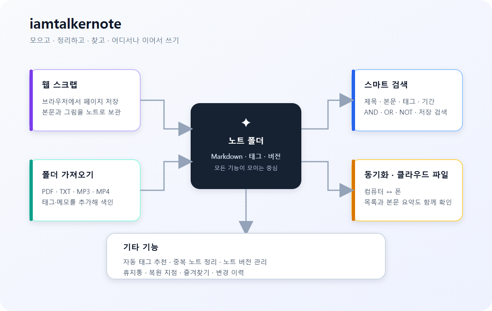

# iamtalkernote 사용 설명서



이 문서는 설치, 기본 사용, 외부 파일 가져오기, 컴퓨터와 폰 연결을 설명합니다.

## 1. 설치

### Windows

1. [최신 릴리스](https://github.com/iamtalker/iamtalkernote/releases/latest)에서 `iamtalkernote.exe`를 받습니다.
2. SmartScreen이 표시되면 **추가 정보 → 실행**을 선택합니다.
3. 첫 실행에서 노트 폴더를 선택합니다. 기본값은 `문서\\iamtalkernote`입니다.

### Android

1. [Android 릴리스](https://github.com/iamtalker/iamtalkernote-android/releases/latest)에서 APK를 설치합니다.
2. 컴퓨터와 동기화된 노트 폴더를 선택합니다.

#### 공유로 스크랩하기

에버노트처럼 휴대폰의 공유 메뉴에서 바로 스크랩할 수 있습니다.

1. 브라우저나 다른 앱에서 저장할 웹페이지·글·사진·파일을 엽니다.
2. **공유**를 누르고 공유 대상에서 **iamtalkernote**를 선택합니다.
3. 제목과 저장할 노트북을 확인한 뒤 저장합니다.

스크랩은 일반 노트로 저장되므로 태그·검색·즐겨찾기·휴지통을 그대로 사용할 수 있습니다. Syncthing이 연결되어 있으면 컴퓨터에서도 곧바로 확인할 수 있습니다.

## 2. Windows 앱

### 화면과 노트

왼쪽부터 노트북·태그, 노트 목록, 편집기, 문법 해설입니다. **보기** 메뉴에서 각 영역을 숨기거나 표시할 수 있습니다.

- `Ctrl+N`: 새 노트
- `Ctrl+Shift+N`: 새 노트북
- `Ctrl+E`: 원문·렌더링·분할 보기 전환
- 입력을 멈추면 자동 저장
- 그림은 `.resources`에 저장

Markdown, 표, 체크 목록, 코드, 인용, 수식, 각주를 지원합니다.

```markdown
[[다른 노트]]
![[다른 노트#특정 절]]
```

### 검색

- `Ctrl+F`: 현재 노트에서 찾기
- `Ctrl+Shift+F`: 전체 파일 검색
- 예: `회의록 AND (예산 OR 일정) NOT 취소`
- 예: `"정확한 구절"`, `#프로젝트`

검색은 제목·본문·태그·기간으로 좁힐 수 있고 저장할 수 있습니다.

### 태그와 안전망

본문의 `#태그`, 머리말의 `tags:`, 문서 아래의 `태그:` 줄을 태그로 읽습니다. 태그 목록에서 이름 변경·삭제·합치기를 할 수 있습니다.

- **휴지통**: 삭제한 노트를 `.trash`에 보관
- **노트 버전**: 저장 전 내용 보관
- **복원 지점**: 여러 노트를 한 시점으로 복원
- **전체 변경 이력**: 수정·이동·삭제 기록

### 웹 클리퍼

조플린 클리퍼 확장을 설치한 뒤 **설정 → 웹 클리퍼**의 토큰을 입력합니다. 클리퍼 서버는 이 컴퓨터의 `127.0.0.1`에서만 열립니다.

### 외부 폴더 가져오기

1. **설정 → 옵션 → 가져오기**를 엽니다.
2. 노트 폴더 밖의 폴더를 추가합니다.
3. 읽을 확장자를 선택합니다.
4. **지금 다시 읽기**를 누릅니다.

기본 확장자는 `pdf`, `txt`, `md`, `mp3`, `mp4`입니다. 원본 파일은 수정하지 않습니다.

가져온 파일을 우클릭하면 확장자별 연결 프로그램을 지정할 수 있습니다.

#### 확장자별 연결 프로그램

확장자마다 연결 프로그램을 따로 지정할 수 있습니다.

- PDF·TXT·JPG·WEBP: WaterView/NeeView 같은 문서·이미지 뷰어
- MP3·MP4: Windows Media Player·VLC 같은 전용 미디어 플레이어

MP3·MP4를 열 때는 같은 폴더의 미디어 파일도 함께 전달합니다. 연결한 플레이어가 여러 파일 열기나 재생목록을 지원하면 폴더 안의 미디어를 이어서 재생할 수 있습니다. 반복·셔플은 연결한 미디어 플레이어의 설정을 사용합니다.

### 트레이와 종료

창의 X 버튼은 기본적으로 트레이로 숨깁니다. 완전히 끝내려면 트레이 아이콘 우클릭 → **종료** 또는 **파일 → 종료**를 선택합니다.

## 3. Android 앱

서랍에는 모든 노트, 노트북, 태그, 가져온 파일, 휴지통, 설정이 있습니다. 노트를 길게 누르면 여러 노트를 선택할 수 있습니다.

노트를 열고 **편집**을 누르면 자동 저장됩니다. 검색, 태그, 노트 버전, 공유, 이름 변경, 이동, 휴지통 기능을 사용할 수 있습니다.

컴퓨터가 가져온 파일의 요약은 `.imported`를 통해 목록과 검색에 표시됩니다. 요약은 읽기 전용입니다.

## 4. 컴퓨터와 폰 동기화

1. 컴퓨터 **설정 → 동기화**에서 Syncthing을 설치하고 켭니다.
2. 폰 앱의 **설정 → 동기화 → 연결 마법사**를 엽니다.
3. 폰에서 컴퓨터를 등록합니다.
4. 컴퓨터에 표시되는 연결 요청을 허용합니다.
5. 폰에서 받을 노트 폴더를 확인합니다.

컴퓨터 앱은 트레이에 있어도 동기화를 계속합니다. 처음 연결하기 전에 양쪽 노트 폴더를 백업하세요.

동기화가 보이지 않으면 두 기기가 같은 네트워크인지, 컴퓨터 앱이 실행 중인지 확인합니다. 충돌 파일은 자동으로 덮어쓰지 말고 두 파일을 비교합니다.

## 5. 파일 구조와 백업

```text
노트 폴더/
├─ *.md
├─ .resources/  그림·첨부
├─ .trash/      휴지통
├─ .history/    변경 이력·버전
├─ .snapshots/  복원 지점
├─ .imported/   가져온 파일 요약
└─ .sync/       동기화 정보
```

노트 폴더 전체를 복사하면 가장 간단한 백업입니다. 앱 밖에서 `.md`를 수정하면 다음 실행 때 외부 수정으로 기록될 수 있습니다.

## 6. 한계

- Windows 전용 기능이 있습니다.
- 스캔 PDF OCR과 음성 인식은 제공하지 않습니다.
- 가져온 원본은 읽기 전용으로 다룹니다.
- 유튜브는 외부 재생 창으로 엽니다.
- Android에서 가져온 외부 파일 원본을 열려면 해당 파일도 동기화되어 있어야 합니다.

## 7. 도움말

앱에서 `F1`을 누르면 이 문서를 엽니다. 버전과 업데이트는 **도움말 → iamtalkernote 정보**에서 확인합니다.
