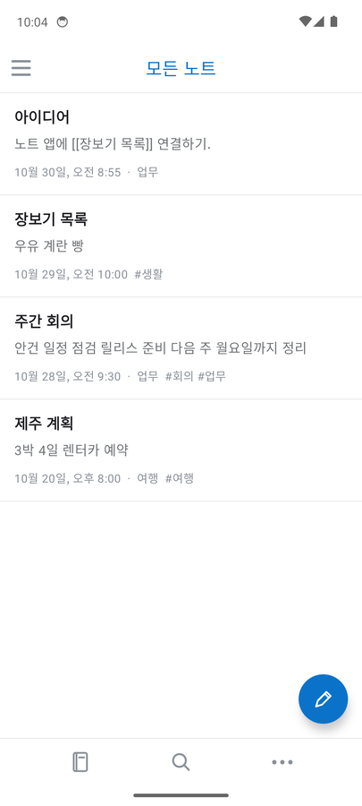
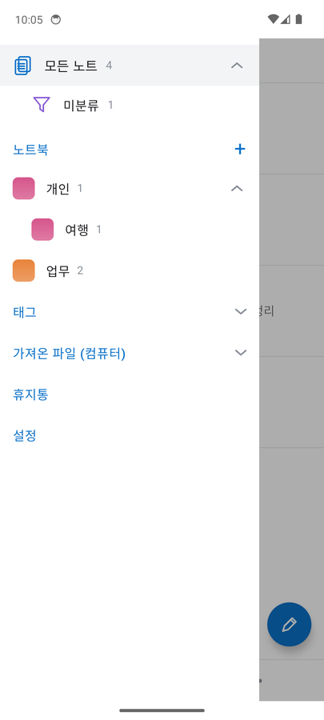
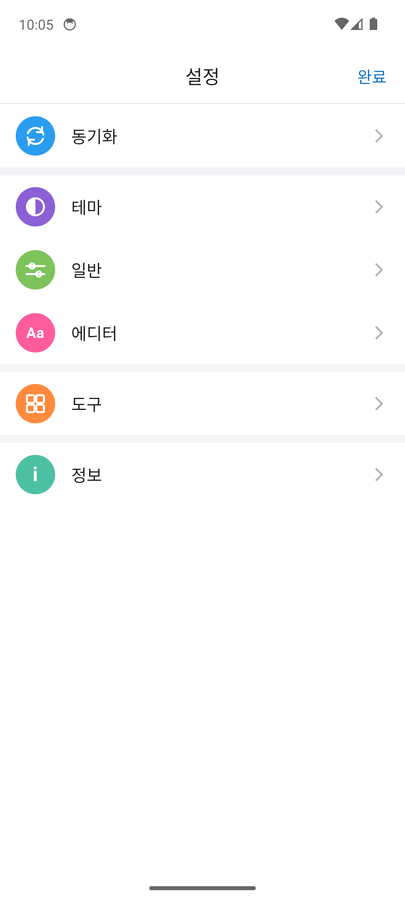
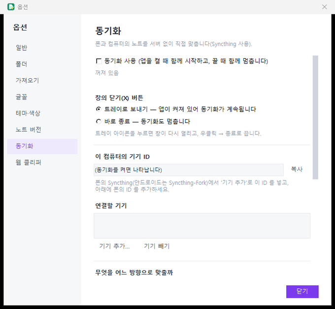

# iamtalkernote 사용 설명서

iamtalkernote 는 **마크다운 파일로 저장하는 노트 앱**입니다. 컴퓨터(Windows)용 앱과 폰(안드로이드)용 앱이 있고, 두 앱이 **같은 노트 폴더**를 쓰며 [Syncthing](https://syncthing.net)으로 서버 없이 맞춥니다.

이 문서는 처음 쓰는 분을 위한 안내입니다. 개발자용 자세한 설명은 [README](../README.md)에 있습니다.

## 목차
1. [한눈에 보기](#1-한눈에-보기)
2. [컴퓨터 앱 설치와 첫 실행](#2-컴퓨터-앱-설치와-첫-실행)
3. [컴퓨터 앱 사용법](#3-컴퓨터-앱-사용법)
4. [폰 앱 사용법](#4-폰-앱-사용법)
5. [컴퓨터와 폰 동기화](#5-컴퓨터와-폰-동기화)
6. [문제가 생기면](#6-문제가-생기면)
7. [폴더와 파일 구조](#7-폴더와-파일-구조)
8. [안전·개인정보·한계](#8-안전개인정보한계)

---

## 1. 한눈에 보기

| | 컴퓨터 앱 | 폰 앱 |
|---|---|---|
| 하는 일 | 노트 쓰기·정리·검색, 웹 클리퍼, pdf·mp3 가져와 검색, 동기화 관리 | 노트 보기·쓰기·검색, 가져온 파일 목록 보기, 동기화 연결 |
| 받는 곳 | [Releases](https://github.com/iamtalker/iamtalkernote/releases/latest) 의 `iamtalkernote.exe` | [iamtalkernote-android Releases](https://github.com/iamtalker/iamtalkernote-android/releases/latest) 의 APK |
| 노트 저장 | 노트 폴더 안의 `.md` 파일 | 같은 노트 폴더(동기화) |

**원칙 세 가지**
- **노트는 그냥 `.md` 파일입니다.** 앱이 없어도 메모장 등으로 열 수 있고, 백업은 폴더를 복사하면 끝입니다.
- **노트를 맡아 두는 서버가 없습니다.** 컴퓨터와 폰이 직접 파일을 주고받습니다. 계정 가입이 필요 없습니다.
- **검색 색인은 각 기기 안에만 있습니다.** 지워도 노트 파일에서 다시 만들어집니다.

---

## 2. 컴퓨터 앱 설치와 첫 실행

1. [Releases](https://github.com/iamtalker/iamtalkernote/releases/latest)에서 **`iamtalkernote.exe`** 를 받아 원하는 곳에 두고 실행합니다. 파이썬은 필요 없습니다.
2. 코드 서명이 없어서 Windows **SmartScreen** 경고가 뜰 수 있습니다. **추가 정보 → 실행**을 누르세요.
3. 처음 실행하면 `문서\iamtalkernote` 폴더를 노트 폴더로 씁니다. 바꾸려면 **설정 → 폴더 설정**에서 다른 폴더를 고릅니다. 이미 `.md` 노트가 모인 폴더(조플린에서 내보낸 폴더 포함)를 그대로 지정해도 됩니다.
4. **업데이트**: **도움말 → 업데이트 확인**을 누르면 새 버전이 있을 때 내려받아(릴리스의 SHA-256 과 같을 때만) 바꾸고 자동으로 다시 시작합니다.


---

## 3. 컴퓨터 앱 사용법

### 3.1 화면 구성
왼쪽부터 **노트북·태그 | 노트 목록 | 에디터 | 문법 해설**입니다. **보기** 메뉴에서 각 칸을 켜고 끌 수 있고, 에디터는 *좌우 분할 / 렌더링만 / 원문만*으로 바꿀 수 있습니다(`Ctrl+E`).

### 3.2 노트 쓰기
- **새 노트**는 `Ctrl+N`, **새 노트북**(폴더)은 `Ctrl+Shift+N`입니다. 하위 노트북도 만들 수 있습니다.
- 글은 **입력을 멈추고 0.6초 뒤 자동 저장**됩니다. 노트 제목이 파일 이름입니다.
- 마크다운(제목, 굵게, 목록, 체크 목록, 표, 코드, 노트 링크 `[[노트 제목]]` 등)을 쓸 수 있고, 오른쪽 **문법 해설**을 누르면 커서 자리에 넣어 줍니다.
- 그림은 붙여넣으면 노트 폴더 안 `.resources` 에 저장되고 노트에는 상대 경로로 연결됩니다.
- 유튜브 주소를 한 줄에 쓰면 **썸네일 카드**가 되고, 누르면 작은 재생 창으로 열립니다.

### 3.3 검색
- 위의 검색창에 입력합니다. `회의록 AND (예산 OR 일정) NOT 취소`, `"정확한 구절"`, `#태그`를 쓸 수 있습니다. **도움말 → 검색 문법**에 요약이 있습니다.
- 글자를 치면 아래에 자동완성(파일 제목, `#` 로 시작하면 태그)이 뜹니다.
- 노트를 연 채 `Ctrl+F`는 **그 노트 안에서 찾기**, `Ctrl+Shift+F`는 **모든 파일에서 검색**입니다.
- 지금의 검색식·기간·태그·정렬을 **저장된 검색**으로 이름 붙여 두면 노트북 칸 아래에서 한 번에 불러옵니다.

### 3.4 태그
- 본문의 `#태그`, 글 맨 아래 `태그: a, b` 줄, 머리말의 `tags:` 를 모두 태그로 읽습니다. 주소·코드 속의 `#`(위키 각주 `#cite_note-…` 등)은 태그가 아닙니다.
- 글 맨 아래의 태그 줄을 누르면 그 자리에서 편집합니다. 노트 목록에서 여러 노트를 골라 우클릭 → **태그 추가…**도 됩니다.
- 태그 목록(보기 → 태그 보기)에서 우클릭하면 **이름 변경·삭제**가 되고, 그 태그가 든 모든 노트에 적용됩니다.

### 3.5 지운 노트와 되돌리기 (안전망)
- **휴지통**(파일 → 휴지통): 지운 노트·노트북은 노트 폴더 안 `.trash` 에 **30일** 보관됩니다.
- **노트 버전**(편집 → 노트 버전…): 저장할 때 이전 내용을 노트별로 남기고, 보고 되돌릴 수 있습니다. 개수·간격은 설정 → 노트 버전.
- **복원 지점**(파일 → 복원 지점): 그 시점의 모든 노트로 되돌립니다. 하루에 한 번 자동으로 만들고, 한꺼번에 바꾸는 작업 직전에도 자동으로 만듭니다.
- **전체 변경 이력**(편집 → 전체 변경 이력): 모든 노트의 수정·삭제·이동을 시간순으로 보고, 줄을 골라 **이 변경 되돌리기**도 할 수 있습니다.

### 3.6 정리 도구 (도구 메뉴)
- **중복 노트 찾기**: 제목이 같고 본문이 같거나 아주 비슷한 노트를 묶어 보여 줍니다.
- **스크랩 군더더기 정리**: 웹에서 스크랩한 노트의 메뉴·머리글·바닥글 같은 반복 줄을 미리 보고 지웁니다. 적용 전 내용은 노트 버전으로 남습니다.
- **안 쓰는 미디어 파일 정리**: 어느 노트도 가리키지 않는 그림·첨부를 휴지통으로 보냅니다.

### 3.7 웹 클리퍼
크롬 확장 [조플린 클리퍼 플러스](https://chromewebstore.google.com/detail/joplin-clipper-plus/fbieoidncnoalmenkkpbcbomppoenfoa)를 설치하고, **설정 → 웹 클리퍼 설정**의 **토큰**을 확장 옵션에 붙여 넣으면 웹 페이지를 이 앱에 바로 저장합니다. 서버는 이 컴퓨터(127.0.0.1)에서만 열립니다.

### 3.8 다른 폴더 가져오기 (pdf · txt · mp3 …)
**파일 → 폴더 가져오기…**로 노트 폴더 밖의 폴더를 추가하면, **원본은 건드리지 않고** 글을 읽어 노트처럼 검색합니다. 읽을 파일 종류(확장자)를 고르고, 앱을 켜 두는 동안 5분마다 새 파일을 색인합니다. 파일에는 태그와 메모를 달 수 있습니다(원본이 아니라 색인에만 저장). pdf·mp3·Office 문서는 윈도 미리보기 방식으로 노트 화면 안에서 바로 봅니다. 가져온 문서의 요약은 폰으로도 내보내져서 폰 앱에서 목록·검색으로 볼 수 있습니다(읽기 전용).

### 3.9 닫기(X) 버튼과 트레이
기본값은 **앱을 끄지 않고 작업표시줄 오른쪽 아래 트레이로 보내기**입니다. 웹 클리퍼, 가져온 폴더 색인, **동기화**가 계속 돌아갑니다. 트레이 아이콘을 누르면 창이 다시 열리고, **우클릭 → 종료**로 끕니다. 설정은 **옵션 → 일반** 또는 **옵션 → 동기화**에서 바꿉니다(바로 종료로 바꾸면 동기화도 멈춥니다).

### 3.10 단축키
| 키 | 동작 |
|---|---|
| `F1` | 이 사용 설명서 열기 |
| `Ctrl+N` / `Ctrl+Shift+N` | 새 노트 / 새 노트북 |
| `Ctrl+F` / `Ctrl+Shift+F` | 문서에서 찾기 / 모든 파일에서 검색 |
| `Ctrl+E`, `Ctrl+L` | 편집기 보기 순환 |
| `Ctrl+B` / `I` / `K` | 굵게 / 기울임 / 링크 |
| `Ctrl+,` | 옵션 |
| `Ctrl+-` / `Ctrl++` | 이전 / 다음 노트 |
| `Delete` | 선택한 노트 휴지통 |

---

## 4. 폰 앱 사용법

폰 앱은 컴퓨터 앱과 **같은 노트 폴더**를 읽고 씁니다. 앱을 설치한 뒤 **노트 폴더를 한 번 고르면** 됩니다.

### 4.1 설치와 폴더 고르기
1. [iamtalkernote-android Releases](https://github.com/iamtalker/iamtalkernote-android/releases/latest) 에서 `iamtalkernote-android.apk` 를 받아 설치합니다(출처를 알 수 없는 앱 설치 허용 필요). 컴퓨터 앱의 옵션 → 동기화 맨 위에도 같은 주소가 있습니다. 업데이트는 같은 방법으로 **덮어 설치**합니다.
2. 처음 실행하면 **노트 폴더를 골라 주세요** 화면이 뜹니다. 컴퓨터와 같은 폴더(동기화로 폰에 받은 폴더)를 고릅니다. SD 카드의 폴더도 됩니다. 폴더는 내장 메모리나 SD 카드의 일반 폴더여야 하고, `Android/data` 아래는 앱이 열 수 없습니다.
3. 폴더를 열면 `.history` `.trash` `.resources` `.imported` `.sync` 폴더가 없을 때만 자동으로 만들어집니다(동기화 도구에서 경로를 고르기 쉽게).

### 4.2 화면


- **목록**: 위에 접히는 **고정됨**, 아래에 노트가 제목·한 줄 미리보기·날짜로 나옵니다. 아래 바는 **노트북(서랍 열기) · 검색 · ⋯**이고, 파란 **연필 버튼**이 새 노트입니다.
- **⋯ 메뉴**: 오른쪽 아래에 뜨며 새 노트북 · 노트 필터(기간) · 노트 정렬 · 노트 선택 · 설정이 있습니다. 바깥을 누르거나 뒤로 가기로 닫습니다.
- **노트를 길게 누르면** 여러 개를 골라 이동·태그 추가·휴지통으로 보낼 수 있습니다.



- **서랍**(왼쪽 위 ☰ 또는 화면 왼쪽 가장자리에서 밀기): 모든 노트 → 미분류 → **노트북**(색 네모, 접기) → 태그 → **가져온 파일(컴퓨터)** → 휴지통 → 설정. **길게 누르면** 노트북은 휴지통으로 보내기, 태그는 이름 바꾸기·삭제, 저장된 검색은 삭제 메뉴가 뜹니다.

### 4.3 노트 보기와 쓰기
- 노트를 누르면 보기 모드이고, **편집**을 누르면 글을 고칩니다(자동 저장). 설정에서 *노트를 열 때 바로 편집*을 켤 수 있습니다.
- 편집 아래 도구줄: 굵게, 기울임, 취소선, 코드, 제목, 목록, 체크, 인용, 링크, `[[노트]]`, 그림.
- 체크 목록은 보기 모드에서 눌러 체크할 수 있습니다. `[[노트 제목]]` 링크를 누르면 그 노트로 갑니다.
- 노트 안 ⋮ 메뉴: 문서에서 찾기, 태그 편집, 이전 버전, 속성, 맨 위에 고정, 공유, 이름 바꾸기, 노트북으로 이동, 휴지통.
- 다른 앱에서 **공유 → iamtalkernote**를 누르면 글을 노트로 저장합니다.

### 4.4 검색
검색 아이콘을 누르면 위쪽에 검색창이 열립니다. 공백은 AND, `"구절"`, `-제외`, `OR`, `(괄호)`, `#태그`를 쓸 수 있고, **본문까지**를 켜면 본문도 찾습니다. 자주 쓰는 검색은 **검색 저장**으로 서랍에 둡니다.

### 4.5 가져온 파일 (컴퓨터에서 가져온 pdf·mp3 …)
컴퓨터 앱이 가져온 폴더의 요약이 `.imported` 로 동기화되면 서랍의 **가져온 파일**에 나옵니다. 이름·태그·메모·글 앞부분을 보고 검색할 수 있고, **읽기 전용**입니다. 파일 자체를 폰에서 열려면 그 폴더를 동기화(외부 폴더)해서 받아야 하고, 앱 안에서 바로 여는 기능은 아직 없습니다.

### 4.6 설정


| 항목 | 내용 |
|---|---|
| 동기화 | 컴퓨터가 정한 방향 보기, **연결 마법사**(5장) |
| 테마 | 시스템 설정 따르기 / 밝게 / 어둡게 |
| 일반 | 앱으로 돌아올 때 자동 새로고침, 지금 새로고침, 노트 폴더 다시 고르기 |
| 에디터 | 노트를 열 때 바로 편집, 편집 글자 크기 |
| 도구 | 휴지통, 전체 변경 이력, 동기화 충돌, 중복 노트 찾기, 안 쓰는 미디어 |
| 정보 | 버전, 사용 설명서 |

### 4.7 안전망
컴퓨터 앱과 같은 형식으로 **노트 버전, 변경 이력, 휴지통**을 남기므로 폰에서 지운 노트도 컴퓨터 앱의 휴지통에서 복원할 수 있습니다.

---

## 5. 컴퓨터와 폰 동기화

### 5.1 어떻게 동작하나
- **Syncthing**이 컴퓨터와 폰 사이에서 파일을 직접 주고받습니다(P2P, 암호화, 노트를 맡아 두는 서버 없음).
- 컴퓨터 앱은 Syncthing 을 **대신 내려받아 숨겨서 실행하고 설정**합니다(공식 릴리스를 받아 코드에 박아 둔 SHA-256 과 같을 때만 설치).
- 폰에서는 **Syncthing-Fork**(별도 앱)가 파일을 옮기고, iamtalkernote 폰 앱의 **연결 마법사**가 그 앱을 대신 설정해 줍니다.
- **컴퓨터 앱이 켜져 있어야** 컴퓨터 쪽 동기화가 돌아갑니다(트레이에 있어도 됩니다). 폰과 컴퓨터가 **같은 와이파이**에 있을 때 서로를 자동으로 찾습니다.

### 5.2 준비물
- 컴퓨터 앱(0.5.2 이상)과 폰 앱(1.3.3 이상)
- 폰에 **Syncthing-Fork**(구글 플레이에서 설치). 처음 실행하면 나오는 권한 안내(모든 파일 접근, 배터리 최적화 제외)를 모두 허용하세요.
- 같은 와이파이

### 5.3 처음 연결하기 (한 번만)

**컴퓨터에서**
1. **설정 → 동기화 설정…**(또는 옵션 → 동기화)을 엽니다.
2. Syncthing 이 설치되어 있지 않으면 **Syncthing 설치…**를 누릅니다(약 14MB). 윈도 방화벽이 네트워크 허용을 물으면 **개인 네트워크**만 허용합니다(한 번만 묻습니다).
3. **동기화 사용**을 켭니다. "이 컴퓨터의 기기 ID"가 나타나면 **복사**합니다.



**폰에서** (폰 앱 → ⋯ → 설정 → 동기화 → 연결 마법사)
1. **1단계 Syncthing-Fork 설치**: 설치돼 있으면 완료로 표시됩니다. 없으면 **설치 페이지 열기**(구글 플레이)로 설치합니다.
2. **2단계 API 키**: Syncthing-Fork 앱 → **왼쪽 위 메뉴(☰) → Settings → Syncthing Options → ‘Syncthing API Key (click to copy)’** 를 눌러 복사한 뒤 붙여넣습니다. Fork 가 실행 중이어야 이 메뉴가 보입니다(꺼져 있으면 첫 화면의 **FORCE START**). 키는 영문·숫자 32자이고, Fork 를 지웠다 다시 설치하면 **새 키로 바뀝니다**.
3. **3단계 컴퓨터와 연결**: 컴퓨터에서 복사한 **기기 ID** 를 붙여넣고 **컴퓨터 추가**를 누릅니다.

**다시 컴퓨터에서**
4. 동기화 탭에 **"연결을 요청한 기기: … [허용]"** 이 뜨면 **허용**을 누릅니다. 폰이 보이지 않으면 같은 와이파이인지 확인하세요.

**폰에서**
5. **4단계 폴더 받기**에 컴퓨터가 보낸 폴더가 나타나고 "받는 중 → 최신"으로 바뀝니다. 앱이 알아서 알맞은 위치에 둡니다.
6. 받기가 끝나면 노트 목록에 노트가 보입니다. (앱으로 돌아올 때 1분이 지났으면 목록이 자동으로 새로고침됩니다.)

### 5.4 무엇을 어느 방향으로 맞출까
컴퓨터 앱 **옵션 → 동기화 → 무엇을 어느 방향으로 맞출까**에서 정합니다. 노트 폴더는 **Syncthing 폴더 하나**로 맞추고 **방향도 하나**입니다(폰에서 폴더마다 허용할 일이 없습니다). 새로 시작하면 이 방식이 기본이고, 예전에 쓰던 정책이면 **새 방식으로 바꾸기…** 버튼이 보입니다(바꾸고 **적용**을 눌러야 반영되고, 이미 연결한 폰은 Syncthing-Fork 에서 이 앱이 만든 폴더(ID 가 `inn-` 로 시작)를 지우고 다시 받아야 합니다. 폰의 파일은 그대로입니다).

| 항목 | 들어 있는 것 | 기본값 |
|---|---|---|
| 노트 폴더 전체의 방향 | `.md` 노트(노트북 포함) | **양방향** |
| 함께 보낼 것 · 미디어 | `.resources`(그림·첨부) | 보냄 |
| 함께 보낼 것 · 가져온 문서 요약 | `.imported`(폰이 읽는 요약) | 보냄 |
| 고급 · 변경 이력 | `.history` | **보내지 않음** |
| 고급 · 휴지통 | `.trash` | **보내지 않음** |
| 복원 지점 | `.snapshots` | 컴퓨터 전용, 옵션 없음 |
| 외부 폴더 추가 | 가져오기에 등록한 폴더(mp3 등) | 직접 추가(폴더마다 방향) |

이력·휴지통은 파일이 아주 많고 폰에서 쓸 일이 거의 없어서 기본으로 보내지 않습니다. 원할 때만 켜고, 켜더라도 노트가 다 맞춰진 뒤에 켜세요.

방향 뜻:
- **양방향**: 어느 쪽에서 고치든 상대에게 갑니다(삭제도 갑니다).
- **PC → 모바일**: 컴퓨터가 보내기만 합니다. 폰에서 바꾼 것은 컴퓨터에 반영되지 않습니다.
- **모바일 → PC**: 폰이 보내기만 합니다. 컴퓨터에서 바꾼 것은 폰에 가지 않습니다.
- **동기화 안 함**: 노트 폴더는 주고받지 않습니다(외부 폴더만 맞출 때).

방향이나 보낼 것을 바꾸면 **적용**을 눌러야 반영됩니다. 정책은 노트 폴더 안 `.sync/policy.json` 에 저장되어 폰에도 전달됩니다.

**추천 설정**
- 방향은 평소 **양방향**을 쓰세요. 노트가 아주 많아 처음 맞추는 데 오래 걸리면 처음에는 **미디어를 끄고** 노트 글(작습니다)부터 맞춘 뒤 미디어를 켜는 방법이 있습니다.
- **폰의 노트 폴더는 SD 카드가 아니라 내장 저장소**에 두세요. 작은 파일이 많을 때 SD 카드는 특히 느리고, 탐색기로 복사하면 멈추기 쉽습니다.
- 폰에서 듣기만 할 mp3 폴더는 **외부 폴더 → PC → 모바일**로 겁니다. 폰에서 실수로 지워도 컴퓨터 원본은 그대로입니다.
- 폰에서 만든 파일을 컴퓨터로 보내려면 **외부 폴더 → 양방향 또는 모바일 → PC**로 걸고, 폰의 `<노트폴더>-files/<폴더 이름>` 폴더에 파일을 넣으면 됩니다(앱 안의 "파일 넣기"는 아직 없고 파일 관리자 등으로 넣습니다).

### 5.5 처음에 파일이 아주 많을 때
미디어가 수만 개·수 GB 이면 와이파이로 처음 받는 데 오래 걸립니다. 이때는 폰의 **SD 카드를 컴퓨터에 꽂아** `.resources` 폴더를 통째로 복사해 두고, 폰에 다시 꽂은 뒤 미디어 동기화를 켜세요. 같은 파일은 다시 받지 않고 비교만 합니다.

### 5.6 같은 노트를 양쪽에서 고쳤을 때 (충돌)
Syncthing 이 `이름.sync-conflict-날짜-….md` 복사본을 남깁니다. 폰 앱의 **설정 → 도구 → 동기화 충돌**에서 어느 쪽을 쓸지 고릅니다. 앞으로는 같은 노트를 동시에 고치지 않는 것이 가장 좋습니다.

### 5.7 시험으로 확인한 것
사용자 노트에서 무작위로 뽑은 복사본(노트 100개, 미디어 20개, mp3·pdf 5개)과 컴퓨터용 Syncthing·에뮬레이터의 Syncthing-Fork 로, 방향마다 처음 맞춤과 수정·삭제·새 파일 전달을 **파일 해시(SHA-256)로 비교**했습니다: **양방향 12/12, PC → 모바일 15/15, 모바일 → PC 12/12 통과**(노트·미디어·외부 폴더 모두). 방향 밖의 변경이 전달되지 않는 것도 확인했습니다. 실제 폰과 같은 와이파이 자동 탐색, 수만 개 규모의 속도는 따로 확인이 필요합니다.

---

## 6. 문제가 생기면

**Q. 컴퓨터 앱을 껐는데 Syncthing 이 계속 도는 것 같아요.**
앱이 켜질 때 함께 시작하고 끌 때 함께 멈추도록 되어 있습니다. 창의 X 는 트레이로 보내기만 하므로, 트레이 아이콘 우클릭 → **종료**로 끄세요.

**Q. 폰 마법사 2단계에서 "API 키가 맞지 않습니다"가 떠요.**
Fork 를 지웠다 다시 깔았다면 키가 바뀝니다. 새 Fork 에서 **왼쪽 위 메뉴(☰) → Settings → Syncthing Options → Syncthing API Key** 를 다시 복사하세요. 기기 ID 는 이 칸이 아니라 3단계 칸에 넣는 값입니다. 붙여넣은 뒤 글자 수가 32자인지 확인하세요.

**Q. "Syncthing-Fork 가 실행 중이 아닙니다"가 떠요.**
Fork 를 열고 **FORCE START**(실행 조건 무시하고 시작)를 누른 뒤 다시 시도하세요. Fork 의 실행 조건(와이파이·충전 등) 때문에 꺼져 있을 수 있습니다.

**Q. 폰이 컴퓨터 앱에 "연결을 요청한 기기"로 뜨지 않아요.**
같은 와이파이인지, 컴퓨터 앱이 켜져 있고 동기화가 켜져 있는지 확인하세요. 회사·공용 와이파이는 기기 간 통신을 막을 수 있습니다. 컴퓨터의 윈도 방화벽에서 Syncthing 이 **개인 네트워크**에서 허용됐는지도 보세요.

**Q. 폰 목록에 노트가 안 보이거나 일부만 보여요.**
받기가 아직 끝나지 않았을 수 있습니다(마법사 4단계에 진행 상태가 나옵니다). 서랍 아래 **설정 → 일반 → 지금 새로고침**을 눌러 보세요. 노트가 많으면 처음 색인에 시간이 걸립니다.

**Q. 태그가 이상하게 많이 잡혀요.**
폰 앱 1.3.1 이상은 컴퓨터 앱과 같은 규칙을 씁니다(주소·코드 속 `#` 제외). 업데이트하면 처음 실행 때 색인을 다시 만들며 고쳐집니다.

**Q. 앱을 지우고 다시 깔아도 노트는 안전한가요?**
노트 파일은 노트 폴더에 있어 안전합니다. 앱 안에만 있는 것(검색 색인, 고정 표시, 최근 검색, 설정, 마법사에 넣은 API 키)은 사라지고 색인은 다시 만들어집니다.

**Q. 컴퓨터 설정이 사라졌어요.**
0.5.2 이전 버전에서 화면과 동기화가 설정 파일을 동시에 쓰면 드물게 파일이 깨질 수 있었습니다. 0.5.2 이상으로 올리세요.

---

## 7. 폴더와 파일 구조

노트 폴더(컴퓨터와 폰이 공유):

```
노트폴더/
├─ 노트북/하위노트북/노트.md     노트(제목 = 파일 이름)
├─ .resources/                  그림·첨부
├─ .history/                    노트별 이전 버전, 전체 변경 이력(journal.jsonl)
├─ .trash/                      휴지통(30일)
├─ .imported/docs.jsonl         컴퓨터가 가져온 문서의 요약(폰이 읽음)
├─ .sync/policy.json            동기화 방향 정책
└─ .snapshots/                  복원 지점(컴퓨터 전용, 동기화 안 함)
```

노트 한 개의 모양(머리말은 선택):

```
---
updated: 2026-10-30T10:00:00
tags: [회의, 업무]
---
# 제목
본문 #태그

태그: #회의 #업무
```

컴퓨터 안의 앱 설정과 색인은 `%APPDATA%\iamtalkernote\`(설정 `config.json`, 색인 `index-*.db`, 가져오기 색인 `docs-index.db`, Syncthing)에 있습니다. 폰의 색인은 폰 앱 안에만 있습니다.

---

## 8. 안전·개인정보·한계

- **노트를 맡아 두는 서버 없음**: 동기화는 두 기기 사이를 Syncthing 이 암호화해서 직접 옮기고, 노트가 중간 서버에 저장되지 않습니다. 다만 같은 와이파이 밖에서 서로를 찾을 때 Syncthing 은 기본 설정으로 공용 탐색·중계 서버를 쓸 수 있습니다(기기 주소만 오가고 파일 내용은 거치지 않습니다). 컴퓨터 앱은 그 밖에 업데이트 확인(내가 누를 때)과 Syncthing 설치·업그레이드 때 GitHub 등에 접속합니다.
- **폰 앱의 권한**: 노트 폴더 접근, 그리고 같은 폰의 Syncthing-Fork 와 통신하는 `INTERNET`(127.0.0.1 로컬 통신 전용)입니다.
- **원본 보호**: 가져온 폴더(pdf·mp3 등)는 읽기만 하고 고치지 않습니다. 외부 폴더를 양방향으로 동기화하면 폰에서 지운 파일이 컴퓨터에서도 지워지니 중요한 폴더는 **PC → 모바일**로 거세요.
- **알려진 한계**
  - 폰에서 pdf·mp3 같은 원본 파일을 앱 안에서 바로 여는 기능, 앱 안에서 파일을 주고받는 기능은 아직 없습니다(로드맵).
  - 폰에서 가져온 파일의 태그·메모를 고치는 기능이 없습니다(읽기 전용).
  - 폰 앱의 노트북 이름 바꾸기는 아직 없습니다.
  - Syncthing-Fork 의 API 키는 한 번 손으로 복사해야 합니다.
  - 컴퓨터 앱에는 충돌 복사본(`…sync-conflict-…md`)을 해결하는 전용 화면이 아직 없습니다(폰 앱에는 있습니다).

문의·문제 신고는 [GitHub Issues](https://github.com/iamtalker/iamtalkernote/issues)에 남겨 주세요.
